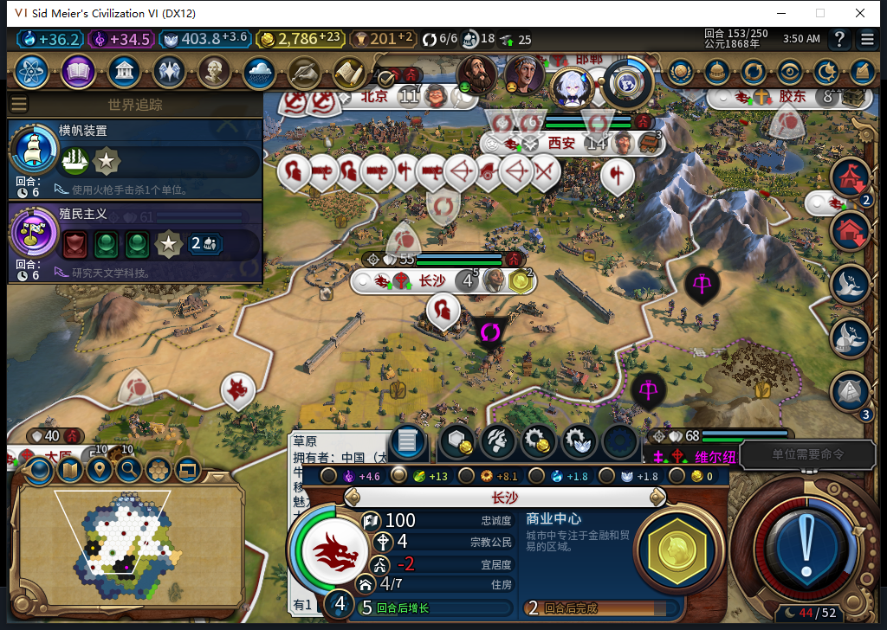
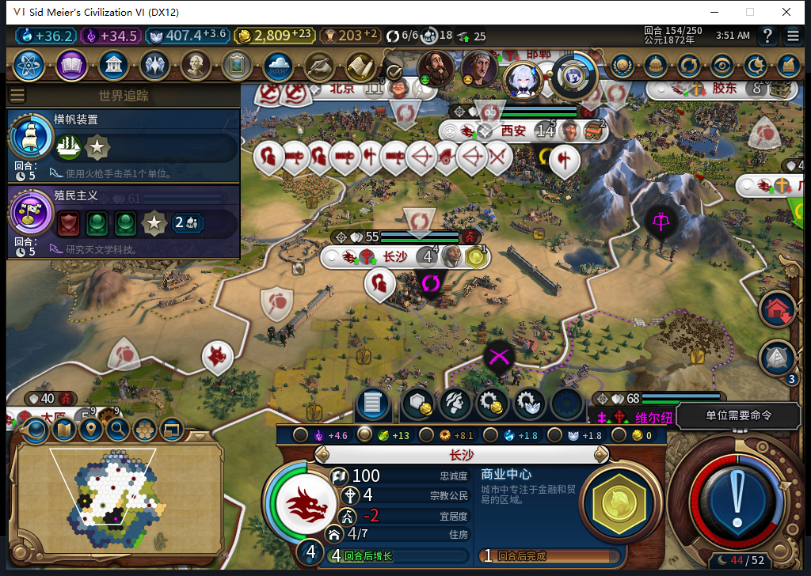
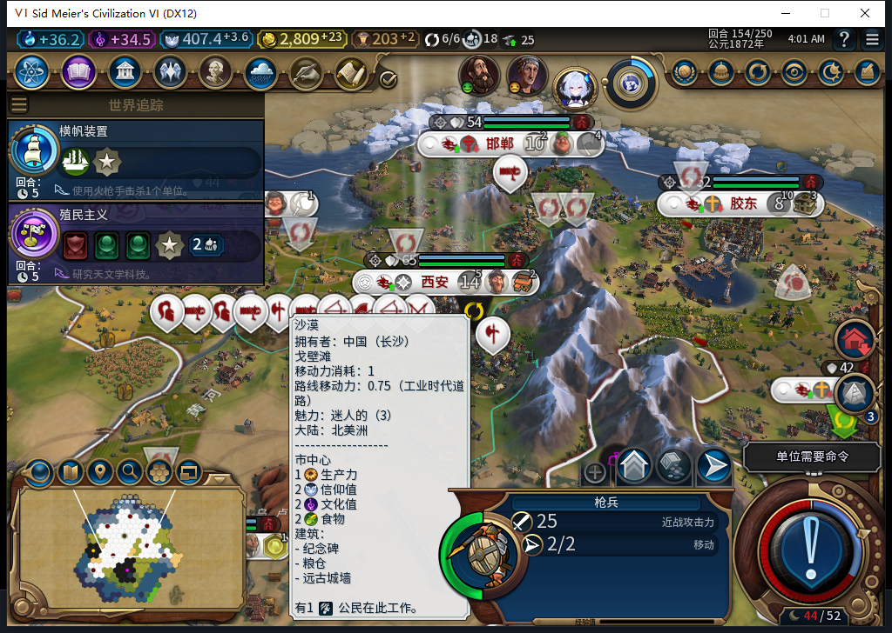

# 97 冷实机：粮食转正、人口保住及保存重载

2026-11-09，BF-202609141645。源码／安装／实机 97，产品 pin `4da78ccc3f3a4f0ed21bc657458dca765da748b4`。**同一 153 饥饿存档的粮食救援窄通过**：后台自行设置粮食侧重，长沙净粮食 −1→+5，下一普通回合人口保住 4；96 同档这里已掉到 3。保存并原版重载后，侧重、人口和粮食保持。

[机器证据](../research/baiqi-p6-food97-native154-evidence-2026-11-09.json)、[96／97 对照 CSV](food97-native153-154-comparison.csv)、[市民地块前后 26 行](food97-native153-citizens.csv)、[保存／重载八城粮食 16 行](food97-save154-food-persistence.csv)。[软件修复与96负例两图](baiqi-food-focus-97.md)中的历史 FAIL 保留。

## 不由测试玩家补内政

原版冷加载 96 的饥饿前 153 档、继续各一次。测试玩家没有设侧重、分市民、补粮或改队列。实际读回只有粮食侧重变为 true，其他五类侧重／忽略仍 false。

| 同一 153 保存点 | 96 负例 | 97 冷加载后 |
| --- | ---: | ---: |
| 人口 | 4 | 4 |
| 粮食余额 | 0.8984375 | 0.8984375 |
| 总粮食产出 | 7 | 13 |
| 净粮食 | −1 | +5 |
| 饥饿倒计时 | 1 | −1（无） |
| 城市产能 | 11.703125 | 8.1015625 |

原图保留地图悬停提示，未修图；精确数值与侧重由原版 Growth／Citizens API 读回核对。市民从部分 0 粮地块转到 3 粮农场等地块，没有新增锁定。代价是产能下降，不能把救粮写成产能也提高。

冷启动时的具体侧重请求次数没有预装计数器，保持未知；这里只授实际侧重和结果通过。模型原稿 0 Native，产品实际使用的是经六处语法修正、软件验证后的 553 纯模块，加负责人编写的真实消费者。

## 普通结束后保住人口

153→154 只有一次正常 END、4 次玩家军队待命，0 UserForced／手动内政。97 长沙仍人口 4，粮食余额 5.64453125、净收支 +5；同样从 153 开始的 96 负例则掉到人口 3。

八城该时点忠诚均 100、变化为正；粮食收支均非负、没有饥饿倒计时。不能由一次救援推成所有人口增长、全部地块或长期经济已通过。忽略粮食→解除忽略的 Native 分支未触发，仍仅有软件用例。

## 侧重真实入档并保持

撤掉第一段被动观察器后，原版保存 ACK=true，重复读取稳定：私人 `Baiqi_P6_20261109_V97_ChangshaFoodPreserved154.Civ6Save`，1560756 B，SHA-256 `57786159962ab9331bbc165c180fd4878a733fcc06758d299638be4e91cc0189`。不公开存档。

原版 Load／Continue 各一次，同一 154 实际恢复，八城的粮食余额、盈余、增长／饥饿倒计时、侧重及人口逐项一致。所采 WORLD、8 城队列、36 建筑、25 区域、116 可见己方地块值保持。

这张图是重载后的实际地图和军队查看，不单独用它证明粮食。25 单位中有一名建造者 `3276819` 从 `50,28／2行动` 到 `51,28／0行动`，继续了保存时的排队移动；因此**不称全世界完全不变或启动期零命令**，具体启动期次数未知。这里通过的是完成态侧重／人口／粮食保存保持，不是未知请求中途恢复。

第一段观察只有 4 次建造者移动、0 errors／drops，已恢复原函数并确认 namespace 为 nil。该工具只包 CityManager.RequestOperation 和 UnitManager 两类请求，**没有包 CityManager.RequestCommand**，不能用它声称侧重命令“只有一次”或“零重发”。

## 后续窗口及发布范围

重载后已另装 `P6Source97W2Finance`，继续 154 起的普通回合。该新窗口及最终撤钩／保存另记，不能把上面的 4 条当最终总数。156 原版罗马来访导致有界等待未到 157；第一次 Bye 助手漏依赖，0 输入拒绝，补齐后新鲜画面精确比较再点击一次，之后实际 157 空闲读回通过，未重发 END156。

95／96 的旧忠诚及饥饿负例、ARMED／旧档等待失败仍保留；长期、宗教、Base／RF、性能与完整 40 项继续验收。没有新 HTTP 或软件方法，本包复用 97 的 1375 pass／1 SDK 环境 skip、107 文件／85 Lua 5.1 基线，不重复计模型 553／554 的生成成果。

97 启动前 UTC `2026-11-08T19:45:30.297387+00:00` 对当前 Steam 实例后台实际读到“上线…”菜单，证明新鲜度 0.005622 秒，查询 0 输入／激活／移动／截图。头部导航及关闭前台菜单单列。旧 96 正式退出后 266 秒无窗口／端口、两次 CPU 相等，只清理自有残留一次，未处理 Steam 或其他游戏。

Steam 他机占用禁令保持：0 模式切换／上线／登录／下载／上传器初始化／上传。Alpha 2 下载和工坊仍 82／12 图；[GitHub 饥饿补记及两张内嵌图已实际发布并核验](../releases/v0.1.0-alpha.2/food-risk-publication-2026-11-09.json)，这三张 97 图仅先入库。82 未用同一保存点复测，不能替换上述版本标记。
