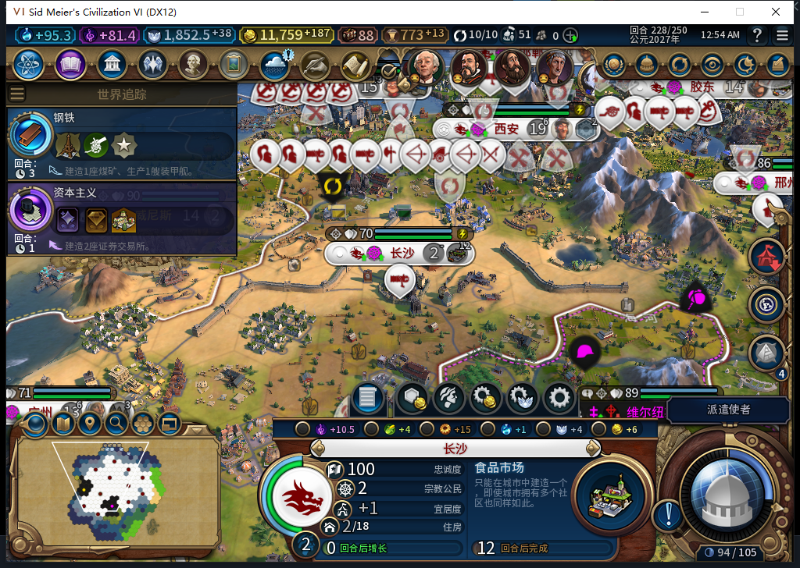

# 116：长沙缺粮条件下，食品市场实际优先开工

228 回合，长沙原有社区正常完成后，后台选择食品市场并实际排入 0/190，原版显示 12 回合。选择瞬间为 2 人、净粮 0、库存 0.68359375，科技已正常研究完成；两种原版生产资格均为 true，实际请求返回后队列读回也为食品市场。没有手动改队列、取消社区或补科技。

这次有实际选择证据：食品市场从默认 40 提到 94，超过额外社区的 55、下水道／燃煤发电厂的 40。把同一个已观察合法候选集仅将食品市场分数改回 40，离线纯选择函数会选额外社区；这不是旧 115 的实机重跑。长沙已住房 18、人口 2，额外社区尚有候选，也揭示了后续应处理的住房需求排序问题。

227 的胶东和邢州也开工食品市场，但当时净粮各 +4，实际分数仍为 40，不能拿这两条当作新缺粮分支通过。观察器共 23 次真实选择、3 条食品市场请求、0 错误／丢弃；评分选择和请求包装已经精确还原。生产完成事件仍在观察，**目前只证明新排序和实际开工，未证明市场建成或粮食盈余改善。**

北京同回合正常训练出新移民 7077933，事件中人口 15→14→15，最终仍 15；重复人口事件不能重复算扣人口，正常生产代价也不能当饥饿。十一城当前检查通过，228 已正式保存。此前 222 武汉人口损失及 213 商路断粮仍保持各自未关闭范围。

[真实候选、双资格、队列、纯函数对照和存档指纹](../research/baiqi-p6-source116-food-market-start228-evidence-2026-11-12.json)。继续正常生产至完成，不使用免费建成或人工内政。Steam 离线，工坊 82 未更新。
