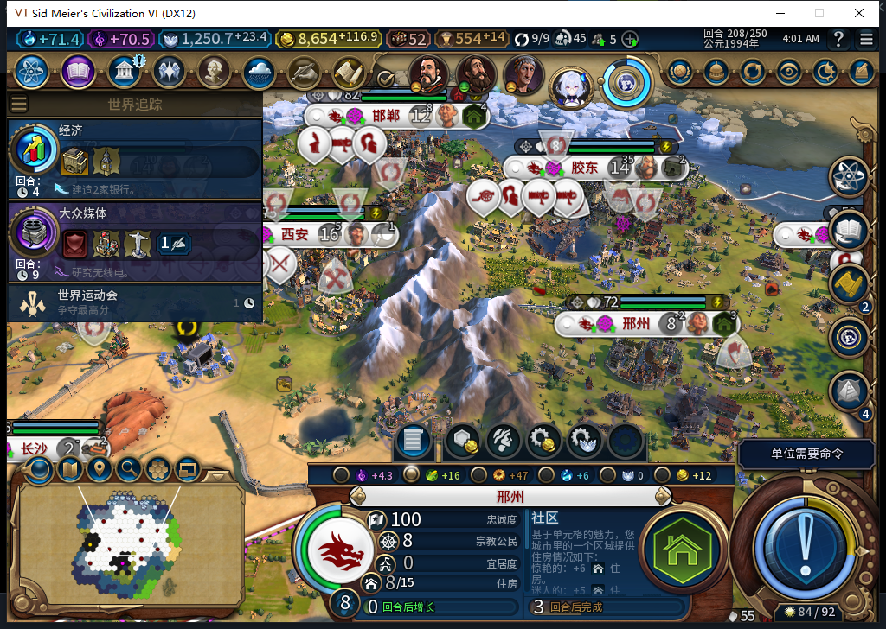

# 110正式离线冷读：208救粮与210保持

2026-11-11，BF-202609141645。110已正式安装，111文件与仓库逐字节一致。旧109已保存并正式退出，残留超过180秒且无窗口／监听、两秒CPU不变后，仅清理自己的旧游戏进程。Steam与其他游戏未关闭。

Steam只读查询先返回unavailable，正式头部Invoke0匹配／0输入；只导航正式Steam菜单头部一次，未选择模式项。随后UTC2026-11-10T19:55:46.663141+00:00独立后台读到“上线…”确认离线，0输入／焦点变化／截图，以0.012492秒新鲜证明启动110。全程0切上线／登录／下载／上传，其他设备占用禁令仍有效。

仅加载一次原始BeforeLoss208（1872098字节、SHA-256为5ea859bda43ee060b26e73f9131aa01b2e3549f7484292e824d45e6bb5ddf0e3），不是已救粮的预验后存档。官方ACK=true，原加载界面“继续游戏”一次物理输入；实际世界与新模块随后另行读回。启动／加载期间4318拒绝、4319不合格均保留，继续界面后新鲜4318唯一上下文资格成功才正式读取。负责人一次忘传端口、一次在endpoint子进程未完成时启动只读查询，均在连接前／连接拒绝处停止，没有重放加载或游戏动作。

没有临时预验、没有直接调用Runner、没有人工分配人口或地块。正式Admin调度实际1次交换／1次观察到恢复：2277归邢州，工业专家1、新粮食格工作1人，总粮食16、净0、饥饿−1。十城坐标／人口／库存／当时队列Hash与原存档相同，但邯郸盈余另外13→14，未隔离原因，不宣称全世界完全一致或后台零命令。

按普通军队待命和END流程实际208→209→210：2次普通END、8次TEST_PLAYER军队待命、0强制结束／人工内政。30城帧粮食非负、饥饿−1、忠诚100、忠诚速率非负。邢州三个采样点均8人口、库存1.74609375、净粮食0；跨过原先两回合掉人口窗口，未掉人口。净0也没有带来实际增长。[逐城读数和生产进度](baiqi-source110-cold208-210-cities.csv)。

210已正式保存：1890304字节，SHA-256为a0d66c107efb26599273723b4d792ec0eacb1e925f8fb8bd7212df74f47d01fd，ACK=true、未加载。私人存档／原日志不公开。

210实际弹出了世界运动会结果，图拉真100分胜出、白绮0分无奖励。原版弹窗在1008×689客户区顶部和底部裁切，尚未确认或安装界面预览；本图不能作为邢州粮食面板已完整展示的证据。继续针对这处真实可见界面修复。

本轮通过的是正式110对原缺粮存档的救粮与两回合保持，不授未知提交跨保存重载恢复、无可用闲地时救粮、完整40例或性能通过。旧FOUND ARMED读档失败、MOVE未知队列、实际水坝施工与其他UI问题仍开。工坊仍82／93文件／12图，新实机解读和BBCode仅上库待发。

[完整分层证据](../research/baiqi-p6-source110-cold208-210-evidence-2026-11-11.json)。
