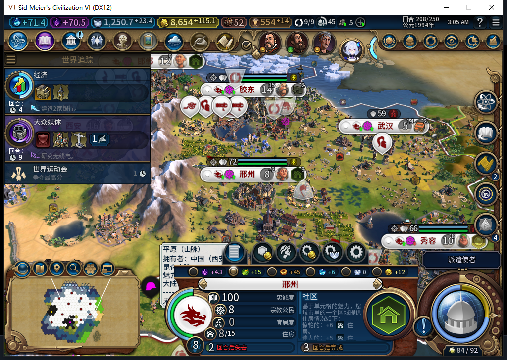
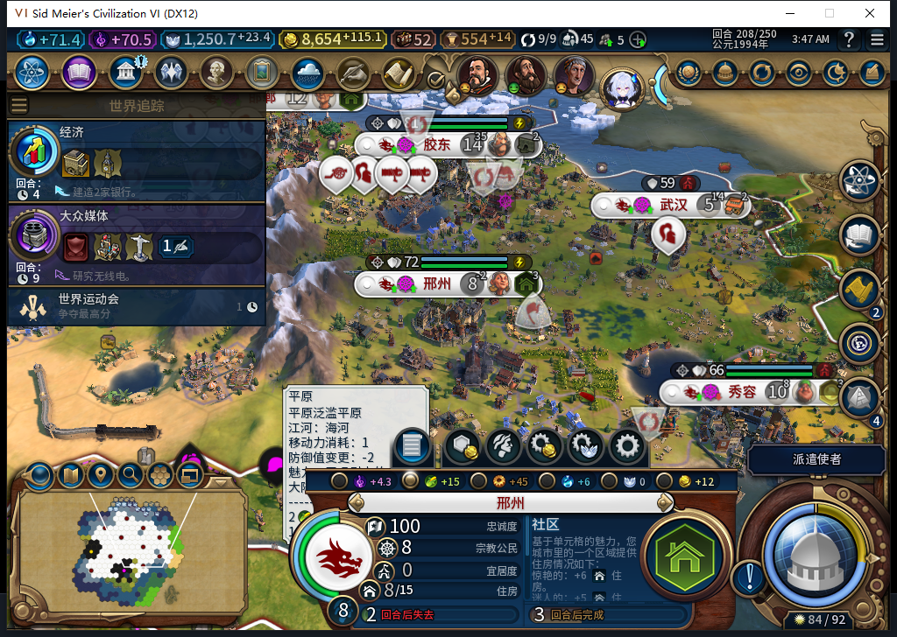
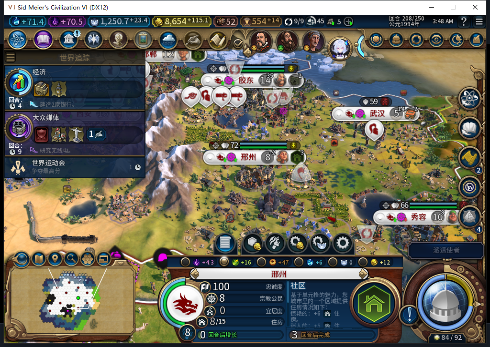

# 110救粮模块：208离线后台预验

2026-11-11，BF-202609141645。源码110，安装／运行仍109。在[208饥饿原况](baiqi-food208-starvation.md)上，由原有Executor后台Update调用原Admin后运行新Runner，未直接调用Runner来代做内政。73次后台Admin调用中仅1次救粮请求、1次实际观察到恢复；0END、0手动内政、0Steam上线／上传。

实测地块2277（57,30）从西安65536划给邢州458758。邢州工业区专家2→1，新粮食格实际工作1人；地块粮食11→12，总粮食15→16，净粮食−1→0、饥饿倒计时2→−1，人口仍8，库存1.74609375。西安净粮食仍16，另外九城的坐标／人口／净粮食／库存／饥饿状态／当前生产Hash完全相同，十城生产Hash保持。此处没有声称所有产出都不变，人口分配会改变产出。

第一次SelectCity选中原来已选中的城，原版面板保留15粮食和红字缓存。只查看西安再切回邢州后，原版显示16粮食、红字消失。绿色“0回合后增长”是原版显示，不代表已观察到增长；本次Native净粮食确为0，没有推进回合或增加人口。

预验结束已恢复精确原Admin.Run，临时模块与命名空间均撤掉，既有财政／getter／世界危机预览均不存在。成功重新分配产生的实际地块归属保留。正式保存Rescued208：1872100字节，SHA-256为53f62645fefecd80f61b3bc087d9d41cdd66551db6ac21b8bb783587d42d10fa，ACK=true、未载入。原BeforeLoss208另存保留，可供正式110冷读重现。

本次只授予该模块在现有109实例的后台预验通过，不能冒充正式安装110、跨回合稳定或跨保存重载恢复。未知提交仅当前UI上下文保持，无可用闲地的城市仍可能饥饿。旧恢复FAIL、水坝实际施工、MOVE未知队列、小视口／性能／完整40用例仍开。Steam保持离线，工坊82未改。

[逐城前后读数、实际工作格与恢复证据](../research/baiqi-p6-source110-food-preview208-evidence-2026-11-11.json)。下一步正式离线安装110，读取原BeforeLoss208，检验无需预验接线即可后台救粮，再推进普通回合。
