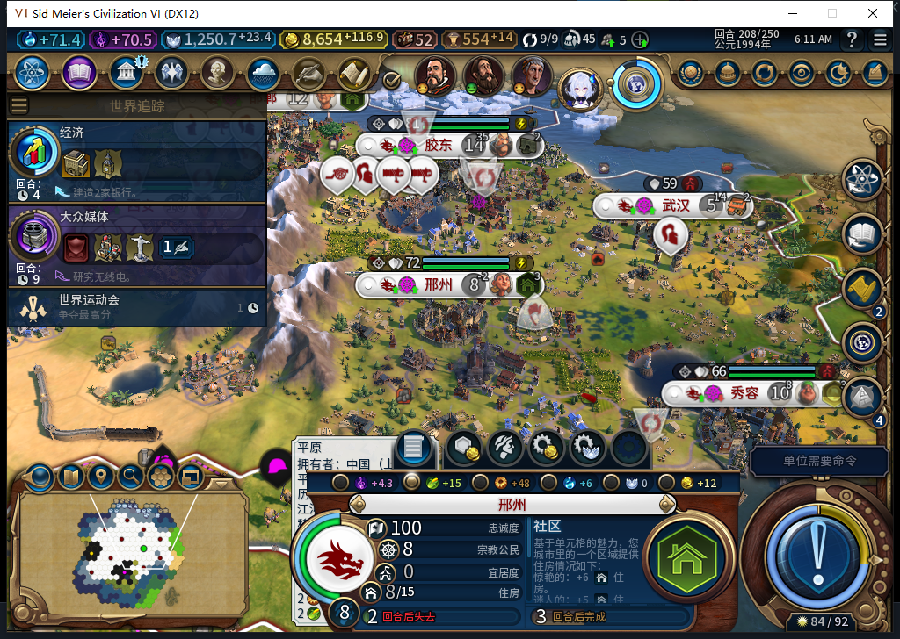
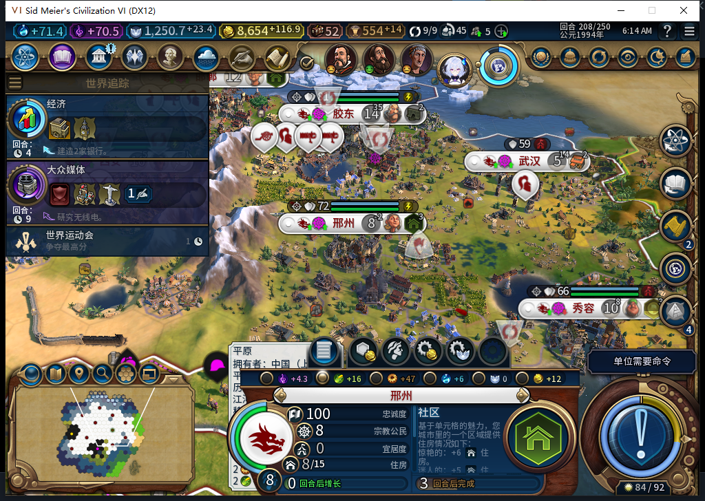
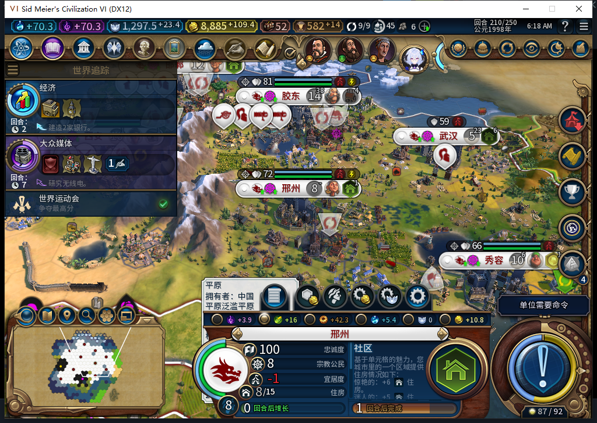

# 113 实机：邢州缺粮，托管如何处理

邢州在 208 回合有 8 个人口，粮食产出 15，净缺 1。粮食优先已经开着，原版界面仍提示两回合后掉人口。我们用同一个原始存档检查了两条路：请求不明确时不乱换地；正常情况下该救粮仍能执行。

先用私人诊断挡住一次许可回复。原版还没收到城市命令，账本已经写入 `foodtile:0:1 / ARMED`。187 次原后台循环后，地块仍属西安、邢州仍缺粮。恢复全部临时函数，再正式保存。安装未修改的 113（115 文件逐字节匹配），离线冷读同一记录；另外观察 118 次后台循环，没有新增许可或救粮请求。这里验证的是**发命令前**丢失许可回复后的保持，故障现场没有救粮，也没有结束回合。

再用原版读档流程回到最初的缺粮档，没有改账本或手动调人口。西安有一块不在本城工作范围内的一粮闲地，白绮托管把它交给能工作的邢州。工业区专家从 2 人变 1 人，新粮格安排 1 人；邢州净粮食从 −1 到 0，西安净粮食仍为 16。日志只有一次救粮提交，实际地块归属和粮食读回后，记录转为 `OBSERVED`。城市照常建社区，玩家继续指挥军队。

按普通流程走完 208→209→210。测试玩家做了 8 次军队待命、2 次普通结束回合，未强制结束或代做内政。邢州三个采样点均为 8 人、净粮食 0、库存 1.74609375；十座城共 30 个采样点没有负粮食盈余，忠诚均为 100。零盈余只表示这段没掉人口，不表示已经增长。见[逐城粮食、忠诚和生产进度](baiqi-food113-208-210-cities.csv)。

210 的世界运动会结算由游戏自然弹出。1008×689 客户区内，标题和确定按钮均可见；点原版确定一次后实际关闭。确认可能走原版已读事件，底层次数没有测量。210 已正式存档，文件 1,890,451 字节；本页冻结时尚未加载这份完成态存档。

没有合适闲地时，托管仍可能救不了缺粮城；遇到不明确的许可也可能一直等下去。已发出城市命令但结果未知的跨存档恢复、旧移民建城恢复、水坝施工和性能仍待验。以上是单人风云变幻、无蛮族的一条实机路线，不能当作全 40 项通过。Steam 保持离线，线上工坊仍是内部 82；新图和 [BBCode](../workshop/v0.1.0-alpha.2/pending-source113-food-cold-2026-11-11.bbcode) 已备在仓库。

[核验数据、记录指纹和未覆盖范围](../research/baiqi-p6-food113-persistence-cold-evidence-2026-11-11.json)。
