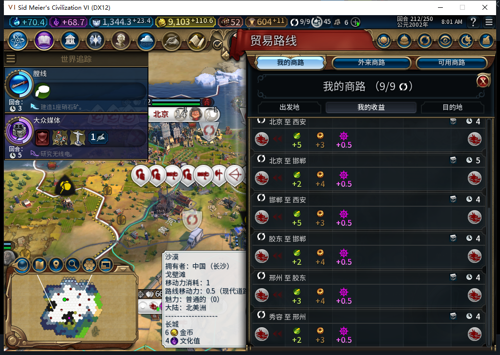

# 114 实机：断粮前还有什么办法

用 212 的断粮前检查点读档。邢州已经偏好食物，有普通粮仓；当时不能生产水磨或灯塔。城内工作格读数没有空闲的正产粮格，唯一在工作的零粮位置是工业区的一个专家。可转入的五格里，三块产粮地都有人在邻城工作。胶东那块 2 粮农场正在工作，胶东本身也只净余 2 粮；本次没有转走它。

本回合的三位建造者离邢州 4 至 5 格，移动都已用完。原版给他们推荐的是在 2277 格修长城。当前市政和地形符合丘陵农场条件，数据库给农场列出基础 +1 粮；没有建造者到场的原版资格或实效读数，不能算能在这一回合补粮。

原版计算给出西安路线预计 5 粮、胶东 3 粮。西安原版路径返回 11 个地块记录，胶东 5 个。界面右侧钟形数字由原版代码填入城市间距离，不是商路剩余回合。已查看游戏当时暴露的交易接口，没有找到剩余期限。9/9 容量已满；本次没有在该状态试开西安路线，也没有取消胶东路线。

短期可验证的是：一座城市缺粮且粮仓库存见底时，如果有空闲商人和可开的国内路线，可以让它先比较粮食，再走原有安全检查。这个方向不会改变已经运行的商路，也不会自动救回 213 掉的人口。另需更早准备本地产粮；本次审计没有读到 212 能立即执行的无损办法。

[只读记录和接口范围](../research/baiqi-p6-source114-prevention-audit212-evidence-2026-11-11.json) · [断粮过程](baiqi-food114-trade-gap213.md)。Steam 离线，工坊未更新。
