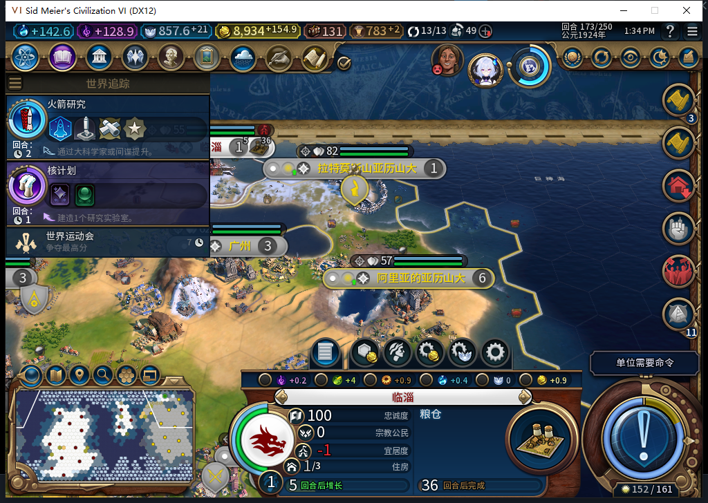
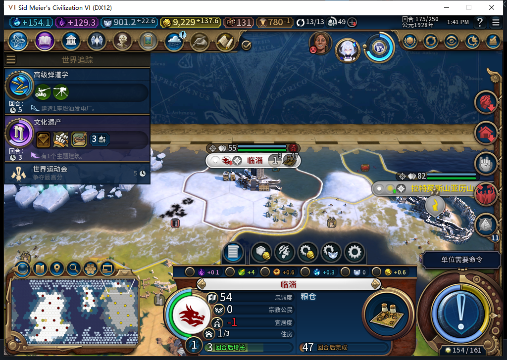

# 79同档实测：建城结果正确确认，忠诚问题仍在

79冷加载同一167保存点后，移民继续原路线，173只发出一次建城，实际建立第16城临淄。这次模组正确记录了城市1114127和完成证明，关闭78“已经建城却报单位不可用”的这个故障样本。175粮仓达到1/32，正式存读档后城、生产、金币和两个完工区域都保持一致。

这仍不是完整扩张通过。移民由77正常训练，79负责本次路线和建城；存档含已披露历史测试单位。工坊仍Alpha74，未包含79。

实际请求0:173:194对应1次原生FOUND_CITY；旧移民9764928在UI／Core的查找和自有完整单位清单中均消失，新城1114127归白绮、(37,24)、人口1。日志随后为observed，证明为“写前空地上的新自有城市＋移民确已消耗”，没有靠单位消失或行动力变化猜成功。

171最后一步仍排队，172有6行动力但没重发，173原移动才被观察完成，随后建城。观察器只覆盖启动后的BaiqiExecutor：214次单位请求，其中目标移动24、建城1，非文职／未知／错误／溢出均0；启动阶段SDK总数未知。军队生产仍允许，本窗口城市23项生产中包含2项军事训练，不能把训练误写为军队指挥。

粮仓173为0/32、174仍0、175为1；粮食0→1.703125→3.40625。它是普通建筑，没有恢复已删除的粮仓经营权。生产与市民管理继续只读，测试玩家没有补生产。

175清理派发观察器和3个事件后，正式保存675630字节，SHA256 6b8b5d6128d9ebc0ab8744963d6523d0d18f1cdc07de1e08e03e52fb2c62a6a5。正式加载一次后，UI／Core均175回合、16城、金币9229.44921875；临淄ID、粮仓1/32、粮食3.40625保持，成都港口3407922和九江工业区3211311仍完成。临时观察器和ActionPanel测试玩家跟踪变量已读回nil，私人存档不公开。这验证完成后的世界状态保持，**不等于未决建城回执已经持久化**；79的见证仍只存内存。

忠诚实测仍54/100、每回合−23、原生预计3回合叛离，选址质量缺口没有修好。[78实际178失城](baiqi-new-city-loyalty-loss-78.md)继续保留为FAIL，不能被本次回执通过抵消。

建城前169的独立只读扫描只查当前可见／已探明格：半径9内实际163格、5座外国城市，最近外国城距离4；15座自有城中最近距离12，0读取错误。此结果支持继续做保守边境筛选，但不是准确忠诚公式。模型464候选只改推荐列表，隔离测试证明旧目标快捷建城仍会绕过；它还沿用先读外国城市坐标、后检查探索的旧源码缺口。候选已拒绝，0原稿实机／产品修改；下一步要同时处理筛选、写前复核和已知信息边界。

本轮普通结束回合、来访外交均为TEST_PLAYER原版操作，没有后台外交或军令。启动前取得新鲜后台只读Steam离线证明；本轮0上线／0上传。24项新增及完整1108项软件检查已在79产品提交中通过，此文档／实机证据工作包未重复跑套件。

[结构化实机、回执、保存点、观察范围和候选审阅](../research/baiqi-p6-found79-native-receipt-evidence-2026-11-06.json)、[79软件修复与限制](baiqi-found-city-receipt-79.md)。
