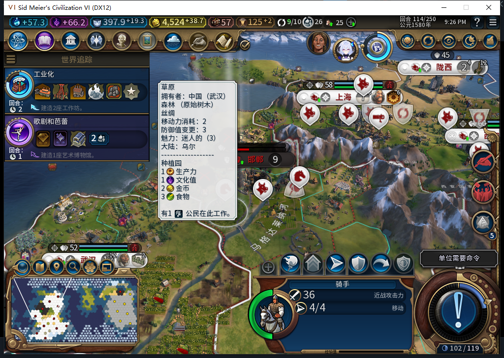

# 更正73版征城样本：62是自由城市

后续新证据：[75版另一个世界的维尔纽斯](baiqi-vilnius-city-state-capture-75.md)已完成真正城邦最后一城300征取窄验；本页对旧73自由城市样本的分类更正保持，不追认旧记录或Alpha74。

此前将377—382征城样本写成“城邦62”，分类错误。2026-11-05在BF-202609141645用75版正式加载同一个73版准备档，Core和UI都读到：`LEADER_FREE_CITIES`、`CIVILIZATION_FREE_CITIES`、`CIVILIZATION_LEVEL_FREE_CITIES`；UI名称为“自由城市”。该样本不能算城邦征城通过。[完整审计、存档和原件指纹](../research/baiqi-p6-audit420-free-cities-classification-evidence-2026-11-05.json)。

| 核验对象 | 原73准备档的75版补读 |
| --- | --- |
| 文件 | 567050字节；SHA256 4d6eb7fda5e29c1492d84984d4aecf8431e6e36828f8eaec4958cfac44dc3e0b |
| 玩家62身份 | 自由城市，存活，非主要文明、非蛮族，2城 |
| QA目标 | 62/131073，10,13，人口9 |
| 原62城市 | 65536，38,20，仍在 |
| 白绮骑手／金币 | 2162700，10,12，4行动；4524.2734375 |
| 征取journal | 空；本次没有重放征城 |

原73已经实际发生的1100扣费、一次转城／结束行动、8栋普通建筑、文物15／类型172及五槽保留仍有效，范围改为**自由城市QA非最后城市征取**。真正城邦的特殊规则和资产结果继续未验。普通主要文明、首都及其他世界的使者／外交测试不因这次特定样本更正而重分类。

原[377—382证据JSON](https://github.com/XenoAmess/civ6_dev/blob/b43feff40e00de6bd47cc6de0a5c01fc302745e9/docs/research/baiqi-p6-minor-city-capture377382-evidence-2026-11-04.json)保持原字节，SHA256为1125bea9ba675a62bf5e0ab4c3e140a01ab09da2ff8b60f6190c38977ace9620；旧文件名及历史标签保留作追溯，本次用新审计纠正其分类，不修改旧机器观测／SHA。补读使用当前75，不能冒称当时73已核过文明身份。

原存档文件在审计前后哈希一致。模组正常运行时仍有6291501的后台移动日志；测试玩家只查看配置、选己方军队和移动镜头，没有文职订单或征城重放，也不声称内存模拟完全不变。随后独立恢复正常Farm114，三上下文核验11城、原资金／信仰／军队／建造者及空journal。工坊风险BBCode仅离线准备，尚未上传；本轮无Steam上线。
