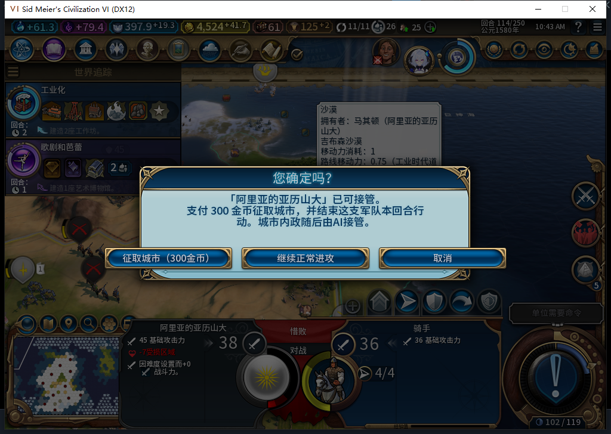
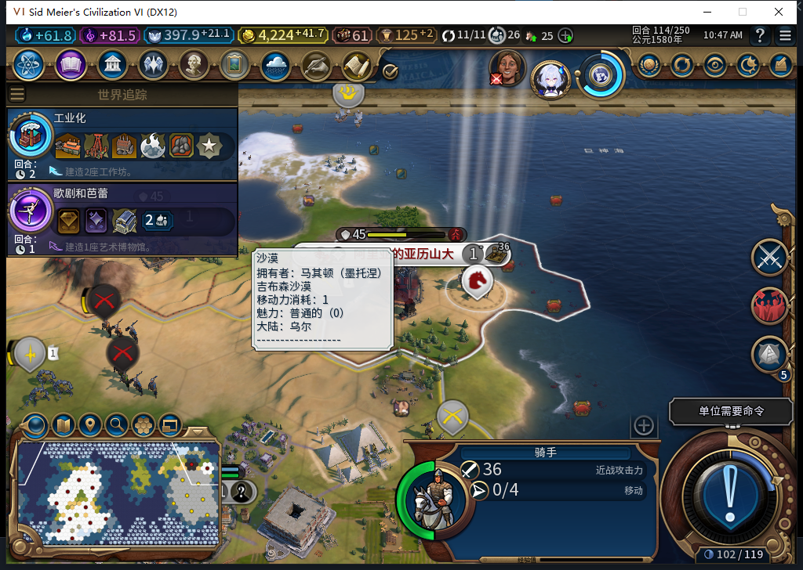

# 74版：既有驻军城市验收

2026-11-05，BF-202609141645，Steam离线，单人风云变幻／构建74。已通过地图物理右键、实际确认300金币，取得一座原有驻军的人口1城市。守军仍属敌方，完整ID与伤害保持，被原生转城移到相邻水格并处于登船状态。这个即时样本已完成；完整驻军及TC-031矩阵仍未闭。[首次只读准备](../research/baiqi-p6-garrison404-preflight-evidence-2026-11-05.json)、[实际征取、守军映射与原图证据](../research/baiqi-p6-garrison74-capture-evidence-2026-11-05.json)。

| 核对项 | 确认前 | 确认后 |
| --- | --- | --- |
| 城市 | 文明1，524295，41,19，人口1 | 白绮0，851979，同位置、人口1 |
| 金币 | 4524.2734375 | 4224.2734375，恰扣300 |
| 我方骑手2162700 | 42,19，行动4，伤害0 | 原地、行动0、伤害0，冷却114 |
| 守军伙友骑兵1179657 | 文明1，41,19，行动0，伤害37，编队数1 | 仍为文明1，同完整ID／类型／伤害／行动，位置40,19；水格、IsEmbarked=true |
| 城内单位／附近单位 | 城内有该守军，40,19为空 | 城内空，40,19有原守军；与按原主人／完整ID查询吻合 |
| 调用与事务 | UI请求0、转城0、结束行动0 | 各1次、观测错误0；COMMITTED／DONE，cost300 |
| 建筑／区域 | 0建筑，1个已完工市中心 | 0建筑，同类型／位置市中心，新ID2097182，已完工、未损坏 |
| 城防伤害 | QA准备150／200，无外城防 | 原生转移后100／200，无外城防 |
| 占领／忠诚度 | 未占领，忠诚度100／每回合+17 | 未占领，100／每回合−27.6875，未跨回合 |

两次独立UI／Gameplay Core读回都确认了守军仍活着、仍属文明1、移出城市。向白绮的单位集合用旧ID1179657查询，会返回另一个完整ID1245193的侦察兵；前后都如此，明确拒绝把该非nil对象认成收编的守军。登船方法由游戏实际UnitFlagManager调用者资格确认。这个例子不能推出所有守军都这样移动，也不能当作后续敌军进攻、区域收益或跨回合恢复的验收。

实际右键按下／松开／MoveUnitToPlot／Interact各1次、错误与丢弃0，接着只物理确认1次。测试工具没有直接打开确认或提交征城。城市取得后，城旁仍留有敌军；玩家需要继续指挥自己的军队，征取没有替玩家消灭守军。

UI读取9座可见外国城市，找到1座有同主战斗单位驻留的城市；另一个城内的大艺术家不计军队。其余60个玩家槽的城市迭代接收者不可用，明确保留UNKNOWN，不能说全世界其余城市都为空。只在可见城市查询普通／宗教地块层，没有遍历外国全体单位或向隐藏地块下令。

404普通HTTP为200／stop／DONE／合法JSON，Lua53编译失败，且驻军分类条件互斥、漏owner比较及边界核验，0代码采用、0游戏执行。负责人另写只读脚本，Lua53编译及本次UI盘点通过；它不算产品功能修复或模型生成实效。

前置中的正式战争强制场景标志、我方骑手放置42,19、单独恢复4行动和市中心150伤害均是QA准备，不授正常外交／自然战斗通过。原守军从只读发现到确认前一直是同一1179657、原位置／0行动／37伤害；没有创建、清空、传送、损坏它或给它命令。转城后的移动是观测到的原生结果，未用测试动作补做。

两项Core、一项UI请求、四项输入绑定已核所有权恢复，并独立检查清理。转前副本568863字节／SHA-256 `194c4d3686b6cda12265519529ebbd9ced29c9e00a9d6af30e4378999f896044`，转后568804字节／`d1da13ab82463078608bc9ec58a1ccef8763dbe6972fdf225376ca69dd28f17e`，原正常Farm114哈希保持。已官方载入原正常114，ACK为true；本切点尚待局内恢复读回。第一次保存前检查误在Executor访问WorldInput的Quote表，止于缺失表、尚未设置保存标志或调用Save；随后在WorldInput独立核报价，再保存一次，未重做征取。

404的共享HTTP／OpenCode分账已[推送cefc76c](https://github.com/XenoAmess/local-model-operations/blob/cefc76c03f915e77273aa99a4f3d6416b0817899/docs/evidence/2026-11-05-civ6-garrison404.json)。本次征取续验没有新模型请求或产品改动；完整软件套件未重跑。新城另有1项生产队列／hash−764771404，本切点没有解析其类型，不授排产到完成链通过。
