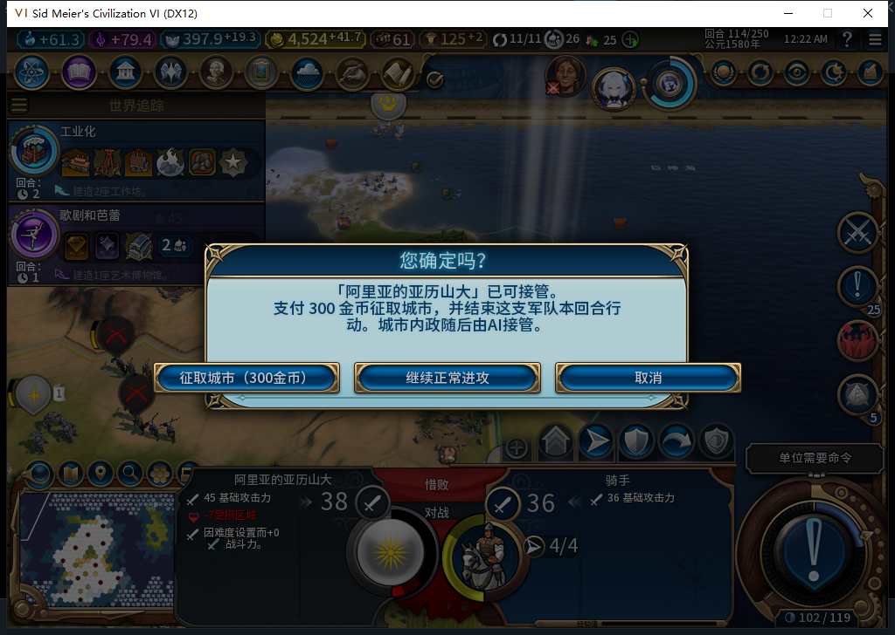
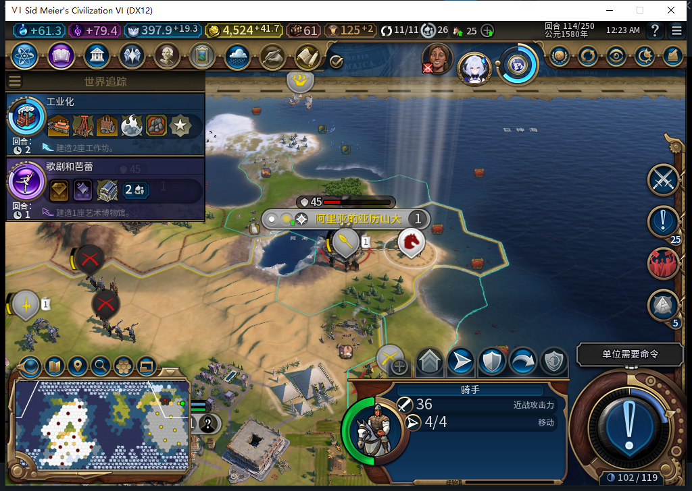
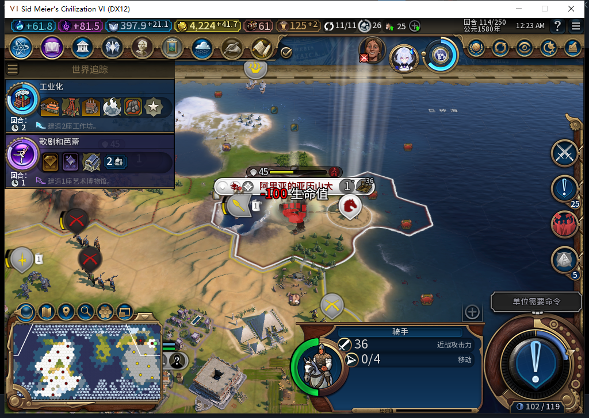
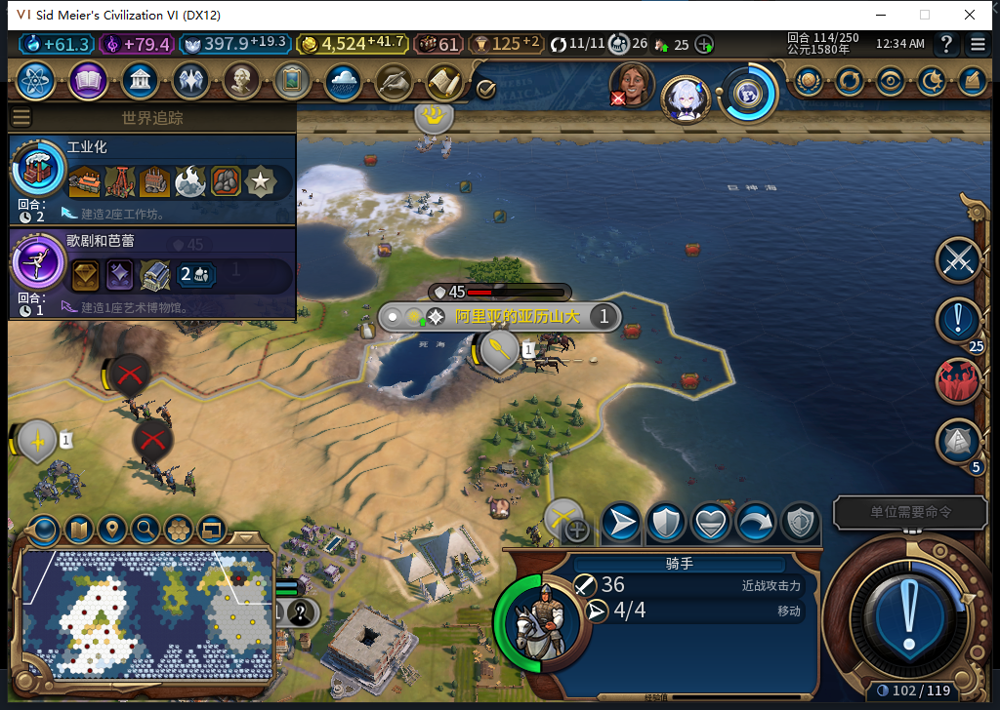

# 76实机：驻军旗帜先报价，取消、征取、继续进攻分别结算

后续已完成[城旗UNKNOWN实际提示及恢复窄验](baiqi-flag-unknown-recovery-76.md)，含冻结／恢复两张原始实机图；本页原三选记录保持，全矩阵仍部分。

2026-11-06，BF-202609141645，源码／安装／运行76。87文件安装比对一致；启动前后台只读确认Steam菜单为“上线…”、未截图／激活／移动窗口或输入，证明年龄0.033307秒，随后新开自有游戏22124。全程Steam离线。[完整计数、保存点及模型审阅](../research/baiqi-p6-capture429-flag-native76-evidence-2026-11-06.json)。

这是[75曾直接攻击的同一驻军旗帜](baiqi-upgraded-actor-recovery-75.md)，不是改点城市空白地块。测试玩家选中骑手2162700，在520,377物理右键，光标地块877；UnitFlagManager直接收到原MOVE_TO尝试并进入新城市交互。准备档的战争、资金、军队位置、城防损伤均来自明确QA布景，不能拿界面库存作正常开局或平衡证据。

| 玩家选择 | 实际结果 |
| --- | --- |
| 取消 | 0付费请求、0原版进攻续行；骑手4行动／0伤害、城防损伤150／200、金币4524.2734375和空账本保持 |
| 再开弹窗后确认300 | 1付费请求，转城／结束行动各1；城市归白绮，骑手0行动／0伤害；金币4224.2734375；一笔COMMITTED／DONE |
| 独立新准备副本中继续正常进攻 | 原版续行1，0付费请求、无征取账本；战斗后骑手0行动／25伤害，城防损伤175／200，金币不变 |

确认征取后的城市为0／851979，41,19，人口1；账本仍准确记录原before4524.2734375／after4224.2734375、价格300和肯定回执。两次LiveRecover后，连续观察仍转城1／Finish1，无新增调用。原敌驻军1179657仍属1、伤害37／0行动，原生移到相邻水格40,19并登船；不是归白绮或所有驻军规则通过。转城后城防实际损伤100／200，按实读记录。

正式保存Baiqi_P6_20261106_V76_FlagCommitted114：568695字节，SHA256 1dedf17f8c934c6a081b6e5c23a4bd7b1f77df2c913973b6903aa92c8e68fc4c。清除全部观察绑定后同进程正式重载，Core／UI的归属、金币、0行动和一笔DONE保持；加载期间原生调用总数未观测，保持未知。

“继续正常进攻”使用另一个正式加载的独立准备副本。它确实进入一次原续行，没有再次打开报价或偷偷征取。最早读回时Core已是0行动／25伤害、城防175，UI还停在战前4行动／0伤害、城防150；等原版战斗回放结束再读，两边一致。不以动画中的旧HUD或一张图判动作完成。观察器计的是续行调用，不是全局Native API总数；征取Lua的Finish为0也不能说没有原版战斗动作。

战斗结果另正式保存568870字节，SHA256 fdd0599d0bb483717e87440138ae3e52f7ac8a7ab0966177b502982922dea598。最后恢复原Farm114，原三上下文加旗帜上下文核实11城、4524.2734375金币、397.94140625信仰、原骑手4行动／0伤害、建造者1次、原地块和空征取账本，临时绑定清除。

该窄样本关闭75的驻军旗帜确认绕过FAIL；其他军队／城市／兼容组合及40项完整矩阵仍部分，下一项继续验新旗帜上下文的UNKNOWN提示和恢复。源码未再改，沿用76完整1058项软件检查95.655秒。429普通HTTP前已完成Nov6首次OpenCode1.19.5每日检查，但原模型观察器会在转发前报错，未进入Native；负责人重写并做8项诊断资格验证。

本次冷启前，旧自有75进程正式退出超过499.609秒仍无窗口／监听、2秒CPU增量0。核保存档后只终止精确匹配的自有15788一次，Steam及他人游戏未动。此前13340也有类似残留；没有原版对照，原因仍未知，不能授干净退出或归因于76。已发布工坊Alpha74未包含76，风险BBCode仍只是仓库待上传稿。
