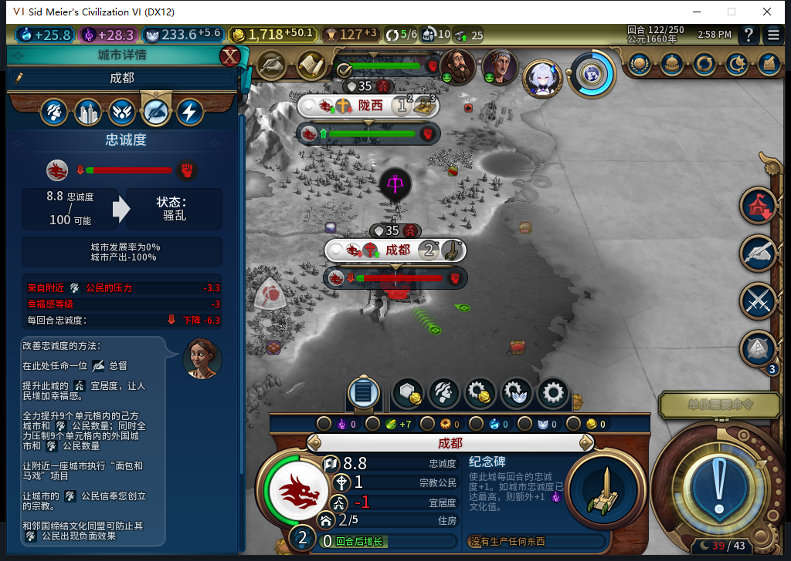
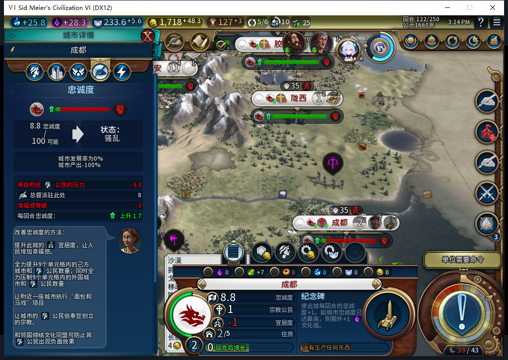
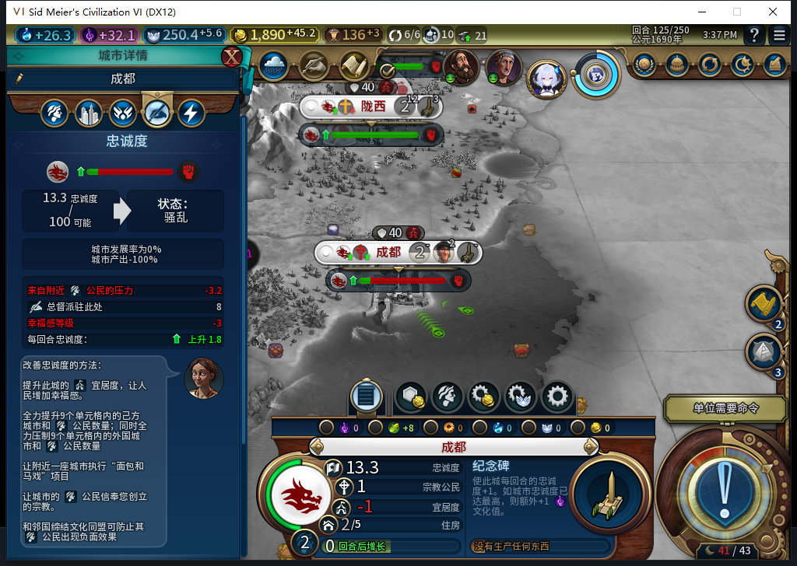

# 91实机：总督自动调往成都，三回合忠诚回升

91冷加载90的122失败档后，模组自行把总督3从西安调往成都。成都当前压力由−6.28125变为+1.71875，西安仍100忠诚／每回合+21。三个普通回合后成都忠诚实际升至13.28125。这通过了**自动调派及短期回升的窄样本**；成都产能仍0，长期稳定与生产恢复继续待验。[精确证据](../research/baiqi-p6-governor-loyalty91-native-and-model540-evidence-2026-11-08.json)、[91软件与边界](baiqi-governor-loyalty-source-91.md)。

此图是修复前90版122回合。保存并核验私人失败档后，退出自己的90游戏，冷装91；没有由测试玩家派任总督、补宜居或改忠诚。

独立原生getter确认总督实际归属成都393221，原城市西安65536无总督，其他四人的驻地保持。总督标题仍6已用6，没有额外授予。实际总督贡献+8，但城市忠诚仍8.828125、产出仍−100%；不能把派任和压力转正直接写成生产恢复。启动时没有安装派任命令观察器，实际提交次数未知，不能声称已观测恰好1次原生提交。

| 实际回合 | 成都忠诚 | 当下每回合变化 | 实际产能 |
| --- | ---: | ---: | ---: |
| 122，自动派任后 | 8.828125 | +1.71875 | 0 |
| 123 | 10.546875 | +1.71875 | 0 |
| 124 | 11.484375 | +1.796875 | 0 |
| 125 | 13.28125 | +1.796875 | 0 |

各列为实际时间点读回，不能按固定压力外推或推断AI回合内每次变化的原因。[三回合7城共21行CSV](governor-loyalty91-123-125-vitals.csv)显示其他城市采样压力也保持非负。西安仍100／+21，未因调派进入新的负压。

122→125共3次普通END、6次测试玩家军队SKIP，无UserForced或人工内政；7城单位15→18。首都自动训练移民及骑士、北京接工业区等生产仍接续。冷加载后建造者2555909自行继续移动和建设，因此不能声称载入后全部单位行保持静止。已有军队的位置保持只属窄样本，不是全命令审计。

123罗马来访由测试玩家再见一次；124巴西要求设使馆，测试玩家拒绝后再见。原拟继续到132的工作窗口均在外交处停止，没有自动执行后续END；处理原版对话、读回真实回合后才继续。巴西第一次精确像素比较失败，在物理点击前停止；随后负责人重新检查新鲜原图和原版场景，用同一进程／birth／窗口／图片哈希与时效检查发送一次拒绝，未接受使馆。

自动派任后122备份1375151字节／SHA256 a9aaacace82b34e8d45290cb991bbc2098ba8c26f97d213073d5498413db2aed；125正式备份1394257字节／SHA256 e001a510652968465a05b31d04157a2d7a6664194eff618fc73163a32812cd86，均ACKtrue及连续字节稳定，均未加载该新文件。首次125保存脚本产生双分号，旧Lua53预编译漏拦、引擎Lua51在执行前拒绝；原件保留，工具改用Lua51预编译，新v2名称／标志并确认旧标志nil后成功，0保存重放。私人存档不上库。

540本地模型提出后续扩张稳定性纯组件，完整SSE／stop／JSON和编译通过，但漏掉metatable拒绝与实际include所需全局导出。原稿5失败；修正后29纯场景通过，**尚未集成产品或进游戏**。低忠诚即便当前转正，也应先恢复再继续扩大；具体Controller接线和兼容边界继续做。累计540逻辑、504完整外层JSON、33截断、3最终传输失败、570HTTP／30额外重试；OpenCode原生生成0、未知成本null，不能把候选返回当实现。

启动前UTC07:18:29.990183对同一Steam14904独立后台读到可见“上线...”菜单，至spawn0.002428秒，查询0输入／激活／焦点变化／移动／截图。此前头部导航激活了客户端，另记为导航；Esc仅关闭同一自有菜单。其他设备占用禁令仍有效，离线不证明账号空闲，本轮0上线／登录／下载／上传器初始化／上传或模式切换。公开Alpha2仍82／12图，91未发布。既有ARMED／旧档恢复FAIL、选址与长期保城、宗教采购正案、兼容、性能和全40项仍开放。
