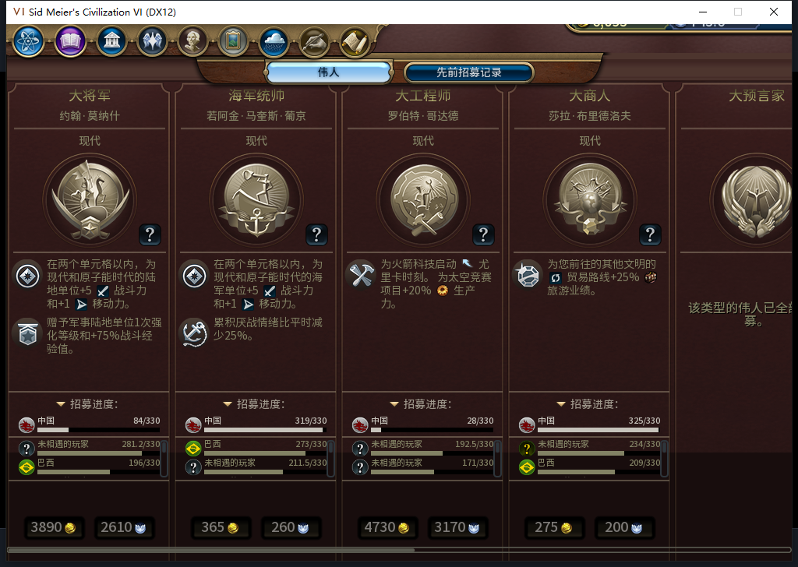
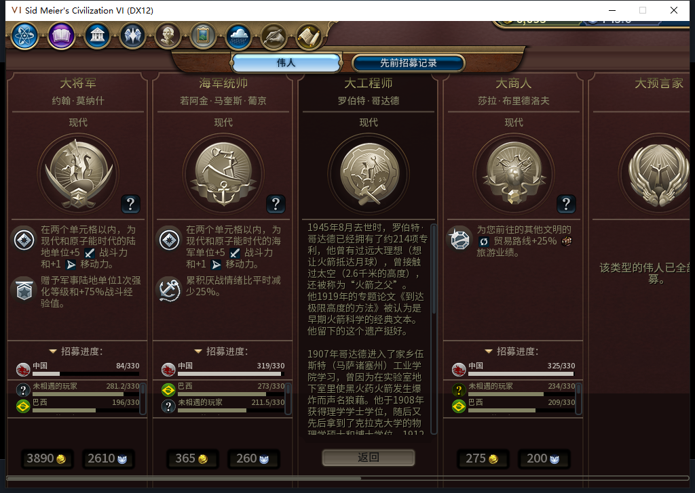
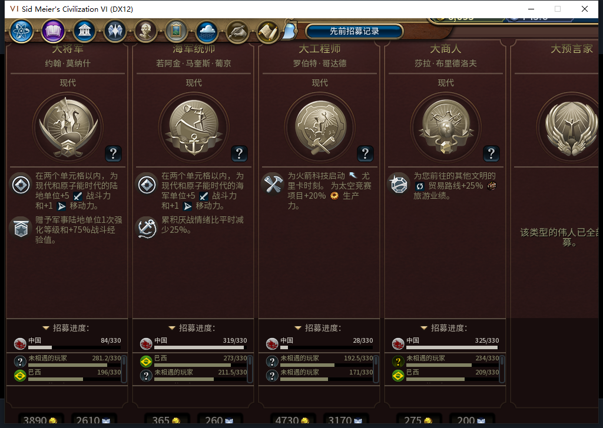

# 107界面可还原预验：首次适配有效，重复应用FAIL

107软件通过后，在现有已确认离线的106／186回合实例中临时加载负责人布局模块，只调用Apply，不安装回调、不换产品文件、不结束回合。首次9张卡片全部适配689高，标题、招募进度和费用可见；原版传记／返回与历史页能打开。但切回当前页后再次Apply返回false，故**107重复应用FAIL，尚不能授界面修复完成，更没有107冷安装通过**。已恢复75项原尺寸、撤销临时模块并关闭伟人页，游戏仍106／186，Steam没有上线或新启动。

图1：实际1008×689，弹窗／横滚区689、卡片591、MainInfo575、效果滚动区161、招募区保持152、传记／详情312；九卡逐项读回。图片是106上临时107布局预验，不是订阅版或正式安装107截图。

图2：原版按钮打开罗伯特·哥达德传记，长文留在312高滚动区，返回按钮与其他卡费用行可见。本次证明打开／返回，没有测滚动到底或全传记内容。

图3：历史页标题、表头和记录正常显示，纵向滚动区507。第一次点击后立即拍到的是旧当前页；稍后原版历史页完成更新，没有再次点击冒充首次成功。切回当前后尝试重复Apply得到false，现有591高画面未塌缩，却仍是失败。

只读对照同一控件两次GetChildren返回的句柄：9张卡以及首卡4个子控件均`a==b`为true，但以a作Lua表键存标记后，用b查不到。107按控件句柄保存弱键缓存的假设不成立，需要补这种真实消费边界；软件中固定对象的替身没有覆盖。Native没有debug和rawequal，最初两次只读探针因此中止，未运行布局setter；随后仅用已可用比较／表键完成观察，没有在产品引入这些调试依赖。

图4：恢复弹窗768、卡片670，原裁切重现；随后原版关闭伟人页，临时BaiqiGPViewport／P6GP107Preview均nil，没有遗留布局回调。186此前正式存档未覆盖，0END186。

同时更正一处负责人评审：原版确实以`data.Timeline`组织当前及历史列表；`m_kGreatPeople`也是原版已声明的局部表。先前把Timeline列为伪造、把People假想输入当原生消费证据错误，已更正当前项目记录。592仍因从另一文件按全局读取该局部表、把实例映射当控件、缺范围与大视口恢复、复制实现的测试等而整份拒绝。正确的隔离反例是：实际Timeline形状下局部表作为全局不可见；即使为定位下一缺陷而提供合成全局，实例映射没有GetChildren，仍无法适配。原始模型和早期错误评审私有原件保留，Git旧blob不改写；共享经验另记勘误。

本包新增模型／HTTP／OpenCode生成0，累计仍592。源码107和之前1616通过／1SDK跳过、87Lua编译／109包结果不变；那些结果没有覆盖这次Native句柄语义，不能用绿测试覆盖实机FAIL。后续补回归、修正缓存并复测；Steam新启动所需模式只读确认不可用，继续不新启、不上线、不上传。工坊仍Alpha2内部82／12图。

[107软件](baiqi-great-people-viewport-107.md) · [结构化预验与勘误](../research/baiqi-p6-gp107-preview186-reapply-fail-evidence-2026-11-10.json) · [待同步BBCode](../workshop/v0.1.0-alpha.2/pending-gp107-preview186-2026-11-10.bbcode)

后续：[108已补别名／原池重置回归并完成软件修正](baiqi-great-people-handle-cache-108.md)。本页107失败保留，108实际预验与冷安装仍待做。
