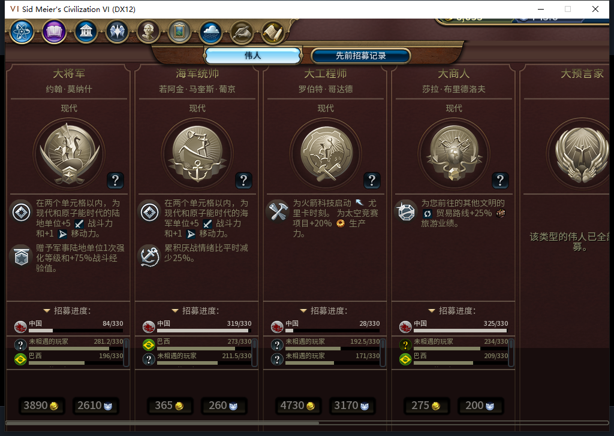
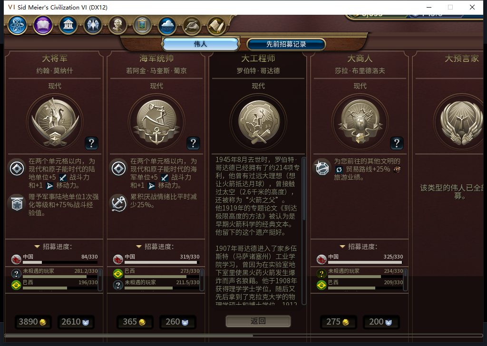
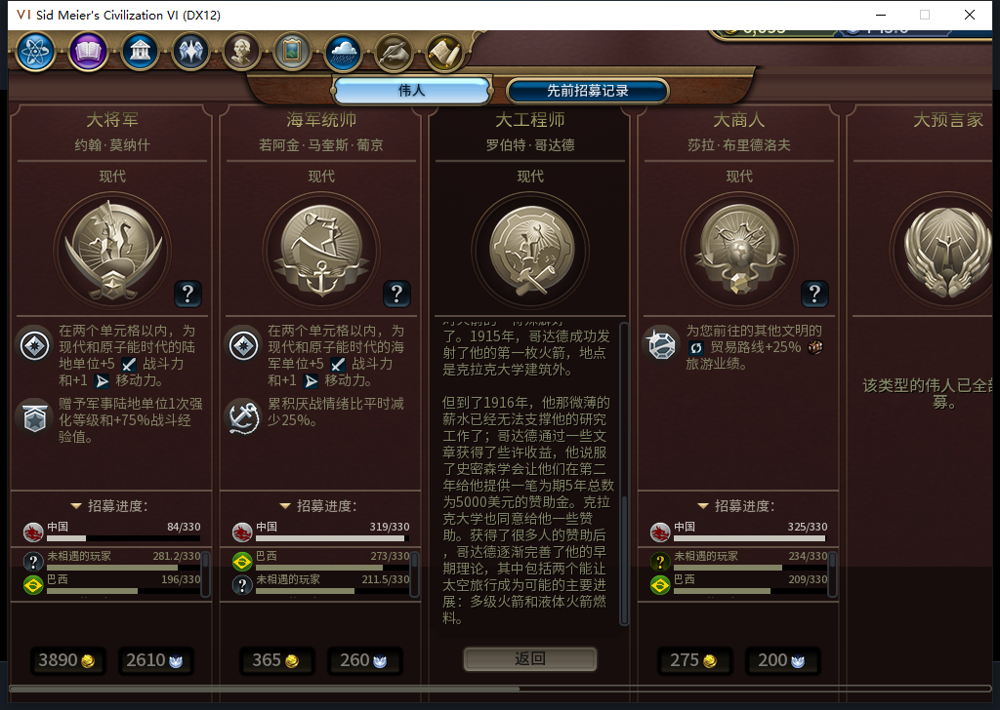
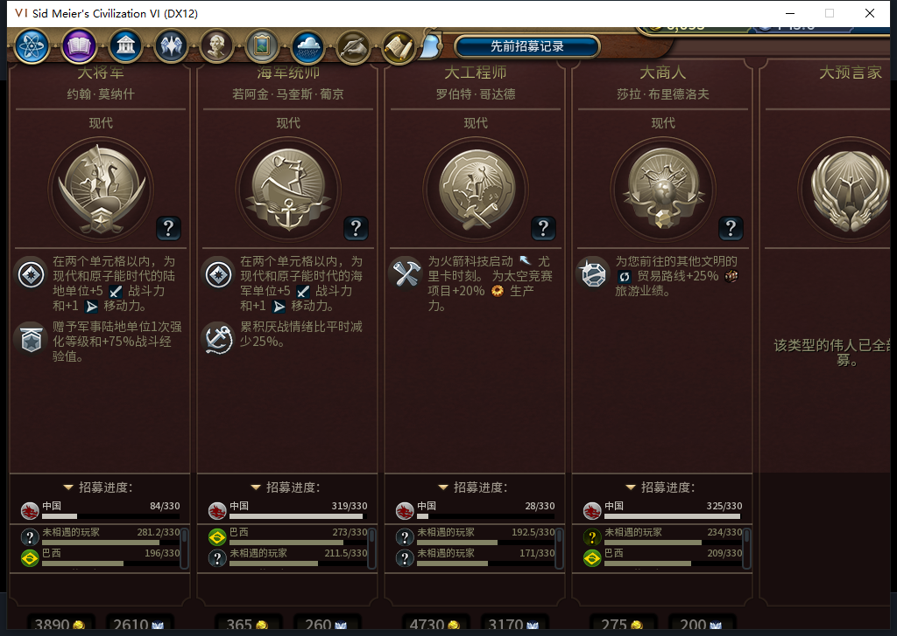

# 108可还原预验：重复适配、原版切页与重开通过

在现有已确认离线的106／186回合实例中，临时加载已提交的108布局模块。首次适配、三次独立重复应用、原版历史／当前切页和关闭重开触发的三次渲染适配，合计7次Apply均返回true。107的句柄键缓存FAIL保留，108仅授本次可还原预验通过；**没有安装108、没有冷启动，更不代表全部UI或40项通过。Steam没有上线／新启或上传，工坊仍内部82／12图。**

图1：689高视口内，标题、公开进度、完整152高招募区与费用行可见。九卡实际测得591高、MainInfo575、效果滚动区161、传记／详情312，名字偏移−255。只测九卡尺寸，未横向逐类目视遍历。

图2：调用真实原版渲染后，临时108回调自动适配，历史滚动区507高。当前卡片被原版隐藏，因此PeopleStack高度0正常，九个池内卡片仍可逐项读尺寸。未测历史滚动到底。

图3：原版关闭、再打开，九卡与费用行保持；再次独立Apply仍true。临时透明观察器最终读到4次返回true／0false，其中3次是原版ViewCurrent／ViewPast回调，另1次是独立重应用，不把4次全算自动渲染。

图4—5：原版按钮打开罗伯特·哥达德传记，通过原版ScrollPanel:SetScrollValue(1)查看末段，实际滚动值0→1，返回按钮保持可见。此项为原版控件API查看输入，不是鼠标滚轮通过；没有截掉长文冒充可读。原版返回后布局仍保持。

图6：还原75项属性、两渲染回调和透明观察器后，临时模块／命名空间均nil。另作一次原版重开，九卡实际回到670、MainInfo654、效果240、名字−295、弹窗768，原裁切重现，证明没有遗留自动缩放；随后原版关页。共3次原版开／关、4次原版查看按钮物理点击和1次传记滚动API输入，0END186。

186回合预验前后，自有采样的世界摘要1、9城市、65建筑、34区域、144地块、35单位逐项相同；9行食粮和9行城市状态也相同。原186存档仍1709266字节，SHA-256 `ba39b408bc543e39cfa7644aa750db1835ee3404b89db5cbba70b4ff784b752b`，未覆盖或加载。比较只覆盖这些自有样本，不叫全世界不变；预验代码未调用游戏命令，不据此推断所有上下文全局发令数。

本包不改源码、不新增模型／HTTP／OpenCode生成，累计仍593逻辑／553完整／37截断／3最终传输失败、623HTTP／30额外重试。软件1618通过／1SDK环境跳过的既有结果独立保留，没有重复全套。正式安装冷验、实际宽视口／全规则集、城市面板裁切、旧移民已发令ARMED恢复FAIL、通用未知MOVE、十城性能与完整40项继续开放；新启动所需后台只读Steam离线证明不可用，继续不新启或上线。

[108软件与两项回归](baiqi-great-people-handle-cache-108.md) · [结构化原图／回读／还原证据](../research/baiqi-p6-gp108-preview186-evidence-2026-11-10.json) · [待同步BBCode](../workshop/v0.1.0-alpha.2/pending-gp108-preview186-2026-11-10.bbcode)
