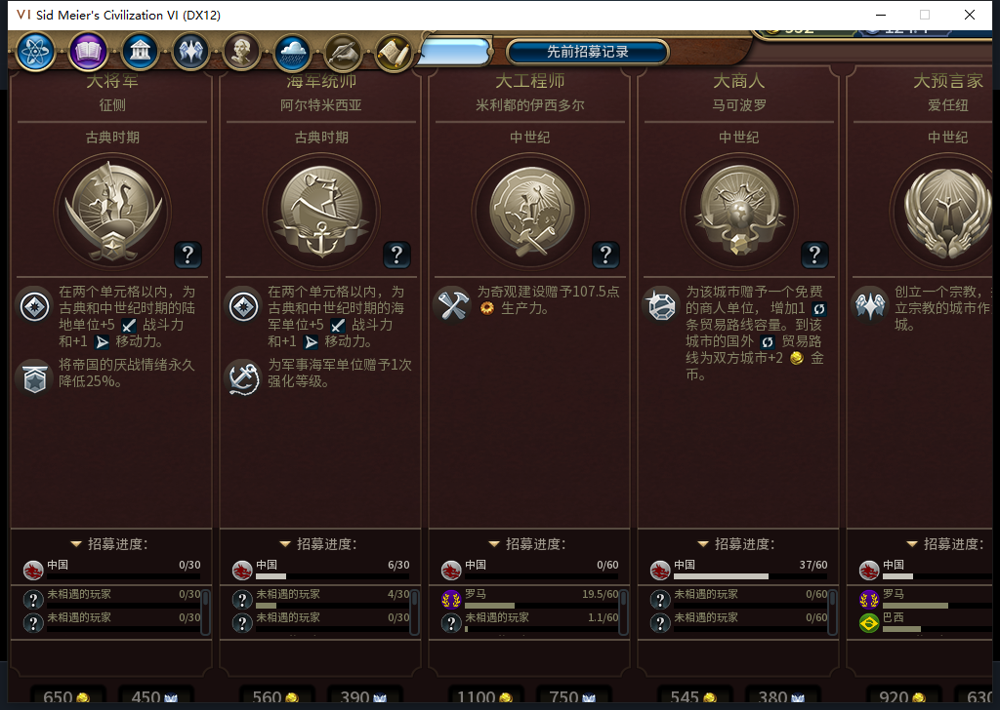
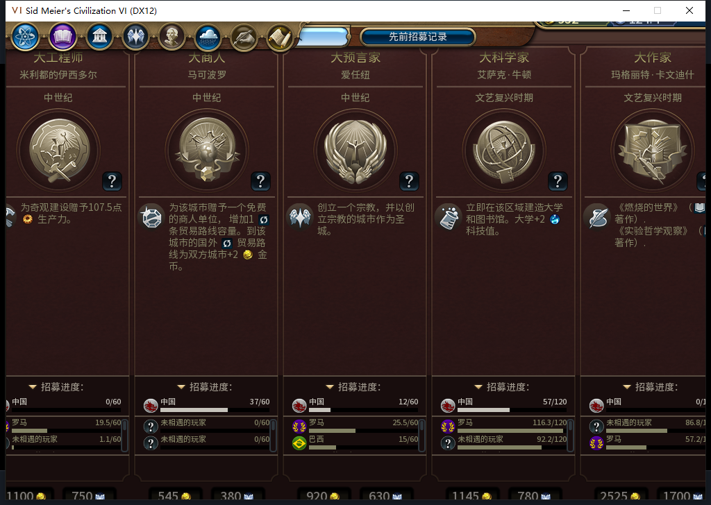

# 102实机：伟人招募数字恢复，先知进度12/60

102在原版伟人页显示了真实数字，白绮仍只能查看。103回合先知122尚未领取，自己12/60点、每回合增加4点，普通招募资格为false。10个伟人类别各有6位存活主要玩家的公开进度；未相遇者仍显示“未相遇的玩家”。原版打开、水平滚动、关闭各一次，独立读回确认可见／弹窗队列和只读状态，没有招募或赞助购买输入。

第二张图中先知卡片为“中国12/60”，与独立数据一致。卡片的金币／信仰报价是原版显示，不能当作已购买。这里只授“打开关闭、白绮只读、实际数字恢复”的窄通过；小窗口底部仍有截断，整页布局及全部UI不因此通过。

本次另有一次宿主图形中断，必须保留：为检查视口，测试玩家只对自己的文明VI按了一次Alt+Enter。窗口一度为1024×768，随后原游戏弹出“显示装置启用失败。请确保您的显示驱动程序已更至最新。退出中。”，验收连接断开。伟人打开请求失败在LSQ读取阶段、尚未发CMD；随后的只读连接也被拒，不能算本地模型HTTP失败或把事件重复发送。

通过原错误对话框“确定”正常关闭，等待超过180秒后，仅清理同一PID／出生时间／路径、无可见窗口与监听、CPU稳定的自有退出残留；两个已知隐藏微小辅助窗口亦核对。没有结束或重启Steam。原游戏配置保持FullScreen0，未改配置；从同一103保存点恢复窗口模式，才取得上面两张原图。不推断驱动根因，不再把这台宿主的全屏切换当作已验证步骤。

两个102冷启动前均有独立后台Steam离线确认，分别距启动0.004372和0.004803秒；菜单头导航单列，未选模式项。Steam外机仍在使用，0模式切换、上线、登录、下载、上传初始化和上传。公开Alpha2仍是内部82。

保存的自有状态在101→102首次冷读、显示故障后102窗口重读三者一致：经济1组、5城队列、14建筑、10区域、63自有可见地块、9单位；5城食粮也保持。它只证明该自有切片，不授全世界或已发令队列恢复通过。103查看后已另存校验，私人存档不入库。

宗教验收来自真实99回合的独立早期分支。99→103实际换回合4次，玩家军队待命4次，普通结束请求5次，与实际换回合分列，0强制结束。罗马的原版议程提示关闭一次；102一次选军前置检查失败没有发动作，新鲜读回后才继续。25行食粮均非负且无饥饿倒计时。先知点99、100为0，101为4、102为8、103为12，101起每回合4；没有手补点数或信仰，本证据不补猜其具体收益来源。

透明观察537条，0错0丢，其中22条单位调用全部为自有文职：14建造者、8移民；操作为16移动、6建造。观察器103全部撤除，只覆盖BaiqiExecutor绑定。移民仍在路上，没有新城或圣地／祷告完工；先知招募、创教、传教整链保持未通过。

本轮新增模型HTTP和逻辑任务均0，是既有569负责人修复的实机复验；模型原稿仍0Native。累计保持569任务／531完整／35截断／3最终传输失败、599HTTP／30额外重试，新OpenCode原生生成0，未知成本null。102完整1546项软件回归不重复计为本轮新执行。

[结构化证据](../research/baiqi-p6-source102-native-gp-numbers103-and-windowed-recovery-evidence-2026-11-09.json)、[25行队列](source101-early99-103-queues.csv)、[25行食粮](source101-early99-103-food.csv)、[5行宗教点数](source101-early99-103-points.csv)、[102软件范围](baiqi-great-people-standings-102.md)、[101显示失败原图](baiqi-great-people-native-partial-101.md)。
