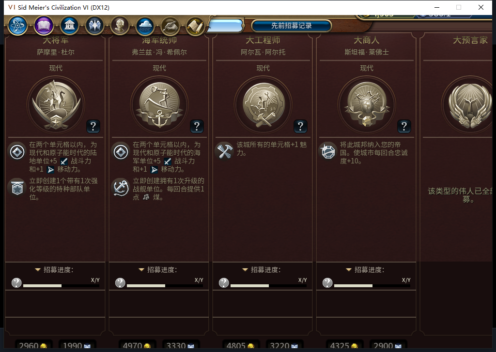

# 101实机：伟人页能打开，进度数字仍有问题

101冷读保留的187回合存档，原版伟人页主体和打开事件已经恢复。测试玩家分别打开、关闭一次；独立读回确认页面可见且在弹窗队列中，关闭后隐藏并退出队列。IsReadOnly为true，白绮仍只能查看。没有招募、赞助购买或内政输入，也没有结束187回合。

这张原图同时暴露未完成项：招募进度仍是模板“X/Y”，1024×728视口下底部也被截住。不能把“弹窗打开”写成整页验收通过。原版PopulateData使用的Game.GetPlayers列表，在本机以Major、Alive、两者合并和空筛选各读一次，均为空；PlayerManager.GetAliveMajors则读到6位存活主要玩家，包含自己。为什么两个枚举入口不一致仍未知，不声称它已废弃或是游戏必然行为。

下一步只对白绮页面的明确空列表补读原版公开伟人点数，保留已有数据、原版主体与禁写守卫，不改写Game.GetPlayers。修订569正在单独审阅，尚未装入本轮101；截图不补字、不重绘卡片。

187仍是当前无先知的负例，白绮42点／每回合1、未持先知或创教，已另存校验。随后正式读取同一无蛮族地图的真实87版本99回合存档，作为独立宗教验收分支：5城9单位，公开先知122尚未领取；自身0点／每回合0、信仰100.41015625、未创教。5城食粮非负且无饥饿倒计时。没有赠送点数、信仰或单位，尚未授祷告完工、招募或创教通过。

568只读诊断器把具名适用窗口从150..250扩到99..250，保留其他校验。原20项加3项早期检查共23项通过，旧窗口对同3项产生3个失败事件（含子场景）。模型首个边界补丁采用；另一个增加>=0的补丁重复了已有integer校验，未采用。模型6项测试通过，但超过所要求3项；负责人合并成3项，并先断言当回合记录可读再测试未来领取拒绝，避免旧窗口本身拒读使负例虚假通过。旧149越界夹具同步改为98。最初私有食粮包装器也保留了154下界，在任何Native前拒绝，修订具名99范围后才真正读取；不是产品失败或游戏输入重放。

模型568完整stop／DONE／JSON，1HTTP、4173+782=4955 tokens、5.176399秒。累计到568为568任务／530完整／35截断／3最终传输失败，598HTTP／30额外重试；569另账，新OpenCode原生生成0，未知成本null。工具23项不冒充新的产品完整回归；101的完整1531项保持原切点。

101启动前后台只读离线确认距启动0.003397秒；正式菜单头导航单独记录，未选择模式项。外机正在使用Steam，0模式切换／上线／登录／下载／上传初始化／上传。公开Alpha2仍内部82。宗教整链、旧ARMED恢复FAIL和完整40用例继续。

[结构化证据](../research/baiqi-p6-source101-gp-partial-and-supply568-early99-evidence-2026-11-09.json)、[101软件](baiqi-great-people-view-101.md)、[原100失败图](baiqi-empty-prophet-and-gp-ui-fail-100.md)、[3项早期诊断](../../tests/test_diagnostic_prophet_supply_early.py)。
