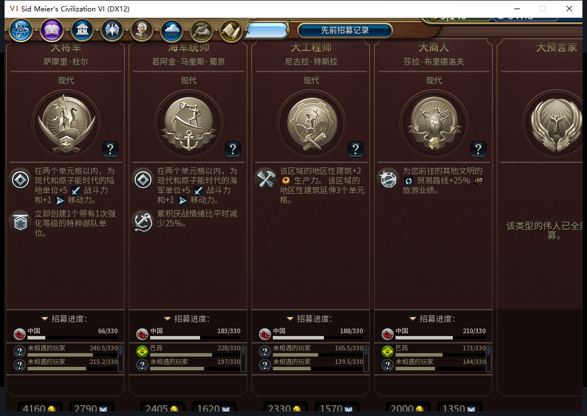

# 107伟人页小视口修正：软件通过，实机待验

当前代码107，安装／运行仍106、186回合。106在1008×689视口下，伟人页弹窗和横向滚动区都高768，卡片670、MainInfo654，导致顶部与底部裁切。107按真实控件树适配高度，保留完整152像素招募进度区与费用行，把介绍、传记和招募详情留在滚动区；切到大视口恢复原768设计。公开进度数据仍走原102补数逻辑，没有改变招募、金币、信仰或内政权限。

图中是修正前106，不是107已修好的宣传图。107没有修改或复制原版资产，新增独立布局模块并接入现有伟人页。仅当前人类白绮单人范围生效；异常、缺控件、外部改动尺寸和低于600高的视口保留原布局，不把缺失当作0。遍历上限32卡、每卡128节点／深2，整页先检查后写，按绝对尺寸适配，避免每次打开继续缩小。招募进度区不缩；原版渲染回调的结果、nil和错误保持。原生setter异常会尝试恢复已改尺寸，永久setter故障不能保证一定恢复。

6项新增方法直接运行真实模块，覆盖689布局的标题／效果区／进度／费用相对位置、大窄视口反复切换、实例池重用、后卡损坏不部分写、普通领袖／非法尺寸、原回调与异常及实际wrapper接线。相关36项通过；完整1617项中1616通过、1项因SDK环境跳过，108.024秒。87个Lua文件通过Lua5.1编译，109文件ZIP逐字节相等，SHA-256 `30164464080d3bdceaae207b992c77136b981f16d21b118bdd971271ed199ab1`。私有性能对照仅追加准确107白名单，108继续拒绝，未改行为屏蔽锚点。

模型592实现因伪造Timeline／原版实例全局、缺范围／恢复、复制实现的测试而整份拒绝；负责人用实测控件另写本实现。此前私有5项检查与现在产品6方法分开记录，没有新增模型请求或OpenCode原生生成。累计仍592逻辑／552完整／37截断／3最终传输失败、622HTTP／30额外重试，未知成本与节时保持null。

Steam他机占用，持续禁止上线、登录、下载或上传。新一次后台只读模式查询不可用，0输入／激活／移动／截图；因此尚未启动新游戏进程。先在已取得离线确认的现有106实例做可还原的界面预验，再于取得新鲜只读离线证明后进行107冷启动验收。软件通过不能代替安装后实机；传记、历史页、重开、实际窄／宽视口仍待验证。

城市面板裁切、旧已发令移民ARMED恢复FAIL、通用未知MOVE、十城性能与全规则集／军队／宗教／40项验收仍未关闭。工坊仍Alpha2内部82／12图，本次没有上传。[106二十回合实机与六图](baiqi-continuous-window-106-166-186.md) · [结构化软件证据](../research/baiqi-p6-gp-viewport107-software-evidence-2026-11-10.json)
