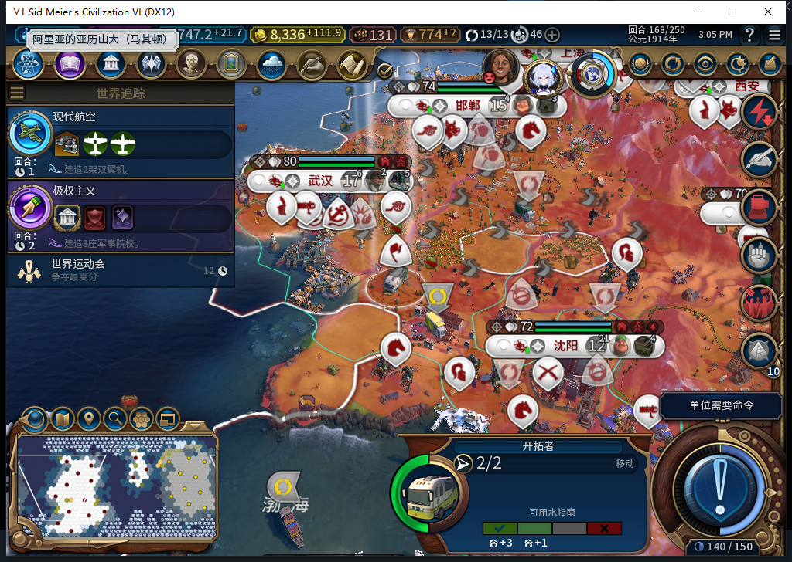
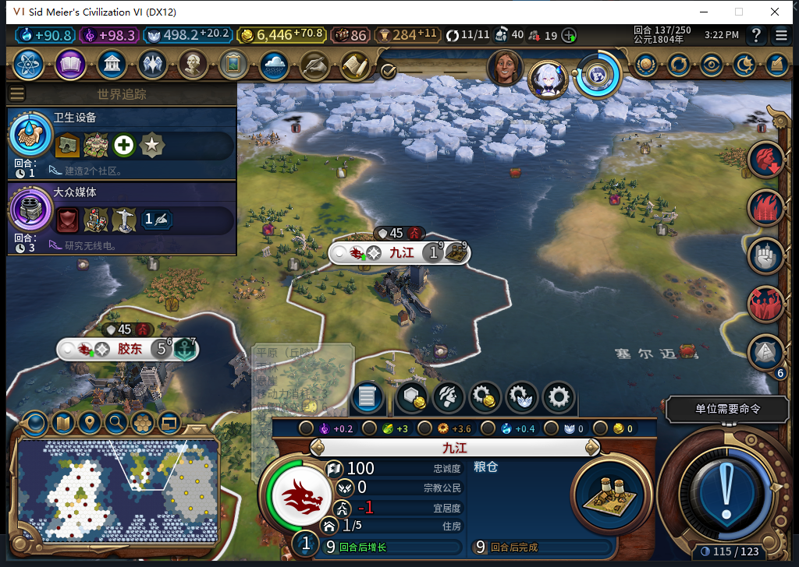
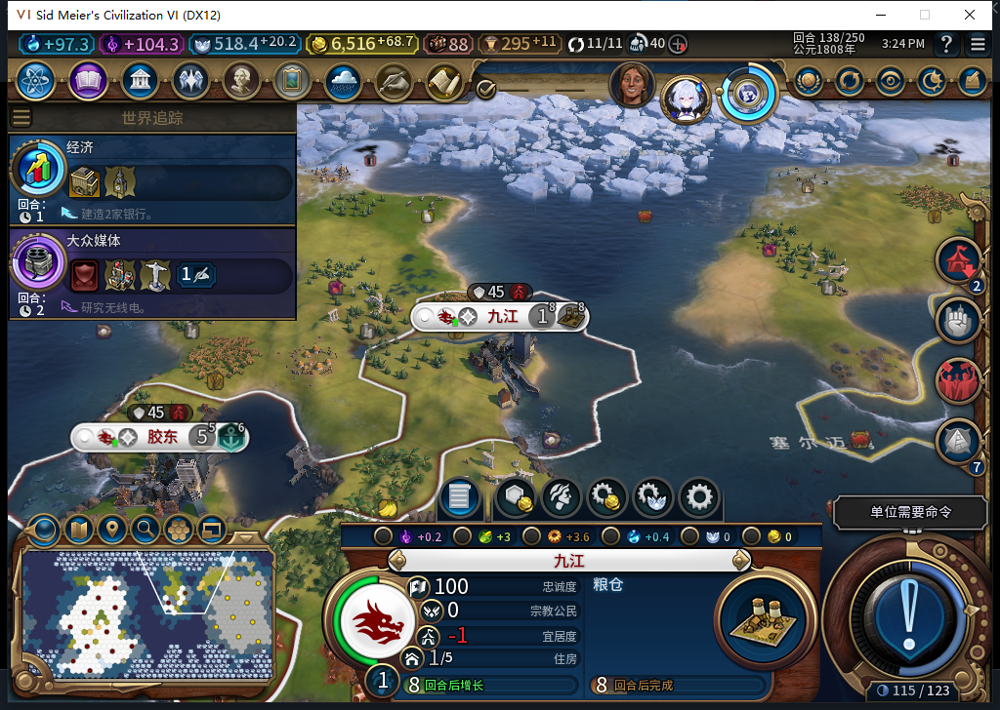

# 80实机：危险孤城等待，有己方支撑的城址正常建城

80在两个原保存点中分别验证了拒绝与放行。原来会建成后迅速叛离的临淄城址，这次没有再消耗移民；另一处距己方城市4格的城址，137回合自动建成九江，138粮仓已有3/32进度，正式存读档后保持。三张图均为80版原始实机截图。

这只关闭已知坏城址的这个复现样本。9格规则是保守距离筛选，不是忠诚计算器；迷雾、人口、时代、政策、幸福感和未来压力变化仍不能保证。工坊仍Alpha74，本页不是已上传新版的公告。

## 原坏城址：保留移民，等待其他选择

从同一77版167阻塞保存点冷加载80。空地1093位于(37,24)，最近己方城距离12；当前可见半径9内有5座外国城市，最近距离4。独立只读扫描163格，0错误，没有遍历外国城市清单。旧78曾在这里建城并于178实际叛离，该历史FAIL保留。

普通结束167回合后，168仍15城，移民9764928保持(9,8)、2行动力、无护送编队和排队目标。启动后观察窗口内，目标0移动、0建城、1次待命，其他城市继续3项合法生产。原生实际只给出1093和受保护地貌1052两个推荐；不能据此断言全图没有其他好城址。

图中是本回合等待的结果，不是自动护送或玩家代下移动。测试玩家只处理19个原生可跳过的军事单位及普通结束回合，没有移动先知、军队或文职去补路线。168已正式保存，未在本工作包重载此负案。

## 有支撑城址：自动建城并继续普通生产

再正式加载独立136抵达保存点。该移民7274546由76自然训练、77抵达，80负责本次建城、生产和读档验证；不是完整80新局。目标776位于(28,17)，仍是原生第2推荐，最近自有胶东851979在(25,15)、距离4。37个3格邻格均当前可见，没有可见外国城市，0错误。

136结束时遇亚历山大交易来访，由TEST_PLAYER拒绝珍珠及双耳瓶交易、再见各一次。实际137回合，后台只发1次FOUND_CITY，请求0:137:14；城市从12增至13，新九江917516归白绮、人口1，UI／Core均确认。模组随后正确observed，证明是新城和已消耗移民，不靠单位失踪猜成功。

粮仓137为0/32，普通推进138后为3/32，粮食0→0.8515625。137和138忠诚均100、当前每回合+1.84375，无总督／军队救场。这只是短窗口，不能称长期保城通过。粮仓是普通建筑，未恢复已删除的经营权。

正案启动后观察窗口有39次文职请求，目标只有1次建城；城市6次生产包含1名新移民和2名建造者，没有军事生产，0观察错误／未知／溢出。11条城市／单位事件没有丢弃。两个窗口都只覆盖BaiqiExecutor，启动阶段SDK总数未知，不升级为全局零军令证明。

138精确撤去两项派发包装及3个事件处理器后，正式保存600429字节，SHA256 25f1cfd8e6825cc1dc38041e91d43d66eb5dd3d5991ca5a9b5a7d333b200447d。正式加载一次、继续一次后，UI／Core仍13城、金币6516.9765625，新城ID保持；粮仓3/32、粮食0.8515625、忠诚100／+1.84375保持。六个临时观察器和三个测试玩家跟踪变量均已核为nil。私人存档不公开。

这是建城完成后的世界状态读档，不是未决建城日志持久化通过。79／80的写前见证仍只在内存中，中途重启可靠性继续开放。

## 环境与下一项

87文件安装与源码9a6265bf88fc429f0601e68eddd48b989902ebf7一致，冷新进程25132；启动前后台只读离线确认距启动0.00454秒。本轮0 Steam上线／上传。旧79正式退出后427秒仍残留无窗口进程，在核验175保存点后只终止该自有验收实例一次，没有终止Steam或其他游戏；干净退出不授通过。

首次正案Core诊断仍匹配旧坐标、路线读取仍带旧回合范围，两处诊断移植错误已修正并独立重读，未把它们归为产品故障。137的第一次普通结束只处理排队移动，实际仍同回合；新鲜待办核对后再作一次普通结束，才实际到138，没有UserForced或清状态。

22项新增及完整1130项软件检查已在80产品提交通过；本次只有实机和文档，无产品修改，不重复软件套件。继续跟踪138刚自动排入的下一名移民，核完整80训练／人口成本／路线链。完整40项、长期忠诚、未决状态持久化、性能与兼容性仍未完成。

[结构化双案、观察范围、保存点与诊断纠正](../research/baiqi-p6-border80-native-pair-evidence-2026-11-06.json)、[80软件与启发式限制](baiqi-known-border-screen-80.md)、[旧78实际失城](baiqi-new-city-loyalty-loss-78.md)。
