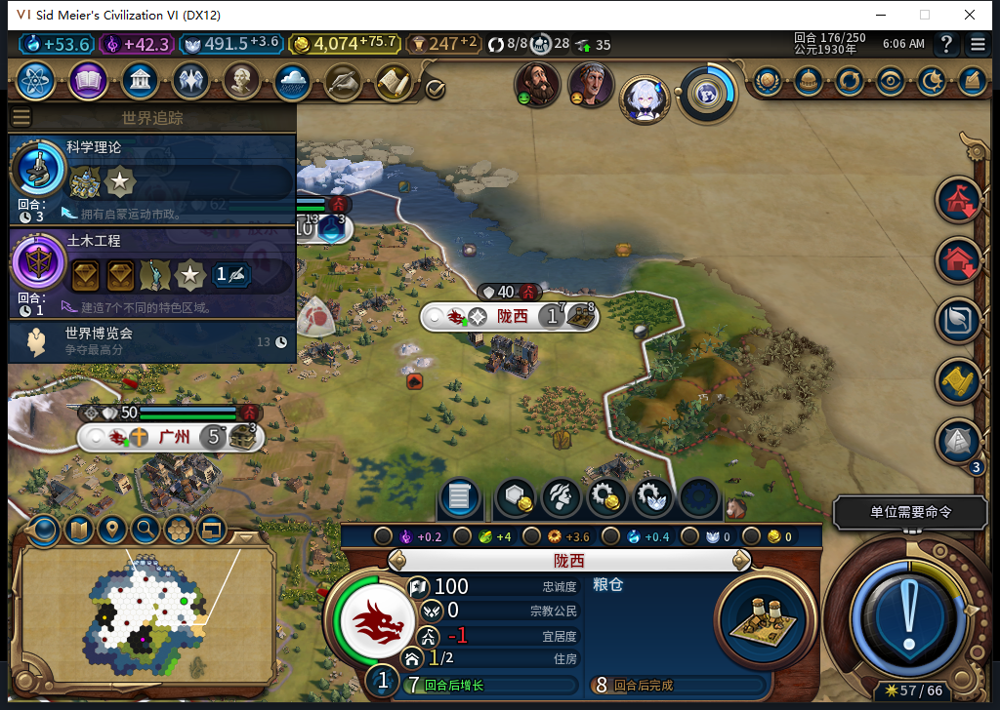

# 98：保留当场尚未发出的建城请求，只在同回合重验后首次发令

97有一个可复现的软件停滞窗口：Core已把新建城记录写成ARMED并返回确认，随后UI最后资格检查暂时不通过，原生RequestOperation尚未调用。旧控制器会一直等城市出现，后续也不再进入该单位的发令分支。23项新回归在旧97有14项行为失败；98全部通过。

98仅保留这次真实确认授予的、内存中的一次发令闭包。它可以在同回合后续正常调度中重新核对现场，再首次调用建城命令。它不写进存档；ARMED快照、旧记录、读档或跨回合均不创建这种权限。旧版“原生命令已调用、存档却未包含效果”的恢复FAIL继续开放。

## 最后发令前检查

每次重验仍要求同一玩家、完整移民ID、独立编队、有行动力、正确目标、可见空地、安全与扩张支持、原生资格、当前主动回合与战略权限、Core空闲、当前无排队目的地；还检查同一请求／令牌／原记录、当前操作编号及原发令函数等绑定。读档代次在Prepare前捕获，因此即使确认返回期间发生加载事件，也不能留下跨世界发令权限。

闭包在进入原生命令函数前消耗一次。返回false、无返回值或抛错都保留为结果未决；资格查询与命令回调重入不会再次派发。被动读回和allowOrders=false不发令，自动待命也不会先消耗尚未发出请求的行动力。完全确认城市与移民消耗的既有OBSERVED规则保持。

## 软件验证及修正

最终完整检查1412项，1411通过、1项SDK环境检查跳过；跳过原因见结构化证据，不推断SDK未安装。23项新建城回归、原40项建城回归、6项写入检测器检查均被完整检查覆盖。107个包文件逐字匹配当前源码，85个Lua文件通过本机Lua5.1编译。

检查曾发现两个实际消费者需要跟进：私有对照构建工具的版本白名单只到97；写入检测器把SDK函数引用后的==误判为赋值。前者补98；后者按相邻token区分==与=，新增执行型测试核对函数身份不变、零SDK调用，原有赋值／声明拒绝检查继续通过。

负责人第一稿也经历了修正：加载事件发生在确认返回期间、操作编号变化，以及自动待命超时，均由反例测试先失败再修正。完整检查第一次1410项出现19个工具版本错误，第二次1411项出现1个检测器错误；它们没有被算作通过。

558的停滞源码诊断窄采用，但其从旧档满行动力／原位置授予重发、清未决记录及不完整重试方案拒绝。559只返回路径，没有测试源码，拒绝。560把用于判断的token索引写错，实际会放行真实赋值，拒绝；工具修复及所有测试由负责人完成。三次请求均完整stop／DONE／合法JSON，0原始候选进入实机。累计560任务／522完整／35截断／3最终传输失败、590 HTTP／30额外重试，新OpenCode原生生成0；未知成本保持null。

## 实机边界与后续

98尚未冷启动，本页不授游戏实效通过。以下图片是已保存的97主线，供核对升级前的独立正例：

主线176已另存，9城，1689325字节，SHA256 `abd1c21c2eb44e7c2130acae313ab660c1c49605692732fd4c2d2ca4fc60c3b7`。下一步是取得当前Steam实例的新鲜离线证明后，冷读主线并继续普通回合；无法取得证明就继续独立准备。实机不能靠人为篡改资格来制造闭包路径PASS。

同回合之外的权限刻意不恢复，因此读档和跨回合仍可能留下等待；这项有限修复不能解除旧ARMED恢复、旧档LEGACY_UNKNOWN等待、自然宗教链及完整40用例的未验项。公开Alpha2仍内部82，其他机器正在使用Steam，0私自模式切换／联网／登录／下载／上传初始化／上传。

[结构化证据、三份候选审阅和完整软件计数](../research/baiqi-p6-dispatch558-560-live-unissued98-evidence-2026-11-09.json)、[97旧失败档读取](baiqi-oldarmed97-native158.md)、[82原生已发令中断FAIL](baiqi-settlement-lifecycle-recovery-82.md)。
