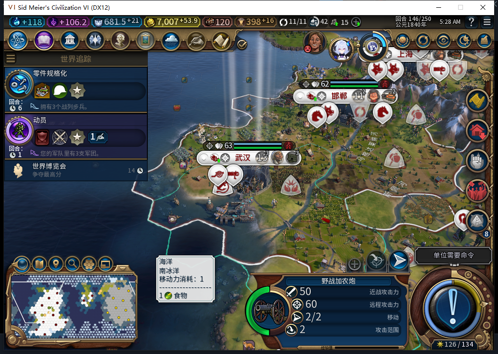
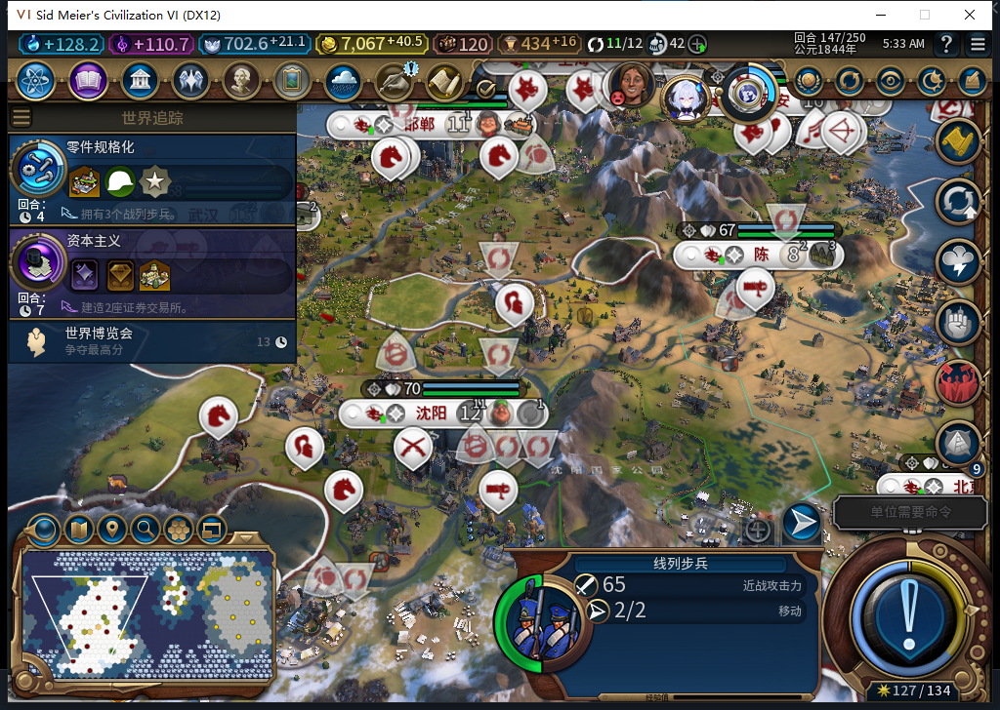
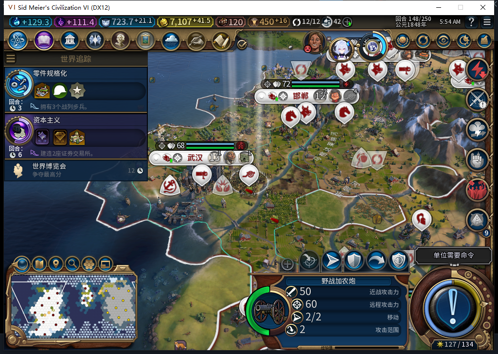

# 新兵完成后等待玩家：炮兵、步兵与军费对账

77实机中，武汉的野战加农炮在146回合正常完成，北京的线列步兵在147回合正常完成。两支都有真实出生完整ID、对应城市的正常生产完成事件，以及Core／UI身份读回。它们保留原版军队动作；测试玩家实际指挥炮兵移动成功。没有用手选生产或直接生成单位补验收。

这把[此前仅有队列、产能和费用快照的阶段](baiqi-military-production-77.md)，推进到两支军队实际完成、待命、玩家指挥和存读档保持。低储备、资源不足等独立分支仍未全部验收，TC-007保持部分状态。

## 实际完成与指挥权

| 项目 | 野战加农炮 | 线列步兵 |
| --- | --- | --- |
| 后台入队 | 139，武汉327684 | 141，北京393221 |
| 原生生产成本 | 165 | 180 |
| 完成前读回 | 145回合161/165 | 146回合158/180 |
| 实际出生 | 146，完整ID8192051 | 147，完整ID8257581 |
| 出生位置 | 8,10 | 15,5 |
| 对应完成事件 | 城市327684，单位行58，canceled=false | 城市393221，单位行94，canceled=false |
| 首次读回 | 存活、2行动、可选择 | 存活、2行动、可选择 |

完整ID用于追踪具体单位；完成事件中的58、94是型号行号，不能把它们当单位ID。关联同时使用事件顺序、型号、城市与出生坐标，再核真实队列和出生对象，不靠“同一回合”就认定同一来源。

原版UnitPanel把两支新兵都识别为非托管文职，没有清掉它们的军队动作。147回合，测试玩家选中新炮兵，按原生资格指挥它从8,10移动到自有地块9,10，独立读回已抵达、剩1行动、无待执行目标。这是明确的玩家军令，没有让后台代走，也没有带动护送文职。

连续观察138—148回合的BaiqiExecutor单位派发，共177次，军事0、非文职0、未知0、记录错误0、溢出0。玩家操作在ActionPanel另记。这个窗口没有覆盖所有上下文或后来的读档引导期，不能追认那些SDK调用也为0。

## 上限随城市数量变化

13城时需求上限26，已排队的军队也计入。141—145持续是24现有加2在训；146是25现有加1在训。期间多城完成其他建筑或项目，没有继续无穷排兵。

147回合两支完成后，早期快照为26现有、0在训。随后托管自然建立第14城长沙，需求升到28。148回合实际是26现有加1在训，新队列为另一座城的炮兵0/165，仍在新需求内。不能把26写成与城市数无关的硬上限，也不能把新城后合法补兵误报为超招。

## 军费为什么不只增加一支兵的钱

两种型号的原生基准维护费都是5。实际第一支出生时，军队维护费28→32；第二支出生时变成54。读回正式146存档并与147、148比较，发现“征兵”政策在146仍装槽，147已过时并被移除；新解锁的“全民动员”没有装入。政策状态由原生槽位、解锁／过时查询和实际规则文本核实，测试玩家没有手动换卡。

| 原生读回 | 146存档 | 147／恢复后的148 |
| --- | --- | --- |
| 军队数量 | 25 | 26 |
| 所有军队基准维护费之和 | 49 | 54 |
| 基准费用大于0的单位数 | 17 | 18 |
| 征兵 | 已装槽、未过时 | 已过时、不在槽 |
| 实际军队维护费 | 32 | 54 |

征兵规则为每单位维护费减1、最低不低于0。146的49减去17份优惠，正好为32；147优惠结束，实际回到基准54。因此上涨22包含旧17份优惠结束和新步兵基准5，不能算作“这支步兵收费22”。

总费用也按原生提示核对：146是军队32加城市52等于84；148是军队54加城市56等于110。建筑46和区域16直接相加为62，与148城市汇总56之间仍差6，具体城市汇总修正来源未核定；这个差额没有藏入军队费用，也没有推断为敌方间谍偷钱。WMD维护费实际为0。低储备和资源不足分支仍要独立验证。

## 正式保存、读档与恢复

148正式保存前恢复原派发函数、移除3个观察事件，并清理本轮Lua临时命名空间，不改世界属性或未知回执。之后只读回146作政策对照，再正式恢复最新148，分别只提交一次加载，保存文件的长度和SHA256先核实；加载中“继续”前置校验失败时没有发输入。

恢复后的Core／UI共同确认：14城、金币7107.87109375、军队维护费54；炮兵仍在玩家指定的9,10，步兵仍在15,5，两支均有2行动。新需求下的炮兵队列0/165也保持。读档引导期没有观察器，SDK调用总数保持未知。

| 正式检查点 | 字节 | SHA256 |
| --- | --- | --- |
| 首支出生146 | 602273 | 7c1c3b8d278e63481c28c9da377f48a494c14500fb9be82eb2d8f6beb3f31c64 |
| 两支出生147、玩家移动前 | 610965 | d202214c39850d8e1b2b7f83e134c9200c43498e38461ed4b94338c3bea78962 |
| 正常148、观察器已清 | 618266 | 3fa6582e3a676bc07aec886a666a5f5e507c6998b5d89c98b9f905e012bdb280 |

还同时核实了九江的原版粮仓在146实际建成，建筑存在且未劫掠，人口已到2；148接续纪念碑16/30。这是此前新城进度的后续实际效果，与删除的粮仓经营权无关。

三张新增图都是自有游戏窗口原始截图。本页通过范围是这两支军队的正常生产、待命、实际玩家移动、动态需求窗口、对应军费与正式读档保持；没有授予所有军种、所有战斗按钮、低财政／缺资源或完整40项通过。历史验收库存与城市不代表新开局平衡。工坊仍是Alpha74，未上传或替换；本轮保持Steam离线。[结构化证据、模型445—446审阅和原件哈希](../research/baiqi-p6-military445446-native77-born-control-policy-reload-evidence-2026-11-06.json)。
