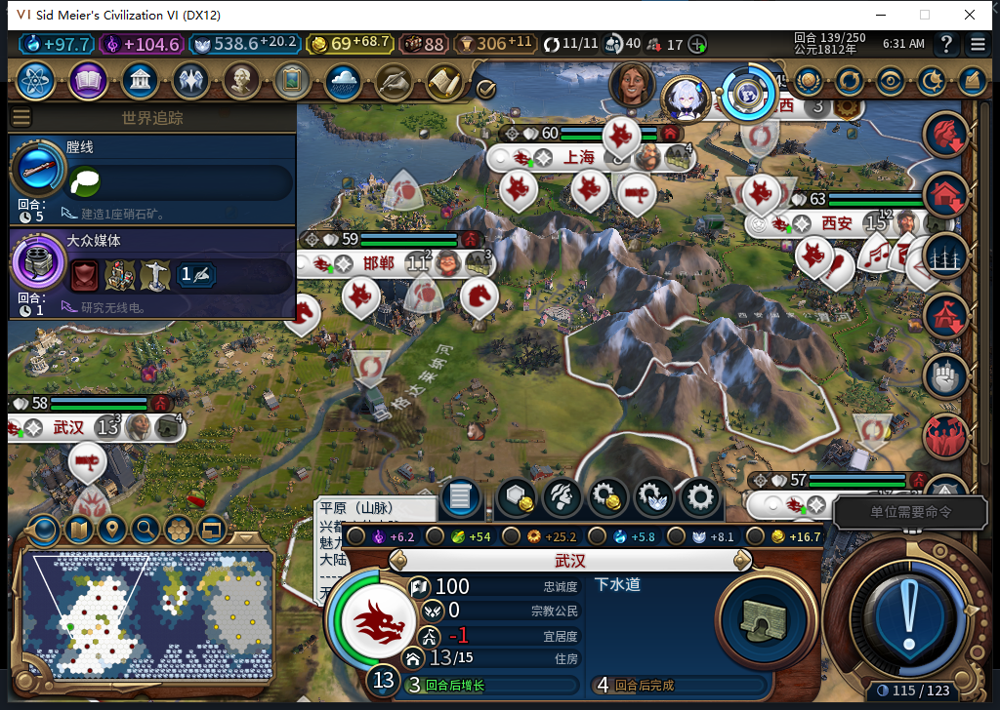

# 低于金币储备时不补兵，城市继续合法生产

77实机独立副本验证了低金币分支：139回合有13座城、24支存活军队，低于需求26；炮兵原生生产资格仍通过，且不需要战略资源，但余额69.754低于100金币储备。后台没有招兵，两座刚完成港口项目的城市改排原版排水系统。最新148主进度随后已正式恢复并独立读回一致。

本页是明确的受控测试：从已有正常138存档复制验收状态，只扣低该副本的测试金币。它不是普通开局、正常消费或AI经营收入，也没有改队列、造单位、加资源、重置就绪状态或清未知回执。

## 测试条件与普通回合

主148存档先保存并校验；独立载入正常138原保存点。该点13城、24军队、0军队队列，金币6516.9765625；两个港口项目分别103/112、95/112，预计下一普通回合自然完成。

测试夹具只执行一次已审阅的Core金币扣减6516，余额变成0.9765625，信仰、城市和单位计数保持。最初准备门把UI原始单位数50用于Core检查，实际Core为51，因此在扣款前拒绝；读回确认金币未变后，修正上下文计数并用新唯一尝试执行。没有重放未知扣款，也不把工具门失败算作模组故障。

测试玩家处理旧军事堆叠、正常跳过军队，使用无REASON／UserForced的原版结束动作。139实际收入后，余额69.75390625，仍低于100储备，回合净收入68.77734375。没有替AI操作文职或选生产。

## 缺兵且能生产，仍没有绕过储备线

| 139回合实测 | 结果 |
| --- | --- |
| 现有军队／军队队列／需求 | 24／0／26 |
| 金币／储备线 | 69.75390625／100 |
| 两座城炮兵的两种原生生产资格 | 均true |
| 炮兵生产成本／战略资源费用 | 165／0 |
| 两个原港口项目 | 均真实完成、canceled=false |
| 后台接续生产 | 两座城均排水系统0/100 |

连续观察BaiqiExecutor的CityManager实际派发，共2次BUILD，都是建筑排水系统，0次单位、0次军事；外方城市、未知类型、记录错误和溢出均为0。两次派发前实读余额都是69.75390625。样本没有伪造内部待确认队列数量，那一项明确保持未知。

这里同时有缺额、炮兵原生合法且资源费0、金币低于线，以及没有单位派发并继续其他合法生产的实际效果。它比“没看到军队入队”多了必要条件，但只授低金币139窗口通过。再过回合收入可能使金币恢复到100以上，不能承诺140以后仍不补兵；净收入下限2和资源不足也没有混算为已通过。

## 保存、清理与恢复主进度

副本138保存600466字节，SHA256 342a48209f1a07f4aa4523f5919a60f9076c421838070e8173ef38eb95b654b2。完成139读回后，精确恢复原城市派发函数，移除3个观察事件，再保存副本139：600538字节，SHA256 ee90c1fc35f8d3d7454aee3932cc18c3568e5c47c285ddf512f98edf3fb51d6c。

随后正式恢复原主148，Core／UI共同确认14城、金币7107.87109375、军队维护费54；炮兵8192051仍在9,10、步兵8257581仍在15,5，各有2行动，原新需求炮兵队列0/165保持，观察绑定均无残留。这是恢复主存档，不是给低金币副本退款或补收入。存档和账号数据不公开。

准备下个资源不足分支时还发现：Core与UI的资源读写接口、库存读值并不相同；本页只读探测，没有执行资源修改或追认资源分支。下一步继续在另一独立副本资格化，不把降低金币的结果代替资源门。

本轮产品代码未变，77既有1064软件通过保持，未重复整套检查；城市审计观察器11项透明性检查通过，既有8项事件观察器资格复用不算新增独立用例。工坊Alpha74未变，Steam保持离线。完整TC-007和40项仍未全验。[结构化证据、模型447—448审阅及原件哈希](../research/baiqi-p6-military447448-native77-low-reserve-evidence-2026-11-06.json)。[此前正常军队完成、玩家指挥及军费对账](baiqi-military-born-control-77.md)。
