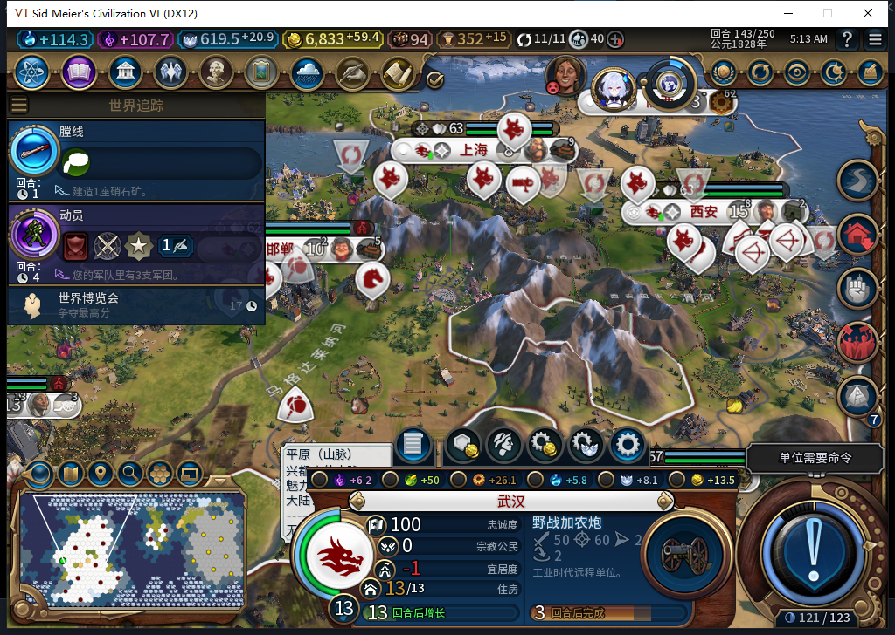
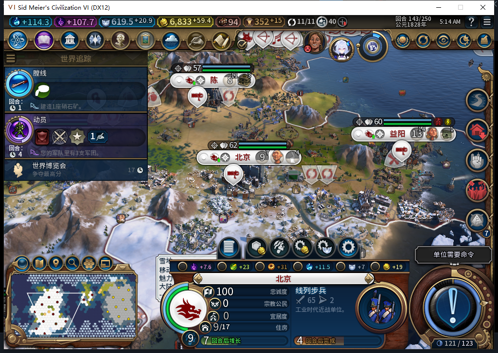

# 托管按缺额排军队：武汉炮兵与北京步兵

后续已完成[两支实际出生、玩家指挥、军费政策对照与正式读档](baiqi-military-born-control-77.md)，新增3图。下面是截至143的队列阶段原记录；低储备／资源不足分支和完整TC-007仍未全验。

本页截至77实机第143回合：13座城、24支存活军队，对应需求上限26。托管在武汉和北京各排入一支军队，两支都按普通产能推进，现有加在训合计26。玩家没有手选军队生产。这里只确认了入队与生产、费用快照，尚未授予训练完成或完整TC-007通过。

## 两个训练队列从哪里来

武汉第139回合完成港口项目后，后台自行选择野战加农炮；北京第141回合完成社区后，后台选择线列步兵。原产品日志分别保留source=BACKGROUND、城市完整ID和请求号，之后原生队列与类型哈希吻合。完成事件本身不提供“后台来源”字段，两类证据分开关联。

| 回合 | 武汉：野战加农炮 | 北京：线列步兵 | 现有／在训军队 |
| --- | --- | --- | --- |
| 138 | 尚无军队队列 | 尚无军队队列 | 24／0 |
| 139 | 0/165 | 尚无军队队列 | 24／1 |
| 140 | 32/165 | 尚无军队队列 | 24／1 |
| 141 | 57/165 | 0/180 | 24／2 |
| 142 | 82/165 | 51/180 | 24／2 |
| 143 | 109/165 | 77/180 | 24／2 |

军队用例先盘点真实对象：24支军队均在图上存活，0离图、0未知身份；侦察7、前线9、远程8。早期抽查7种兵的原生生产资格全为false，但继续扫描真实单位表后，在三座城分别找到11、8、11种同时通过两种原生资格查询的当代军队。野战加农炮、线列步兵等能生产，不能把早期兵种的false误报为“军队无法训练”。所用文明是中国；本页不推断每个旧兵种被拒的具体原因。

## 产能、战略资源和军费

原生按单位Index查到：炮兵成本165、战略资源费用0；线列步兵成本180、硝石费用10。模型原稿把队列和国库方法的self遗漏，实际读前已拒用；负责人按真实消费者接口读取。

硝石从140回合25变为141回合18，再到142回合21、143回合24，每回合积累3。变化与步兵入队扣10、再收入3相符，结合新队列与原生报价形成窄证据；没有声称抓到了即时扣款事件，也不能据此授予“资源不足时拒招”分支通过。煤从18逐步下降与炮兵无战略资源费用分开记录，不冒认为炮兵扣煤。

两种型号的原生基准维护费都是5。143之前实际军队维护费仍为28；总维护费80→82来自建筑、区域分项变化，不能算作未出生新兵的费用。训练完成后还要核新增完整ID、正常完成事件、玩家实际军费、资源和命令来源。内部未确认请求／同回合提交承诺无法从独立队列读者完整读取，快照不冒充派发瞬间的内部预算。

## 玩家仍负责军队和外交

第138回合，原失败存档延续的同城四支旧军队都不能原生跳过。测试玩家按原版规则把其中三支移到已探明、自有、安全的附近地块，分别独立读回抵达；剩余火枪手随后可以跳过。没有搬文职、改就绪属性、取消其路线或替内政补操作。这个现象支持堆叠相关性，不宣称已证明所有跳过失败的根因。

后续仅选择原生允许的自有军事单位，逐个正常跳过，再请求无REASON／UserForced的结束动作。ACK后仍在原回合、进入AI外交或世界议会时，都先停下并读回。世界议会由TEST_PLAYER通过原界面投票，实际通过内容由AI共同决定；不是后台外交，也不作为军队训练通过。

从138安装至142读回，BaiqiExecutor派发窗口共69次单位请求，军事0、非文职0、未知0、记录错误0、溢出0。这里只覆盖该上下文的连续窗口；玩家的军事操作在ActionPanel另记，不宣称全局所有SDK调用均被覆盖。观察器继续用于等待真正出生后的检查。

正式143队列检查点600862字节，SHA256 7a5b1dff8377db21e09680b72fe2306a0f16d6a2eedd0995d358673add1d5b93。存档不公开。两张图均为自有游戏窗口原始截图，未生成或拼接。

接下来继续等两支军队实际出生、核算军费和完整ID，再观察达到上限后的生产及玩家指挥权。财政低于储备、资源不足、完整TC-007与40项矩阵仍未全验。源码／安装／运行77与此前1064软件通过保持；本页没有改产品或重复整套测试。工坊仍是Alpha74，Steam保持离线。[结构化证据、模型440—444审阅和原件哈希](../research/baiqi-p6-military440444-native77-queues-cost-evidence-2026-11-06.json)。
