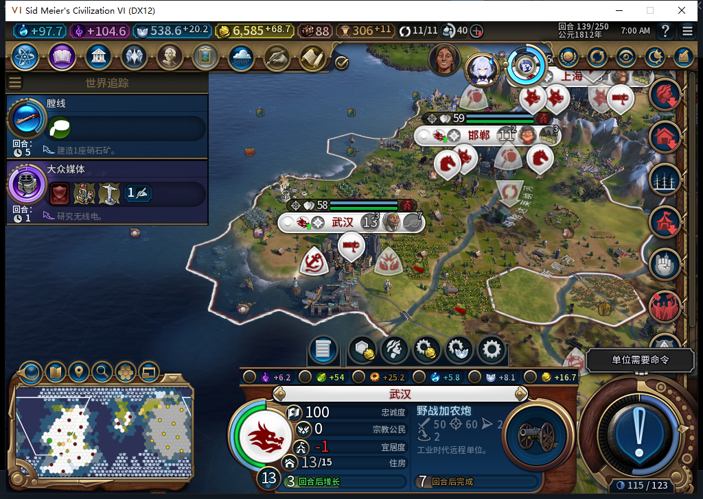
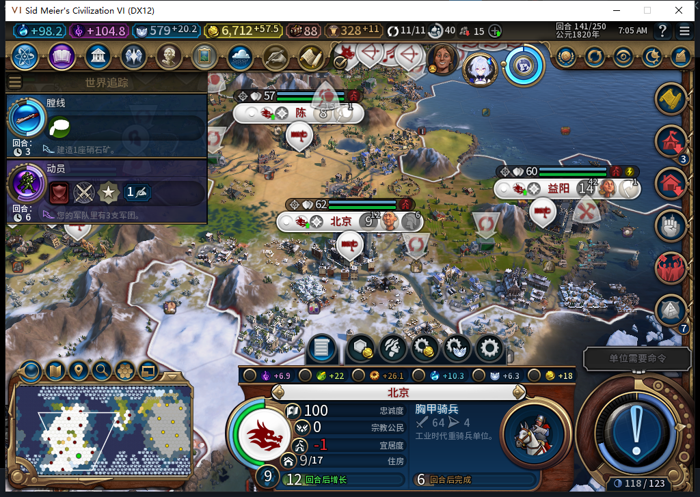
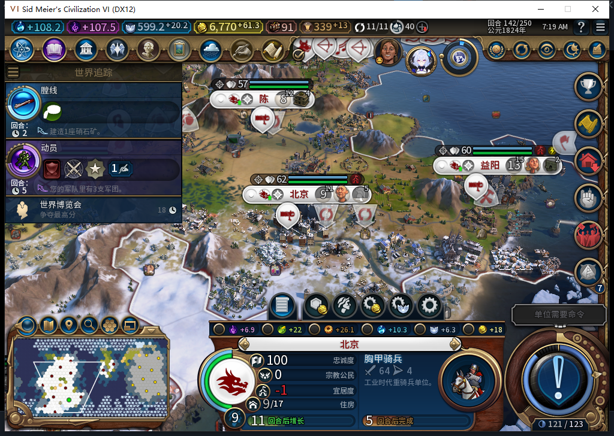

# 缺硝石时改选胸甲骑兵，恢复资源后保留现有生产

77开发版在独立副本验证了资源不足分支：北京准备补充前线军队时只有9硝石，线列步兵需要10，原版完整生产资格为false；后台改排耗铁的胸甲骑兵。下一普通回合硝石自然增到12，步兵资格恢复，但胸甲骑兵队列继续推进，没有被重排。主线148随后已正式恢复并核对一致。

这次只授资源短缺下的选择与恢复后队列保持通过，胸甲骑兵尚未训练完成。完整TC-007、40项矩阵、净收入下限和其他精确边界仍未全验；工坊Alpha74没有随本记录更新。

## 独立副本与前置条件

先保留主148，另载入已有正常138存档：13座城、24支健康军队、0军队队列，金币6516.9765625。明确的QA夹具只扣低这份副本的硝石，不改金币、信仰、城市、单位、生产、就绪状态或未知回执，不加资源、不退款。

资源接口最初仅有[作者实测笔记](https://github.com/Hemmelfort/Civ6ModdingNotes/blob/master/文明6_Lua手册.md)可供参考，不能当本机签名已通过。负责人先执行一次Core硝石Index44的-1资格检查，实际28→27，全部54种资源只有硝石变化，其他资产计数保持；再用不同唯一意图一次扣除已知剩余27，实际27→0。此时UI实际库存也是0，线列步兵可见资格true、完整资格false。两次均有前后审计，属于测试夹具，不是AI经营或正常消耗。

Core和UI的较高资源读值存在差异，不能互换。例如原138硝石28／25、铁27／25；本次低库存0、3、6、9、12均分别读回。结论使用生产请求前UI实际库存和原版费用、资格，不自行解释高值差异。

## 缺硝石不妨碍其他合法生产

139回合硝石自然积累到3。武汉后台排入不耗战略资源的野战加农炮0/165，另一城排入建造者；缺硝石没有让所有城市停工。

140库存6，141库存9。北京原社区自然完成后，后台准备补兵；城市派发入口在原版函数调用前，实际记录如下：

| 141北京派发前实测 | 结果 |
| --- | --- |
| 硝石／线列步兵硝石费用 | 9／10 |
| 线列步兵可见／完整资格 | true／false |
| 铁库存／胸甲骑兵资源费用 | 25／10 |
| 金币 | 6712.9375 |
| 实际后台请求与队列 | 胸甲骑兵，0/165 |
| 原有武汉炮兵 | 57/165 |

这一窗口仍是13城、24军队，已有与新增两项军队队列合计26，需求按每城2计算。没有把入队算作新军队出生。原生通知对北京同一社区完成重复到达两次；这里只计同一处完成，城市派发中胸甲骑兵只有一次请求，不将通知重复算成两个区域或两次生产。

## 自然积累足够后，不清空已有队列

测试玩家处理普通军队待命、外交及世界议会，没有手动操作文职或生产，也没有使用UserForced。议会后的142库存12，线列步兵两种原版资格均恢复true。北京仍生产原胸甲骑兵，进度51/165；武汉炮兵82/165。投票产生的原版效果和先前141短缺证据分开，不拿跨议会的产能变化推算固定回合产量。

连续观察覆盖BaiqiExecutor的CityManager实际派发：138安装至142清理，共8次BUILD，其中4次单位请求为两次建造者、一次炮兵、一次胸甲骑兵；军事请求2次、线列步兵0次。142另外4次为图书馆、工厂、排水系统、银行。外方、未知、记录错误、资源读取错误和溢出均0。内部未确认承诺无法直接读出，保持未知，不伪造0；范围也不扩成全部游戏上下文无请求。

资源支付还保留读值限制：Core铁在140为27、141为17，与费用10一致；UI派发前25、之后17，涉及上下文和回合积累，不能仅拿这两个UI数声称精确扣10。没有给资源填平差额，也没有以此授完整资源结算矩阵通过。

## 清理与主线恢复

精确恢复城市派发原函数，移除3个观察事件，保存独立142。再校验主148原哈希并正式加载一次，实际Core／UI共同确认14城、金币7107.87109375、军队维护费54；炮兵8192051仍在9,10、步兵8257581仍在15,5，均2行动，原炮兵队列0/165保持。旧与本轮观察绑定均无残留。恢复主存档不算给资源副本退款，私人存档不公开。

本轮产品代码未改；14项观察器透明性与资源读取检查通过，复用既有8项事件资格不重复计数。77原有1064项软件通过未重跑。Steam保持离线、0上传，工坊仍是Alpha74。[结构化证据、存档指纹、模型449审阅与原件哈希](../research/baiqi-p6-military449-native77-resource-shortage-evidence-2026-11-06.json)。[低金币储备分支](baiqi-military-low-reserve-77.md)、[主线军队真实完成与玩家指挥](baiqi-military-born-control-77.md)。
