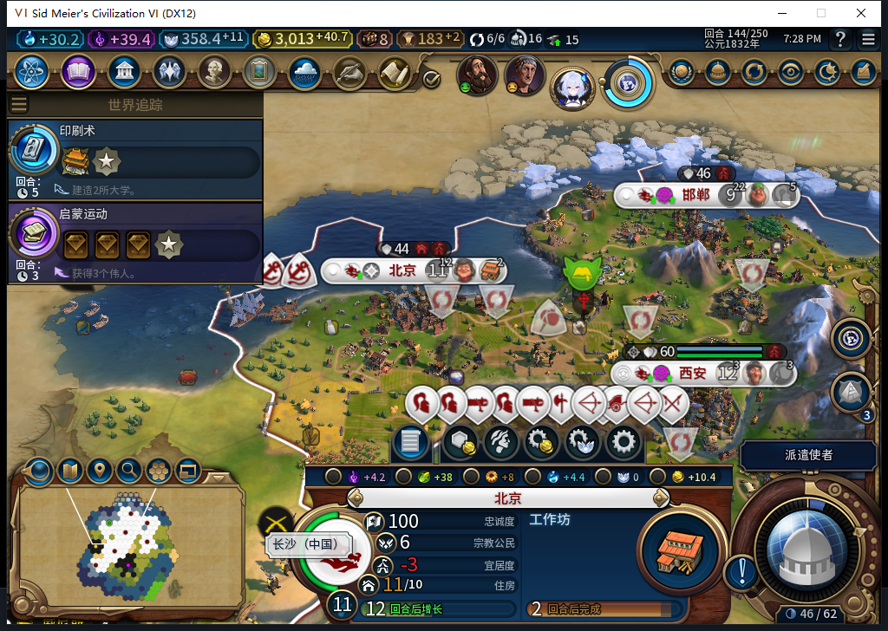

# 105实机144：转往北京并耗尽，完成传播不等于转教

首都之后，白绮把第二名传教士自动带到北京。142四次移动、143传播后余1次，144最后一次也已确认完成，单位耗尽后退出。北京仍是11人口、4名佛教信徒，原生多数宗教为-1；143至144信徒整数没有增加，不能把完成回执写成北京转教。144切点还没有第三次购买，继续观察下一名的正常征购和运转。

这张原图显示北京正在建工作坊、忠诚100，宜居度-3；宗教公民6是各宗教合计。独立原生读回的佛教信徒为4，而非面板上的6。当前7城粮食样本非负、没有饥饿倒计时，忠诚均100且正变化；宜居度不足和小视口底部裁切仍须继续检查，不能据此称长期稳定。

144同一单位3670037持久化记录religion:0:6为OBSERVED，UI原日志同时出现`proof=core_final_charge_receipt`。UI存活传教士0；Core暂留同ID的延迟死亡对象，次数0、死亡true、坐标-9999，不能把Core枚举1当成还有一名存活单位。购买账本仍只有136花70和140花80的两笔。

140读档后的透明观察器至144共809条：765招募读取、6城市操作、38单位操作、0单位命令，0错0丢。单位类型仅建造者、移民、商人和传教士；城市命令0。范围只覆盖白绮执行环境，并非全游戏全上下文统计。观察器仍挂，未制造任何游戏命令。

143普通结束只发一次。罗马提出使馆请求后，测试玩家在原版外交界面拒绝一次并告别一次，随后实际进入144，没有重发结束回合。一次因旧截图而被阻止的点击尝试没有输入，提前按144读取的诊断也被回合守卫拒绝；均未当作成功证据。没有手动文职、购买或传教命令。

144正式保存1502716字节、SHA-256为`782cc2f1739dc331069e6b4a5b78a6f338dcb06896f9d61a7dc0af761c2d4f16`，尚未重载。只授予第二座己方城市的最后一次传播回执窄通过。旧已发令移民ARMED读档恢复仍FAIL，40项完整验收、5城20回合功能窗、10城性能、基础版／迭起兴衰等缺口保持。

本轮新增两个真实本地模型任务：工具候选与本段图解。两次均完整stop/合法JSON，实际HTTP重叠1.743283秒；工具原补丁损坏、顺序不符且缺测试，未采用原代码；图解仅采用事实表达后重写。负责人诊断工具新增4方法、共14方法通过及Lua5.1编译，不重报此前完整1598运行。完整请求和原候选留忽略目录。

Steam他机占用，0上线／登录／下载／上传初始化或上传。工坊Alpha2仍内部82；105证据、原图和待发布BBCode仅入库。

[逐城信徒CSV](baiqi-source105-followers142-144.csv) · [结构化证据](../research/baiqi-p6-source105-beijing-final144-and-diagnostic-bound-evidence-2026-11-09.json) · [141首都转教](baiqi-capital-religion-postreload-105.md) · [观察器上限与撤除合同](baiqi-finance-observer-bound.md)
