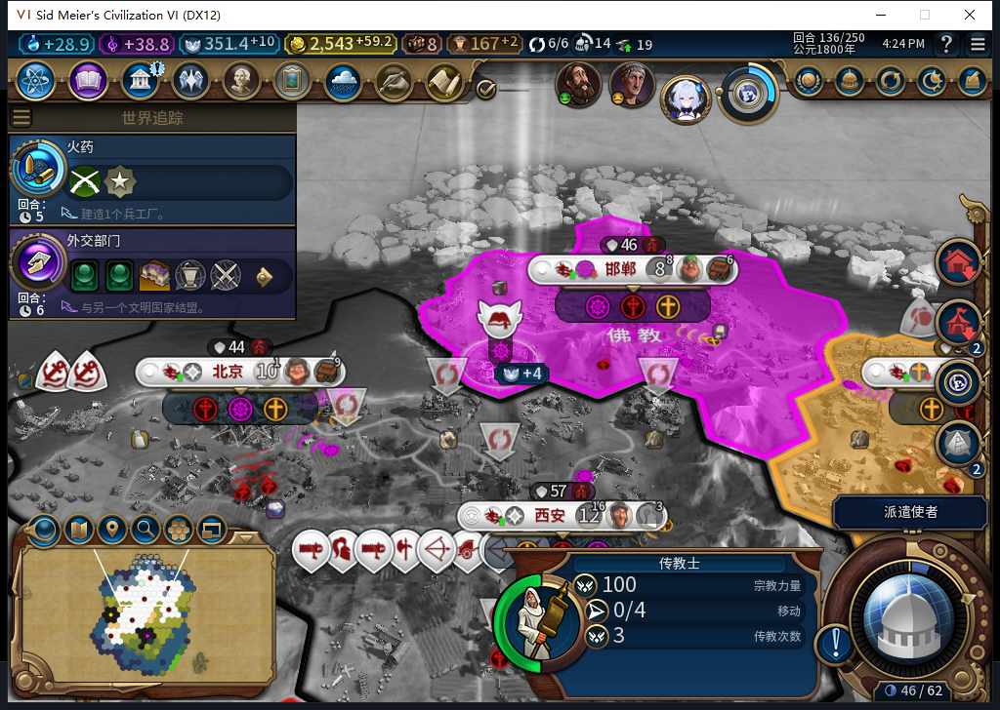
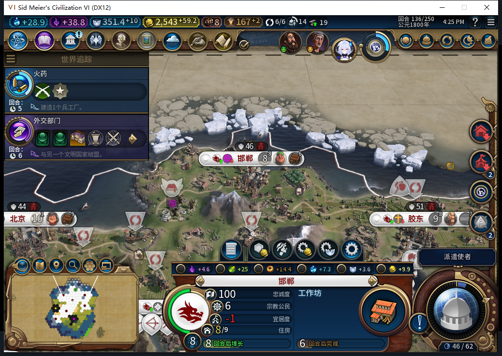

# 136实机FAIL与104软件修复：传教士出生在圣地

邯郸神社正常从133的0/35推进到134的19、135的33，136完成并接续工坊。白绮随后发出一次原版传教士购买：421.4140625信仰实际扣到351.4140625，花费70，出现佛教传教士3407893、3次传播、0/4行动。这里确认神社完工、购买请求与实际花费／单位出现，不能记为购买回执或国内传播通过。

阻塞在回执判定。记录把购入城市中心56,38当作单位出生点，实际传教士出现在邯郸圣地54,37。原来的坐标检查拒绝闭合，日志仍为missionary-purchase:0:1、ARMED；共享信仰消费与宗教托管继续等待。没有退款、代买、补信仰、移动／传播或重发购买。136未结束，真实失败存档1450072字节、摘要已核验并保留，尚未重载。

104保留市中心路径，并增加严格的本城圣地匹配：Core按圣地类型GetDistrict取得本城区域，核对完整／未劫掠、区域所属城市及城市中心身份，再核对出生地块的区域ID、类型和所有者。不是附近任意圣地，也不硬编码这次的786443。Core的城市区域集合没有Members，实际可用的是GetDistrict；GetCity返回城市对象，地块没有GetPurchaseCity，均已在失败现场只读核验。

原有同回合、精确扣款、唯一新单位、原宗教、剩余次数、独立编队和旧单位基线检查保留。写入OBSERVED前重读完整快照和实际演员、资金、城市与区域，检查日志未变；未知则继续保留许可。没有改变购买报价、Prepare、实际购买写入点、日志格式或信仰共享保护，也没有新增收益／补款路径。这个修复的预期是观察已发生的真实效果，不是补发购买。

8项新检查对旧103有2失败；模型原稿在同8方法有9失败事件（含子场景），既不能通过圣地出生正案，还删除原城市中心坐标守卫而在隔离身份漂移反例里假报完成。原稿helper在local Hash声明前引用它、仍硬编码786443、把城市中心与圣地坐标要求相同、比较Native对象引用、没有最后新鲜性复核。原稿整份拒绝、0实机执行；负责人独立实现。新8项及原有实际23项许可检查通过，完整1577项1576通过、1项官方SDK条件跳过；86个产品Lua5.1编译、108文件包与源码逐字节一致。1577包括此前1562、573工具7和这次8，不把新增工具算产品实机通过。

切点源码104、实际安装与运行仍103，104尚未冷实测。新旧城市中心与圣地路径、未知资格、错城／错区域、复核时扣款或位置变化、保存后观察幂等均有软件检查；真实136恢复能否在不再扣费、不再购买的情况下闭合，还必须冷读复测。传播日志已在购买前初始化为空，136仍序号0／条目0，没有把传教士追认成已传播。国内传播仍开放。

两只观察器已撤除：城市命令只有上述1次购买，0错0丢；发令观察1572条，其中31次单位操作均为建造者／移民，0错0丢，尚无传教士移动或传播请求。只覆盖白绮执行环境。失败诊断最初误用UI的城市区域迭代接口而停止，未执行保存；随后独立正式保存完成，再核验Core实际接口，没有把诊断错误当作第二次购买或重放动作。

574普通HTTP完整stop/DONE/JSON、1请求、14746+1161=15907 tokens、9.868998秒，全部候选拒绝。累计574任务／535完整／36截断／3最终传输失败、604HTTP／30额外重试，新OpenCode原生生成0，未知缓存／人工成本null。用户报告Steam他机占用仍有效，整轮0私自上线、登录、下载、上传初始化或上传；工坊Alpha2仍内部82。旧已发令移民恢复FAIL、国内传播、小视口与显示故障、基础版／迭起兴衰及完整40继续验收。

[结构化证据](../research/baiqi-p6-religion574-holy-site-birth-receipt104-software-and-native136-fail-evidence-2026-11-09.json) · [8项出生地检查](../../tests/test_baiqi_missionary_purchase_birthsite.py) · [实际Core夹具](../../tests/missionary_purchase_holy_fixture.py) · [133开工与信徒基线](baiqi-shrine-start-and-followers-133.md)
