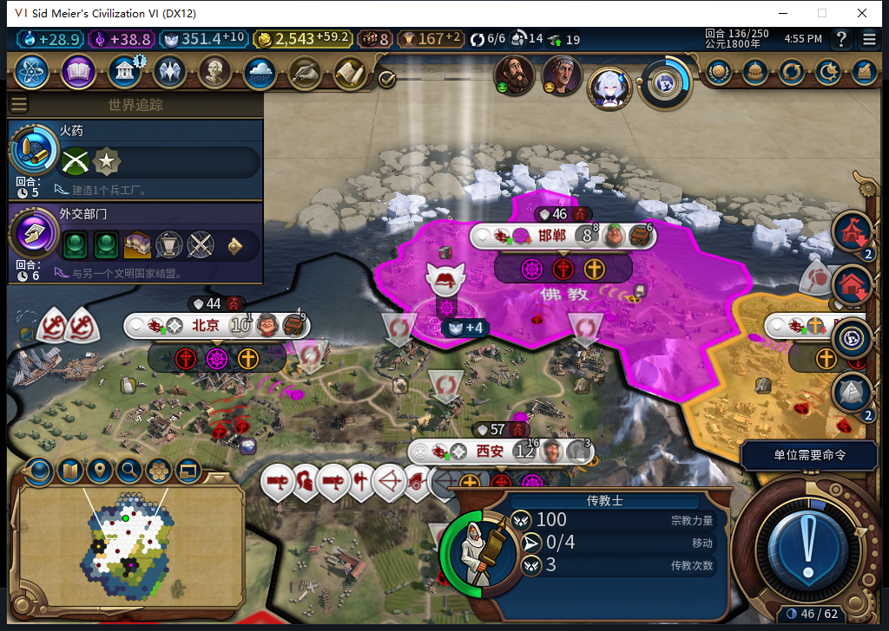

# 104实机冷读136：确认原传教士，不再扣费

103在神社完工后实际花了70信仰购入传教士，但它出生在邯郸圣地54,37，旧回执只认市中心56,38，于是宗教托管继续等待。保留这个真实失败存档，安装与已推送源码逐字节一致的104（108文件），正式冷载同一136回合后，模组自动把原购买记录从ARMED改为OBSERVED。验收只读取属性和实际单位，没有调用Inspect／Prepare或手动补买。

| 核对项 | 103保存前 | 104冷读后 |
| --- | --- | --- |
| 购买记录 | missionary-purchase:0:1，ARMED | 同一记录，OBSERVED |
| 已付代价／余额 | 70／351.4140625 | 70／351.4140625 |
| 场上传教士 | 1名，3407893 | 同一名，3407893 |
| 位置／宗教／传播次数／行动 | 圣地54,37／佛教／3／0 | 保持 |
| 传播日志 | 序号0，0条 | 保持 |

原图能看见单位、次数、行动及余额；OBSERVED来自独立的Core属性读回。原单位没有消失或多出另一名，余额没有再扣70。世界经济宗教行、7城队列、建筑、区域、己方地块、全部单位，以及7城粮食和信徒样本均逐行保持。这里只核对采到的自有状态，不宣称整个世界静止。

因此授予“同回合已支付但未确认的购买回执，冷读后自动恢复”通过。不能据此授予104从零正常购买、跨回合任意未决恢复或国内传播通过。传教士仍3次传播，传播日志为空；后续要看后台实际移动／传播请求、次数消耗及信徒变化，不能把普通宗教压力导致的转教算进去。恢复后的136已正式另存并核对稳定字节1449339，尚未重载这份新保存点；原失败保存也保留。

本次加载ACK与实际世界读回分开核验。加载画面由暗转亮使图像比较守卫拒绝，拒绝前0输入；重新审阅新鲜原版“继续游戏”画面后只点击一次。一次只读Core诊断误用了UI才有的信仰数接口，0游戏动作，核验实际接口后纠正；不算产品故障。自有103退出残留超过180秒、无窗口／端口且CPU不变，只清理这一已校验保存的游戏进程；正常退出清理仍未通过。

两个被动观察器在136恢复后新装，供下一普通回合使用；引导期间的原生命令次数没有直接观察，保持未知。软件检查沿用已发布1577项（1576通过、1官方SDK条件跳过），没有为本次实机记录重跑旧绿或声称新增测试。

575文案候选完整stop／DONE／合法JSON，1HTTP、6139+773=6912 tokens、5.669021秒，但照抄旧软件报告，错误写成104尚未冷验及运行仍103，并把后台购买归给玩家，整份拒绝。负责人依据实际回执独立撰写。累计575任务／536完整／36截断／3最终传输失败、605HTTP／30额外重试，OpenCode原生生成0，未知缓存与人工成本null。

用户报告其他设备使用Steam的限制持续有效。当前实例启动前取得新鲜后台只读离线证明，证明年龄0.008590秒；菜单头部导航另记为输入，未选择模式项。整轮0上线／登录／下载／上传初始化或上传，工坊Alpha2仍内部82。本图和BBCode只入仓库。旧移民已发令中断恢复FAIL、完整40、基础版／迭起兴衰与小视口仍待验。

[结构化核对与摘要](../research/baiqi-p6-religion575-source104-cold136-receipt-recovery-evidence-2026-11-09.json) · [103失败与104软件修复](baiqi-missionary-birth-receipt-104.md)
