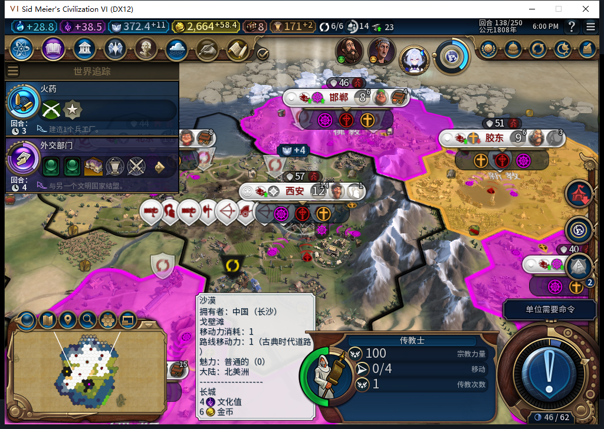
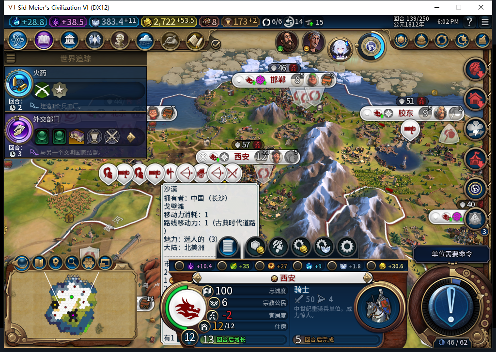

# 105实机139：最后一次传播回执与UI收尾通过

安装与已推送8fd38e7逐字节一致的105（108文件），冷载104剩最后一次传播的138检查点。实际138的七城信徒、原传教士与信仰样本及7城粮食保持一致。测试玩家只让军队待命2次并普通结束138，白绮在139自然发出一次传播。

原记录religion:0:3本次自动成为OBSERVED，不再停在104的ARMED。Core同一演员进入0次数／删除坐标，UI存活名单中原单位消失；真正闭合依据是新修复匹配的原版传播开始与次数1→0事件，并非消失本身。Core属性读回及原始Lua.log分别确认：日志保留同一token／turn139，UI输出唯一一条core_final_charge_receipt，清除了本地等待项。

| 项目 | 104失败139 | 105重做139 |
| --- | --- | --- |
| 传播请求 | 1次 | 1次 |
| 最后一次持久化记录 | ARMED | OBSERVED |
| UI最后一次等待收尾 | 未完成 | 原生日志确认完成 |
| 信仰余额 | 383.42578125 | 保持 |
| 首都佛教信徒／多数 | 5／仍非多数 | 保持 |

原图没有回执文字；OBSERVED与UI等待收尾来自独立属性和游戏日志。城市面板“宗教公民6”是各宗教合计，不能读成佛教6，原生佛教信徒实际5。地形悬浮框仍是长沙地块，不能据它判断传播目标；目标西安65536／55,34由持久化记录核对。首都尚未成为佛教多数。

与104失败139相比，世界经济宗教行、7城队列、建筑、区域、己方地块和单位六组采样逐行相同；改变的是此次回执及UI收尾。只比较这些自有样本，不宣称全世界不变。观察137条（128读取／1城市／8单位操作），其中仅1次本传教士SPREAD，其余建造者／移民，0错0丢；城市购买命令0。未调用诊断Inspect／Prepare或手动移动／传播，没有补单位或重复购买。引导前命令次数未直接观察，保持未知。

本次最终次数收尾窄通过。139完成点已正式另存1463574字节、摘要核验，尚未重载；138及104真实失败点都保留。观察器仍挂，接下来验收普通新购买及完成态保存读回。未改变“旧ARMED缺少新事件仍未知”的处理，也不关闭旧移民恢复FAIL、完整40、基础版／迭起兴衰与小视口缺口。

0新HTTP，本次只是578已发布105实现的实机跟进；原完整1598软件检查保持。Steam14904同实例，启动前后台只读离线证明年龄0.045483秒，查询0输入／激活／移动／截图；正式菜单头部导航另记，0模式项选择。用户其他设备占用限制持续有效，整轮0上线／登录／下载／上传初始化或上传，工坊Alpha2仍内部82。本两原图及待发布BBCode只入仓库。

[结构化Native／日志／前后核对](../research/baiqi-p6-source105-native-final-charge-receipt139-evidence-2026-11-09.json) · [105软件修复](baiqi-missionary-final-charge-105.md) · [104实际事件时序](baiqi-missionary-final-charge-events-104.md)
