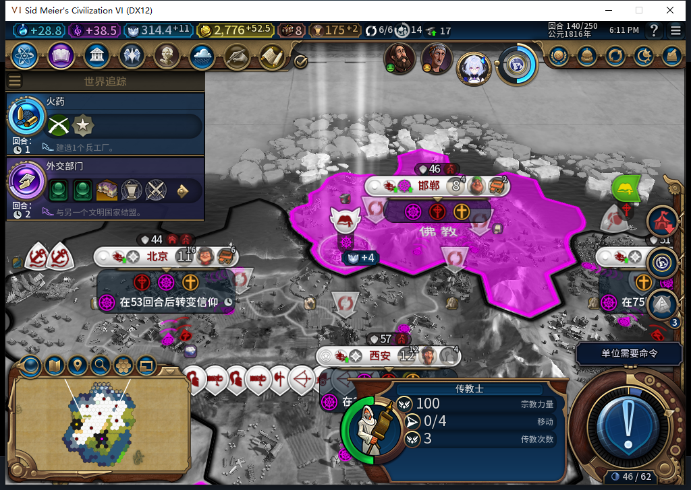
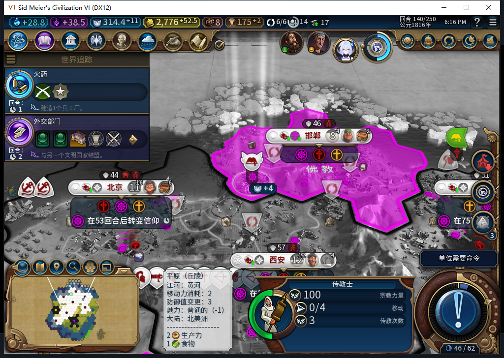

# 105实机140：正常续购传教士，完成态重载保持

140回合，白绮正常支付80信仰，余额从394.4296875降到314.4296875，在邯郸圣地买入一名新的佛教传教士。旧单位已在139耗尽，现场只有这一名新单位；这次有新的已确认购买记录，与旧购买重发区分。

原购买missionary-purchase:0:1保留136／70信仰／演员3407893；本次missionary-purchase:0:2为140／80信仰／新演员3670037，两条都OBSERVED。被动城市命令观察只捕获1次信仰购买，参数对应UNIT_MISSIONARY、YIELD_FAITH与原版编队值；新单位实际在本城圣地54,37，佛教、3次传播、0行动、独立编队。没有测试玩家购买、补信仰或调用桥来促成收尾。

139余额383.42578125，到140正常增长至购买前394.4296875再扣80；不能拿跨回合净变化当作价格。首次70与本次80是两个真实报价，不据此猜通用涨价公式。

140正式保存1464129字节、摘要核验，撤除两个观察器后，正式重载同一保存点。Load ACK、原版继续按钮及实际世界读回分别确认，未结束140。

| 读档核对 | 实际结果 |
| --- | --- |
| 世界经济宗教行／7城队列 | 逐行相同 |
| 24建筑／20区域／103己方地块／23单位行 | 逐行相同 |
| 7城粮食／信徒与当前传教士 | 逐行相同 |
| 两笔购买、上一名单位最后一次传播、先知完成记录 | 保持OBSERVED／原token |
| 信仰余额／新传教士 | 仍314.4296875／同3670037，3次、0行动 |

因此授正常105续购与这次完成态正式存读档窄通过。所测状态未出现额外扣费、单位或收益；引导期间原生命令次数没有直接观察，保持未知，不能说引导0调用。图中位置及余额是实机原图，记录token与前后比较来自独立Native只读数据。

105从冷读138到140实际2个普通回合、2次普通END请求、4次测试玩家军队待命，0UserForced／手补内政。读档前观察270条（256招募读取／2城市／12单位操作／0单位命令），12操作均建造者、移民或原传教士，0错0丢；城市命令1／0错丢，全部已撤。140粮食非负、无饥饿倒计时，七城忠诚100且正变化。读档后尚未新装观察器。

579只针对140实际事实写两句文案，1HTTP、985+84=1069 tokens、1.015649秒、stop／DONE／合法JSON。部分采用数值表述方向，负责人重写“重play”与模糊“独立新事件”，删去任务未要求的未验证总结；文案采用不算代码或游戏动作采用。保存重载结论由负责人独立核验，不来自请求时尚未发生的结果。累计579任务／540完整／36截断／3最终传输失败、609HTTP／30额外重试，OpenCode原生0，未知缓存／人工成本null；完整1598软件检查保持。

下一步继续新单位的正常国内传播及城市转教。旧已发令移民ARMED恢复FAIL、40项完整验收、基础版／迭起兴衰、小视口和性能仍开放；本次完成态不能覆盖旧未决恢复。用户其他设备占用Steam的限制仍有效，整轮0上线／登录／下载／上传初始化或上传，工坊Alpha2仍内部82。两原图、解读及BBCode只入仓库。

[结构化购买／逐项重载证据](../research/baiqi-p6-religion579-normal-purchase105-and-reload140-evidence-2026-11-09.json) · [105最后一次收尾139](baiqi-missionary-final-charge-native-105.md) · [105软件实现](baiqi-missionary-final-charge-105.md)
