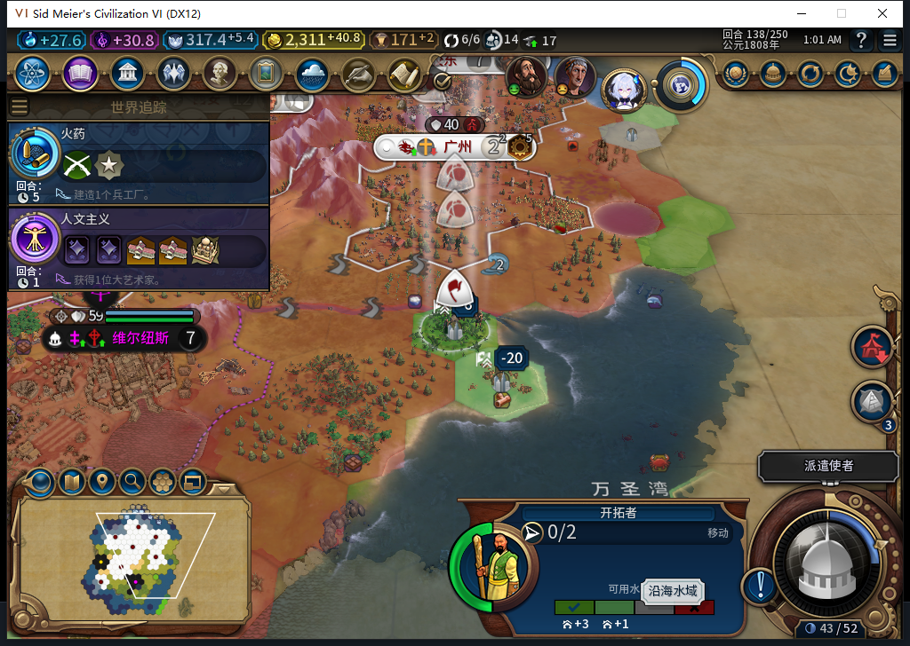

# 95软件修复：拒绝原版明确警告负忠诚的城址

94在139回合建立上海后，每回合忠诚为−9.5625。独立读取130档并正常推进到138后，发现同一城址2131／59,28在建城前已有原版负忠诚警告−6。95把这一明确负值接入现有选址检查：推荐、旧目标和最终建城前复核都能拒绝它。软件验证已通过，95尚未安装实测，不能写成上海风险已修复。

[完整证据、候选审阅与成本](../research/baiqi-p6-native-warning95-model548-evidence-2026-11-09.json)。[94上海失败现场与五张原图](baiqi-shanghai-negative-loyalty-native-94.md)保留，不被本次软件通过覆盖。

当前仍是94：七城、二十五单位，新移民3211284位于59,28、移动队列为空、保存目标2131。138已正式保存，1479619字节，SHA256为ae6771a3493d88297b5dcbb11e1a3f81f985af25b7580311f1e83c32729ef396；尚未加载，尚未发送138→139结束。139失败档另存保留。图片为已查看原图；图中另一个邻格的−20标签不冒称目标2131的−6。

读取前仍选中本方虎蹲炮3473431，水源镜头关闭，原版已返回KNOWN_NEGATIVE／−6；只执行原版“选择查看”移民后，选中身份3211284、镜头开启，结果仍−6。两次读取各自前后上下文稳定，没有移动文职、切镜头命令、修改属性或私有产品调用。这对照说明本样本的负值在镜头关闭时也可取得，不证明所有警告都完整、新鲜，亦不把−6当成建城后总忠诚预测。

产品复用[原有警告读者](../../tools/lua/settlement_warning_info.lua)的相同字节，加入[产品模块](../../mod/Baiqi/Lua/BaiqiSettlementWarning.lua)及清单。已有检查在首都例外之后读取当前目标的警告；KNOWN_NEGATIVE直接拒绝，缺模块等待，UNKNOWN、NOT_APPLICABLE和KNOWN_NONNEGATIVE继续此前的城市稳定、几何与原生最终资格检查。缺失仍是UNKNOWN，非负不是新通行证。不缓存警告、不选单位、不抢镜头、不增加军队或外交动作。

新增13个unittest方法，通过真实Controller消费者覆盖推荐、已保留目标、最终原生资格期间才出现的负警告、数据变化、现有城市衰退、缺条目、Base、首都、依赖缺失、异常与未揭示地块。相同13项对94基线有8失败、0错误，95全部通过；其中一个方法复用原来的34个读者场景，不把34再算成新增场景。完整1352运行／1351通过／1SDK环境跳过；105文件包与源码逐字节一致，83个Lua5.1编译通过。包8781475字节，SHA256为decfe3427b1fd560407135ad2db97564d370bea67bb365c22554808b860bd73e，未安装。

548为真实小接线任务，一次HTTP完整stop／DONE／合法JSON，6461+883=7344tokens，6.431秒。原稿两份hunk都混入展示行号，不能直接匹配源码；include位置也与要求不同，拒绝该hunk。负责人去掉行号、加强模块类型检查后部分采用守卫逻辑，独立完成include／清单／版本／夹具与测试。没有新生成警告算法，也没有把原稿发入Native。输入已提供实际API、消费者和预期行为，不将此记成自主发现。Nov9维护复用547前的新鲜成功缓存，OpenCode新原生生成0。

累计548逻辑任务／511完整JSON／34截断整弃／3最终传输失败／578HTTP含30额外尝试，未知缓存tokens和人工节时保留null。复现途中一个只读异常帧停止了流程，新鲜137就绪后才发新的137结束；一次过期截图拒绝0输入，后续静态完整区域匹配并重新截图后才点击。没有重放未知动作。

下一步在新鲜后台离线确认后冷启动95，加载同一138档，验证实际拒绝旧坏城址、保留移民及后续安全扩张。旧139、92忠诚失败和ARMED／LEGACY恢复、宗教、兼容、性能、完整40项均仍开放。Steam其他设备占用禁令持续，0模式切换／上线／登录／下载／上传器初始化／上传，公开Alpha2仍82／12图。
