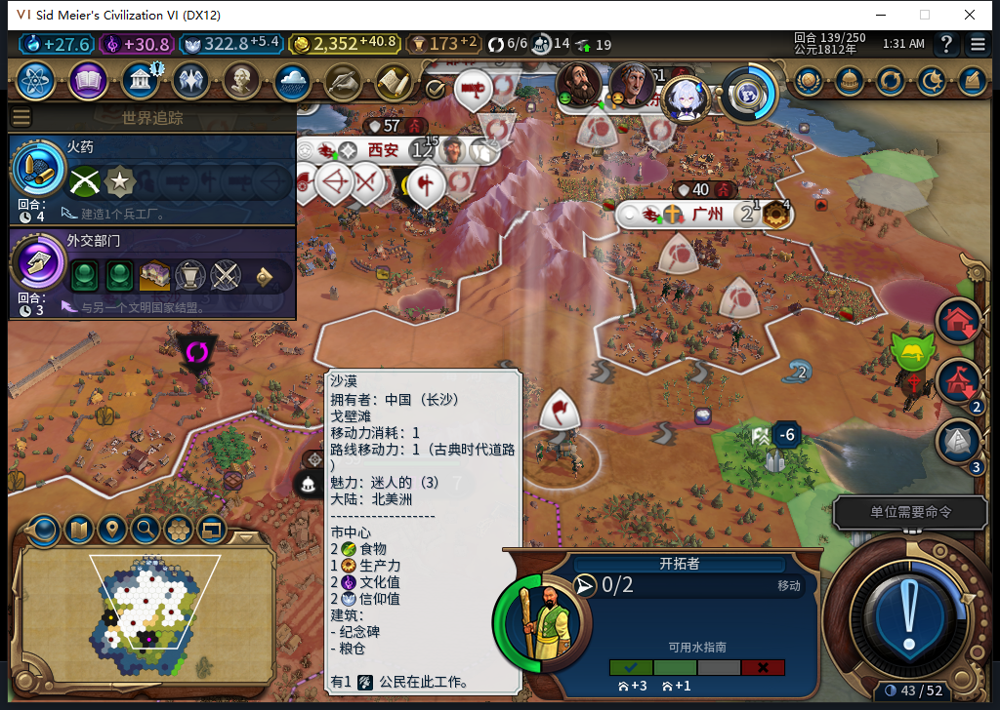

# 95冷实机：旧坏城址被拒绝，移民保留并改道

后续[138→152续验与6张原图](baiqi-warning95-followup152.md)：同移民确实改道建秀容，但初始忠诚每回合−2.6875，已保存停止END。下文139旧坏址拒绝窄PASS保持，不能扩成新址安全。

95加载同一份94的138回合建城前存档后，139没有建立原来负忠诚的上海。七城、二十五单位保持，同一移民3211284从59,28向西走到57,28，保存目标改为1902／52,25。观察器记录该移民两次MOVE_TO、零次FOUND_CITY。这关闭的是本次旧坏城址拒绝和改道的窄检查，新城址的建成与长期稳定仍继续验收。

[14行队列](warning95-138-139-queues.csv)、[14行城市状态](warning95-138-139-vitals.csv)、[机器与逐项证据](../research/baiqi-p6-warning95-native139-evidence-2026-11-09.json)。[95软件验证](baiqi-native-negative-warning-95.md)和[94旧失败](baiqi-shanghai-negative-loyalty-native-94.md)保留各自切点。

原来94在139创建上海并出现100／−9.5625；95同档起点实际读到原版−6警告，随后移民保留、旧目标替换，既有城市继续生产。七城忠诚均100且每回合变化为正：北京工坊12→22，广州工业区28→42，太原纪念碑0→4。截图是已查看原图，没有拼接、裁剪或改数字。

升级前自己的94游戏正式退出一次，116.554秒后确认进程不存在，无强杀。95安装105文件与已推送源码及zip一致；同一Steam实例后台只读实际读到“上线...”，UTC2026-11-08T17:23:33.869976确认离线，证明距启动0.002574秒。正式菜单头部导航单列为输入，之后后台确认无输入／激活／焦点变化／移动／截图；没有选择模式项。新95进程22408，4318端口126上下文；原版加载138和继续各一次，未重放。

加载后程序比对的己方总览1、城市7、单位25、建筑25、区域19、可见己方地块98，与94独立138基准完全相同。这不代表全世界相同或加载后台零动作。一次截图激活失败发生在PNG前，随后只聚焦自有游戏；加载页未就绪时没有输入，看到原版继续按钮后重新取图精确比对再点击。第一次有界等待在139仍忙时停止，新标签只读确认就绪后才采样，没有重发结束。

本窗口为3次玩家军队待命、1次直接普通结束、1次实际换回合，0人工内政、0军队移动、0UserForced。透明观察器138安装后到139共7个单位操作，包含该移民2次移动；0单位命令／错误／丢样，只覆盖Executor绑定。139样本冻结时观察器仍装着，后继窗口的读取和撤钩另记，不能把这7条说成最终总量。

本次无新HTTP或软件用例；累计仍548任务／511完整JSON／34截断／3最终传输失败／578HTTP，未知缓存和人工成本null。软件基线1351通过／1跳过；跳过项实际要求设置BAIQI_WORKSHOP_SDK_ASSEMBLY指向官方Steamworks.NET.dll，并非认定SDK未安装。

负警告拒绝不是完整忠诚预测；缺条目、非负警告、未来人口与时代变化仍有限。旧94／92失败存档、ARMED／LEGACY恢复、宗教、Base／RF兼容、性能及完整40项保持开放。当前正在继续新目标与长期窗口。Steam其他设备仍占用，0模式切换／上线／登录／下载／上传器初始化／上传，公开Alpha2仍82／12图。
