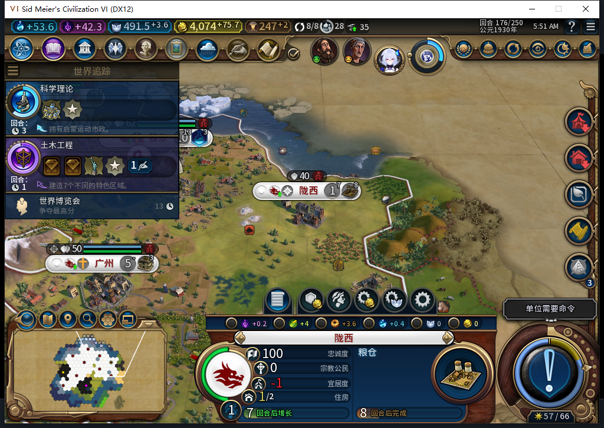

# 97：自然移民建成陇西，建城前警告仍记未知

2026-11-09，机器 `BF-202609141645`，GS／无蛮族，继续[97 的 20 回合分支](baiqi-food-focus-long-window-97.md)。产品仍固定在 `4da78ccc3f3a4f0ed21bc657458dca765da748b4`，没有更换模组代码或版本。

第 158 回合在邯郸自然训练出的移民 `4063259`，经过多次改道，174 到达 `62,34`、移动力为 0。175 自动建成陇西 `589832@62,34`，城市数 8→9；随后自行排入粮仓，176 实际由 `0/32` 推进到 `3/32`。175、176 两次城市状态读取均为 1 人口、忠诚 100／每回合 +17；没有派总督到陇西。176 粮食为 `0.9453125/7`、净粮食 +2、无饥饿倒计时。

这次测试没有手动移动文职、指定城址、建城、排生产、派总督或补粮。173→176 实际推进 3 回合，测试玩家发出 5 次普通 END、15 次军队待命，0 次 `UserForced`。174／175／176 的队列、忠诚、食粮各记录 26 行；175、176 的 9 城样本均忠诚 100 且变化为正、净粮食非负且没有饥饿倒计时。广州净粮食仍为 0，薄余粮风险保留。176 尚未结束回合。

总单位数在 174、175 都是 30，但并非旧移民仍在：完整名册中 `4063259` 在 175 消失，同回合有新建造者 `4653085`。原始自有保存属性中，该移民记录为 `OBSERVED`、城市 `589832`、地块 `2578`、回合 175、request `0:175:193`、token `settle:0:9`、empty=true、conflictingCity=false。既有目标日志也从 174 的 1 个目标／1 个移民变为 175、176 的已知 0／0。只读了原始属性，没有调用私有 Bridge／Inspect／Prepare／RunNow 或清除旧记录。

以前的新城负忠诚案例缺少与实际建城请求同一时点的原生警告。本轮在 174、移民到达且移动力为 0 时，安装一个被动观察器：只在现有 `UnitManager.RequestOperation` 的 FOUND_CITY 请求前读取公开警告，然后原样转发原函数一次。采样失败也不能阻止、重发或改变原动作。它只叠在 Executor 已有财务观察器外面，撤除时先撤外层、再撤财务层。

实际捕获一条建城前记录：175，完整单位 `4063259`、自有移民、`62,34`、地块 `2578`、移动力 2，保存目标与当前位置相符。原生警告为 `UNKNOWN / nil / no_warning_entry`；173 对同目标的读取也为未知。没有把无条目当成 0。事后陇西忠诚为正，只证明这个落点和短窗口；它没有验证负警告守卫命中，也不能关闭旧选址失败或保证未来保城。

外层观察器 1 条、0 错误、0 丢失，175 已撤除。财务 W4 共 659 条：635 次资格检查、5 次城市操作、19 次单位操作，0 单位命令、0 错误／丢失，176 已撤除。只有 1 条由 `4063259` 发出的 FOUND_CITY 调用，返回是 void。实际新城、演员消耗、保存属性 OBSERVED 和次回合生产进度是另外读取的效果证据，不用 void 返回代替完成。

本地模型任务 556 给出了观察器候选：完整 stop／SSE DONE／合法外层 JSON，1 次 HTTP，2944 输入＋601 输出＝3545 tokens，`4.1601312` 秒。原稿含 `!=`，Lua 5.1 编译失败；仅修语法后的隔离对照仍为 12 方法中的 2 FAIL／2 ERROR，涉及未知回调记录形状、操作值和撤除时的表身份。整段原稿拒绝，原稿 Native 执行 0 次。负责人替代工具的 12 项检查及原有财务工具的 10 项相关检查通过；只读采样回调另有 5 个隔离场景通过后才安装。测试包括参数／nil／void／原异常保留、16 条上限、外来绑定拒绝、发布失败回滚和嵌套观察器撤除。回调只读是本次负责人消费者的约束，不能推广为任意第三方回调安全。

通用工具：[diagnostic_found_warning.lua](../../tools/lua/diagnostic_found_warning.lua)，检查：[test_diagnostic_found_warning.py](../../tests/test_diagnostic_found_warning.py)。这个工具不包含在模组安装包内，没有生产代码或全量测试／构建重跑；97 的 1375 pass／1 SDK 环境 skip 基线继续保留原时点。复用同机同用户 11 月 9 日每日维护成功缓存，installed/latest 均为 1.19.5、updated=false；本次只有 1 个真实模型任务，没有为了并发目标凑请求。累计 556 任务／518 完整 stop 合法外层 JSON／35 length 丢弃／3 最终传输失败／586 HTTP／30 额外尝试／0 新 OpenCode 原生生成，当前 HTTP 在途 0，未知成本为 null。

176 已正式保存：`Baiqi_P6_20261109_V97_LongxiEstablished176.Civ6Save`，Save ACK true，重复读取稳定 `1689624` 字节，SHA-256 `2cf7785130032322fe961f3a7f968bb253868606b27d63902bda11e79828c5b8`。本交付切点尚未加载该档，完成态正式重载将另记；私有存档未入库。旧 ARMED／LEGACY 未决恢复没有因此通过。

数据：[队列](found97-followup174-176-queues.csv)、[城市状态](found97-followup174-176-vitals.csv)、[食粮](found97-followup174-176-growth.csv)、[建城前原始读取](found97-prefound175.csv)、[后台单位调用](found97-followup173-176-background-unit-calls.csv)、[目标清理](found97-followup174-176-goal-state.csv)、[结构化证据](../research/baiqi-p6-found556-longxi97-evidence-2026-11-09.json)。此前 5 张内嵌原图和文档已在固定提交公开 GET 验证，全部 200 且哈希相符，见[独立回执](../research/baiqi-p6-food97-long173-public-images-2026-11-09.json)。

自然先知／创教／传教士采购及传播、更多食粮边界、旧未决恢复、Base／RF、性能和完整 40 项仍开放。Steam 外机正在使用，0 次模式切换、上线、登录、下载、上传器初始化或上传；工坊仍是内部 82／12 图，本页是开发版证据。
