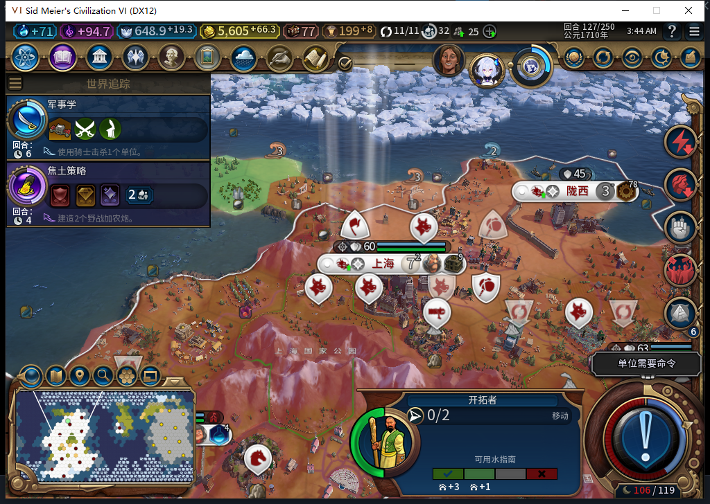
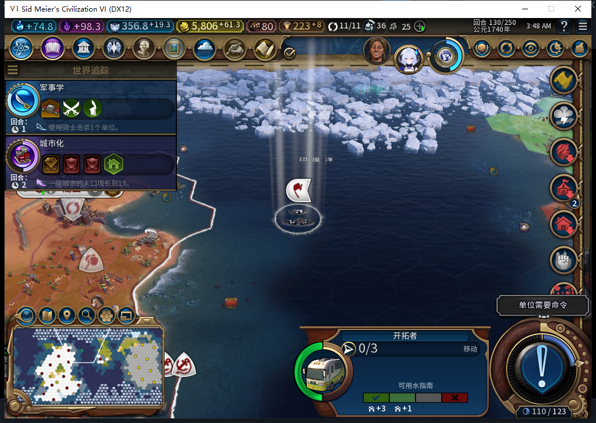
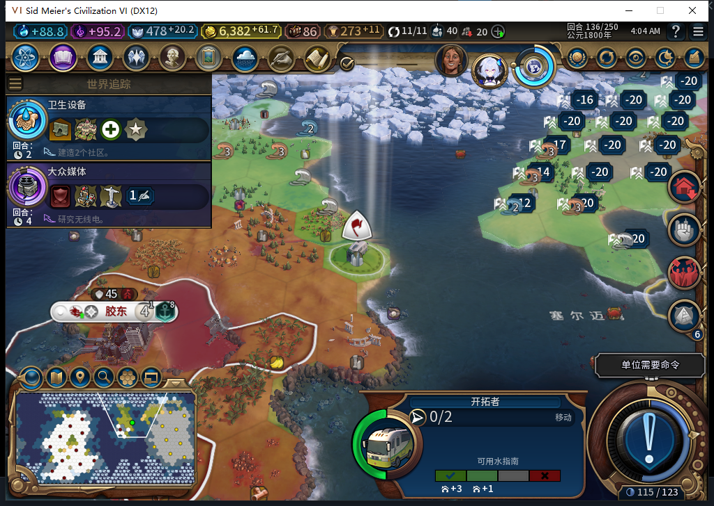
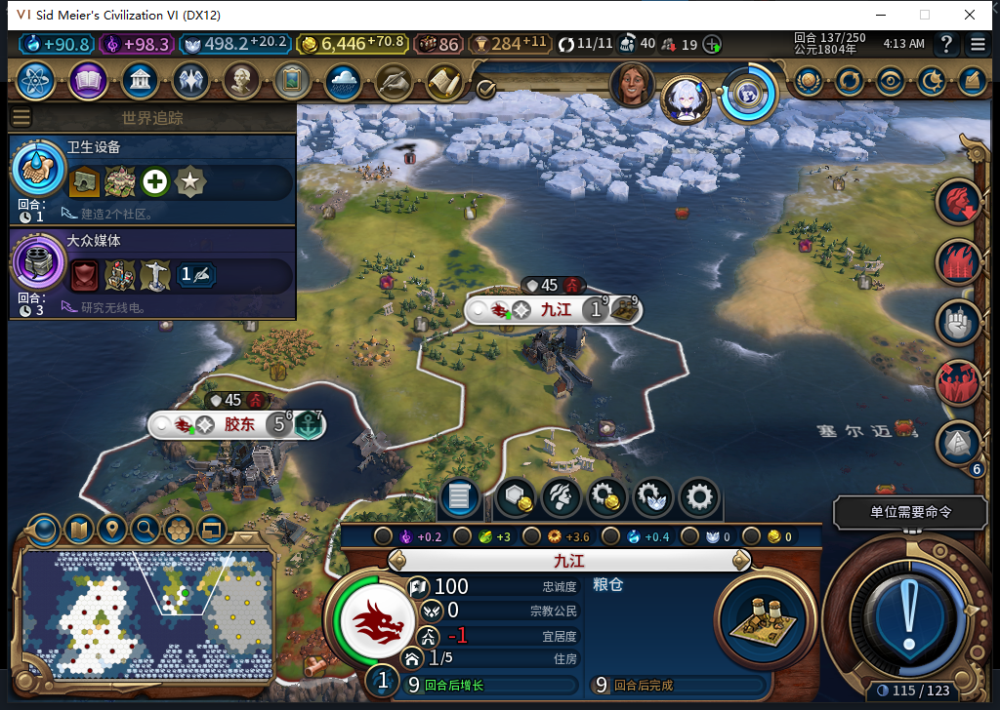
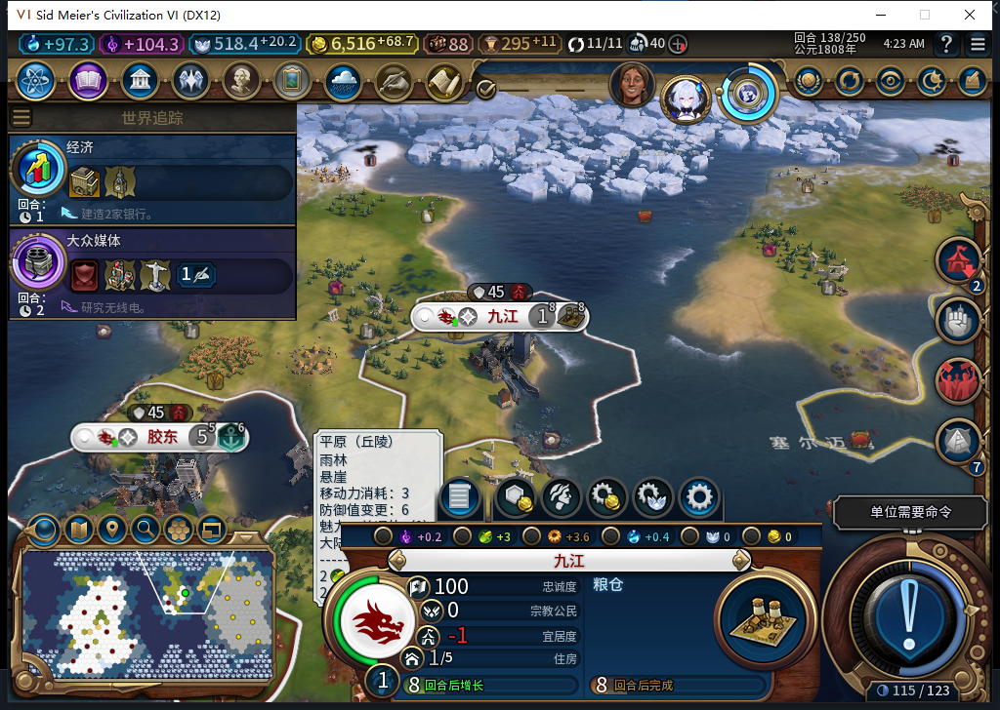

# 新移民绕过堵路、建成九江并接续生产

77实机复测关闭了上一轮“首条路径下一格被建造者占住，移民就不再尝试其他安全城址”的故障。同一个正常训练出的移民，从第127回合的失败存档继续，自行改路，在第137回合建立九江；正式保存、读档后，新城和队列保持，正常到第138回合，粮仓从0/32推进到3/32。玩家没有选生产、搬开阻挡单位或替移民移动、建城。

玩法上，玩家可以继续处理外交和军队，扩张由托管推进；堵路时要尝试其他合格候选，不能要求玩家搬文职来救场。本例走了多回合，还保留了跨回合的原生移动队列，实际抵达与建城分别核实，没有把“已提交移动”写成已经到达。

## 从同一失败存档出发

87个安装文件与77源码提交a5162e4365a985e6f64259d043aa766b7e9db0ff一致，取得新鲜Steam离线证明后冷启。读入的是76第127回合的原失败存档，移民完整ID7274546、原阻挡建造者6291501保持。冷启后，这名移民先从13,16改走12,17，玩家没有搬动阻挡者。

| 回合 | 实际读回 | 应如何理解 |
| --- | --- | --- |
| 127 | 12,17 | 冷启后自行改走替代第一步 |
| 128—130 | 14,17→17,18→20,18 | 连续后台行进，130画面可见登船移民 |
| 131—133 | 22,16→24,15→26,15 | 继续原生路径，没有玩家代走 |
| 134—135 | 27,16，仍排队前往28,16 | 请求已发，尚不能宣称抵达；不清队列、不重发 |
| 136 | 28,17，行动耗尽 | 原生抵达后又执行一步，仍未建城 |
| 137 | 九江917516@28,17，人口1 | 实际FOUND一次，城市12→13 |

首条路线被排除不等于永远采用次选城址。后续回调会随新鲜占用状态重算，本例最后建立在28,17。没有放宽城距、地貌、视野、边境、安全或护送限制；军队同格与文职占格仍按各自规则处理。

## 建城与移民消耗如何确认

第137回合观察到这名完整ID移民在28,17提交一次FOUND，随后出现同位置新城九江，城市数增加1。UI已查不到旧单位；Core仍短暂保留完整ID对象，但坐标为-9999,-9999且IsDelayedDeath=true。因此这次判断同时依靠真实FOUND、新城身份、旧单位完整ID与延迟死亡状态，不是只看到“单位找不到了”便宣布成功。138回合Core和UI都已查不到旧单位。

观察器只覆盖冷启首次移动之后到建城的BaiqiExecutor派发窗口：该移民MOVE20次、FOUND1次、其他操作0次；窗口内总请求205次，非文职0、未知类型0、记录错误0、溢出0。首次冷启移动及读档引导期未被这个观察器覆盖，调用总数未知；不能据此宣称全局所有SDK调用或所有军队在所有时间都未变化。绑定在保存前清除，没有改原函数语义。

## 读档后新城继续生产

正式保存137回合后只调用一次原版加载，再独立读回：13城、九江完整ID917516、28,17、人口1、粮仓0/32、旧移民延迟死亡／UI缺失都保持。正常结束137回合到138，粮仓进度增至3/32，城市生产和公民管理按钮仍禁用。这里是文明VI原版粮仓，不是已经删除的“粮仓经营权”功能。

| 检查点 | 字节 | SHA256 |
| --- | --- | --- |
| 抵达136 | 592253 | 6be24a17fd40302acbdffd4f7c1988fc8cdacda0b366d7e3144c57f3fc99576b |
| 建城137 | 599968 | 96a6f4ca9b1677f05148b63654fdc64bc012e4090b343476565e048ac9bc1a6d |
| 正常138 | 600554 | 8e5b3393a7693c778171aec74df35ed34219dfae9bc502720c1d7a1ab1e0cd02 |

存档不上传公开仓库，截图均为自有验收窗口的原始实机图。TEST_PLAYER执行127—137共11次原版正常结束回合，无UserForced；136回合拒绝来访方涉及珍珠和巨作的交易后告别，这是测试玩家外交，不是后台代决策。

## 通过范围与剩余项

这条链使用同一个真实演员：76完成正常训练及人口成本核算，77完成故障存档上的替代路线、建城、消耗、读档和新城生产推进。没有把它写成“77从头重跑训练全链”。[此前训练与人口成本证据](baiqi-natural-settler-training-76.md)和[76失败、77修复及1064软件检查](baiqi-settler-occupied-route-77.md)分别保留。

TC-015仍是部分验收：其他威胁、全堵、护送和竞态的完整实机矩阵尚未闭合；粮仓也只验证进度，没有宣称已经建成。当前世界含历史验收库存与城市，不代表新开局平衡或长期城址质量。下一项先只读核军队需求、队列、预算和资源，补TC-007真实缺口。

前一76自有游戏正式退出624秒后仍有无窗口、无监听、CPU无增长的残留，仅按精确PID与出生时间清理自有验收进程一次。原因未知，不授干净退出，也不归因于后来才启动的77。Steam和他人游戏未动。

工坊仍是Alpha74；本轮77修复与实机记录已入库，未上传Steam。完整40项未全部验收。[结构化证据、模型438—439审阅及原件哈希](../research/baiqi-p6-settler438439-native77-founded-reload-evidence-2026-11-06.json)。
