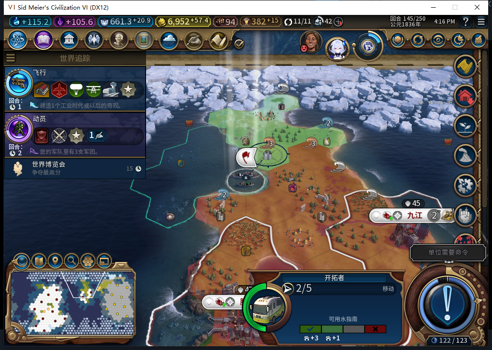
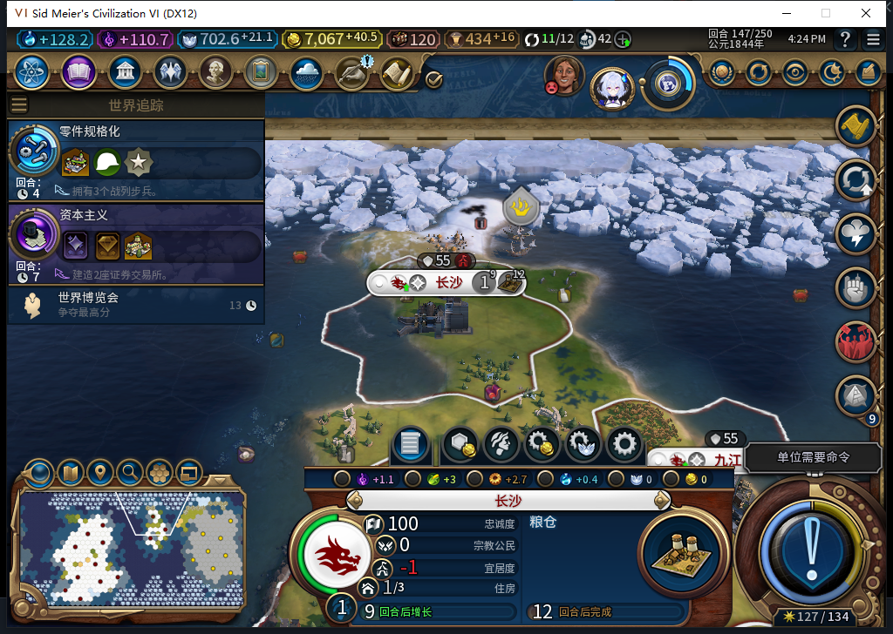
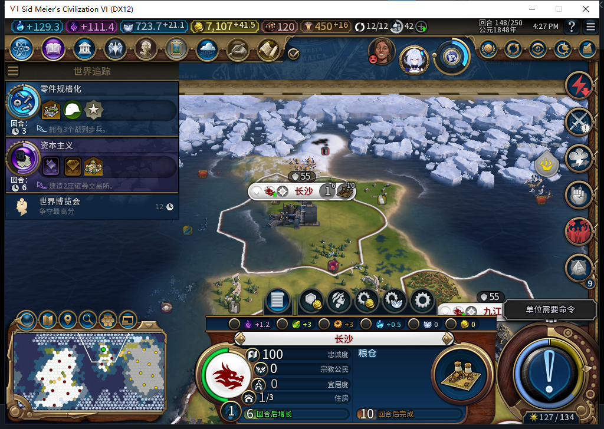

# 80同一名新移民：海路、长沙建城与初期生产读档

益阳138自动排产、142实际消耗1人口训练出的7929900，这次自己出海、等待上岸队列，147建成长沙，148普通粮仓达到3/32，正式存读档后保持。玩家继续处理军队和外交，没有给移民补移动、建城或生产。这闭合了同一演员由80执行的正常训练到建城、初期生产链。

世界仍继承旧保存点，含已经披露的历史测试单位；这不是80全新战役或正常开局平衡证明。工坊仍Alpha74，完整40项没有全过。[前段训练与人口成本](baiqi-natural-settler-training-80.md)另有三张原图。

## 到海岸后，等原生队列真正执行

142离城后在(20,7)，143到(23,12)，144到(23,17)。145只剩最后上岸步骤：移民在(25,19)、2行动力，(26,20)仍在排队；146恢复5行动力，但还没有移动完成，也没有补发同一条命令。

原请求0:145:139直到147才被观察到抵达。随后后台发出1次建城0:147:173，实际城市从13增至14，新城983053位于(26,20)、归白绮、人口1。模组正确确认新城和移民消耗，军队没有参与侦察或护送。

建城当回合，UI中的原移民已消失，Core仍保留同完整ID的离图、延迟销毁对象。这不是另一名活移民，不能把两个上下文硬写成同时清理完成。148原完整ID在两边清单均为0，但旧查找接口返回了另一个完整ID8388652的商人；正式读档后仍如此。验证按完整ID和类型区分，没有把商人当作移民复活。

## 新城继续生产，完成后的世界状态能保持

粮仓147为0/32、粮食0；普通结束回合到148后为3/32、粮食1。它是普通粮仓，没有恢复已经删除的经营权。长沙忠诚147为100、当前每回合+17，148为100、每回合+20；只证明这两个实际回合，不承诺长期保城，也不是空地忠诚预测。

出生后安装的BaiqiExecutor观察窗口共108次文职请求，目标移动14、建城1，其他93；非文职／未知／错误／溢出均0，15条目标样本未超过32条上限。142出生后最初离城移动没有SDK计数，保持未知。它也不是全部上下文的全局零军令证明。

148撤去观察包装后，正式保存618017字节，SHA256 feeb426ca41edf66e1e274c579f204c5eb548894978080b6f55df3a609e6c585，正式加载、继续各一次。UI／Core仍148回合、14城、金币7107.87109375；长沙ID、普通粮仓3/32、粮食1、忠诚100／+20保持。原移民完整ID清单仍0，九个临时观察器及三个测试玩家跟踪变量均已读回nil。私人存档不公开。

这是动作完成后的世界状态保持；**未决建城见证仍只存内存，中途保存／重启的持久恢复没有因此通过**。旧78实际失城FAIL和80保守9格规则的盲区仍保留，不能把长沙短期正收益升级为永久保城。

142亚历山大因不同政体谴责，由测试玩家再见一次；143、145第一次普通结束仍同回合时，先核实际待办和空闲，再作新的普通结束，未用UserForced。146的第一次就绪检查后，UI读回又遇忙状态，守卫拒绝0命令；之后独立读回才确认147新城，没把就绪ACK当实际效果。

本地模型466在报告未写前提供文案候选。145／147的事实顺序可参考；148图注误沿用147的+17，还把只在UI读取的生产／忠诚写成两边一致，均拒绝并按实际原件改写；商人别名也由负责人补清。模型没运行游戏、没改产品，不能分享本次实机通过。完整stop／合法JSON与事实正确分别记账。

本包无产品改动，沿用80完整1130项软件检查，不重复套件。本轮0 Steam上线／上传，工坊仍Alpha74。下一步继续未决状态持久恢复等真实缺口；TC-015／017其他边界、长期质量、性能与兼容性仍未全验。

[结构化同演员链、队列、别名、观察器及正式重载证据](../research/baiqi-p6-route80-native-founded-evidence-2026-11-06.json)、[80双城址筛选实机与限制](baiqi-known-border-native-80.md)。
