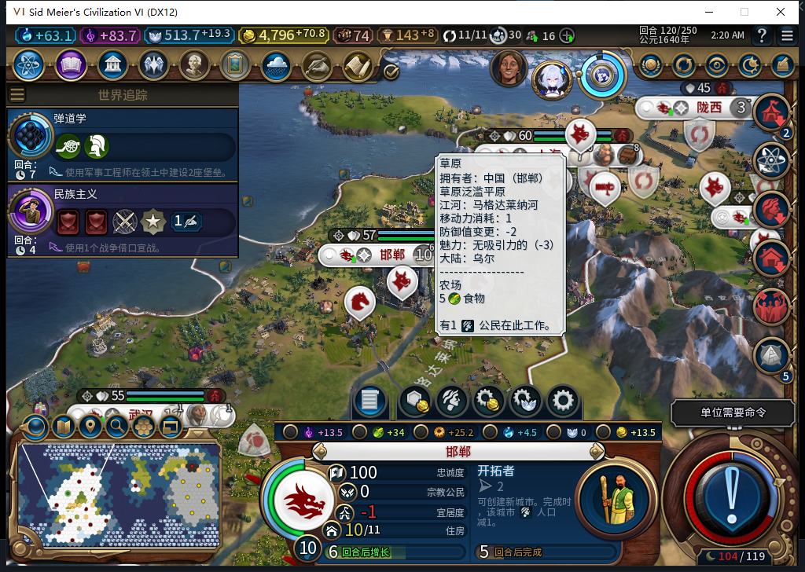
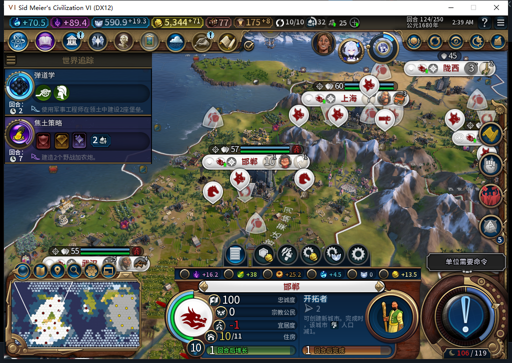
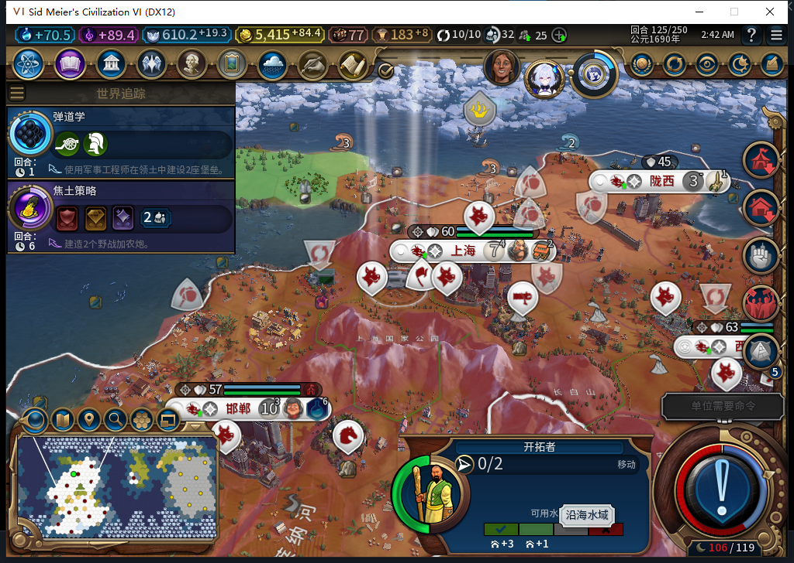

# 76实机：后台训练新移民，人口成本没有被增长掩盖

后续[77同档实机：改路、建成九江、移民消耗、读档及新城生产](baiqi-natural-settler-founded-77.md)已关闭首路占格故障。76训练／人口成本与77同演员移动／建城／读档衔接；不宣称77从头复做，完整TC-015仍部分。

后续发现[首路被文职占用、不试安全替代的实机FAIL及77源码修复](baiqi-settler-occupied-route-77.md)。本页训练／人口成本效果保持；新演员完整建城仍未通过，77冷验继续。

白绮的和平扩张需要城市先训练移民，再由后台把移民送往合法城址。本次从已有12城的保存点继续：玩家没有选择生产、补生产力或创建单位，邯郸完成银行后自行开始训练移民。第125回合确实产出一名新移民，并开始后台移动。本页验证正常训练及人口成本；这名新移民的完整建城链仍在继续。

第119回合没有健康的在地图移民，也没有城市正在训练移民。第120回合，银行完成后，后台请求0:120:6选择UNIT_SETTLER，原生队列随即确认。此时城市人口10，本局实际生产成本175；基础定义80不能当作本局实际成本。城市生产和公民管理控件另有读回确认已禁用，玩家只查看界面。

| 回合 | 移民训练进度 | 邯郸人口 |
| --- | --- | --- |
| 120 | 0／175 | 10 |
| 121 | 40／175 | 10 |
| 122 | 78／175 | 10 |
| 123 | 115／175 | 10 |
| 124 | 153／175 | 10 |
| 125完工过程 | 新单位7274546出生；队列随后转为学院 | 先10→9，随后9→10 |

这次最容易误判的是人口。完工前粮食53.55859375，人口10的增长门槛57；已就任的总督是GOVERNOR_THE_BUILDER，实读没有免除移民人口消耗的晋升。第125回合，事件先记录新移民7274546在邯郸10,13出生，接着人口降为9；生产完成事件也读到人口9。随后才出现增长到10的事件，粮食变为17.18359375。因此这次确实消耗1人口，又自然增长1人口，不能用回合前后10→10认定免费训练。人口9有两条通知，实际读数均为9，也不能把重复通知算成消耗2人口。

原生生产完成事件里的单位类型0是UNIT_SETTLER的索引，新单位的完整ID是7274546，两者不能混用。本次成本175；完工清除进度后，下一个移民的报价变为190，也不能将190算成本次成本。完工瞬时读数191是当时累计进度，不用于声称底层扣生产接口调用次数或额外授予溢出生产验收。

Core与UI均确认同一名健康移民7274546已到12,16、0行动、单单位编队；各城此时没有第二个移民队列。第126回合它继续到13,16，第127回合仍在那里，尚未建城。精确身份和位置来自独立读回，不从镜头光束或鼠标地块提示猜测。后续继续验证安全路线、建城、单位消耗与保存重载，TC-015完整链路仍未关闭。

完工前正式存档579772字节，SHA256 `c01c125818ce0324eea7611aaf6fe99a62710a80029b41f08355b1e7701def16`；产出后存档580398字节，SHA256 `b25922f2accce5cb806a141e5531273378be9fbe2e1a6eadf618bec95745bb4d`。已核文件与重复哈希，本阶段尚未重载这两个保存点，不能把保存成功写成读档通过。

这不是新开局或经济平衡测试：正式加载的是旧74的第119回合保存点，原有城市、库存及历史QA布景保持。源码／安装／实际运行均76，机器BF-202609141645、自有进程22124。测试玩家只处理军队待命、正常回合与普通外交；没有手动文职移动、建设、改队列或清理旧UNKNOWN。正常结束未带UserForced；执行排队移动和真正换回合分别读回。世界议会由测试玩家各投一张免费票，实际生效的是近战+5和剧院广场建筑加成，不把我方选择的学院当作最终生效目标。

临时事件观察器在完工读回时记录26条事件，丢弃和诊断错误均0。这是本上下文的元数据记录，不是所有底层接口的全局计数。源码未改，沿用76完整1058项软件基线。Steam一直离线，工坊Alpha74没有更新。[结构化事件、存档、模型审阅与未验范围](../research/baiqi-p6-production432435-natural-training-evidence-2026-11-06.json)。
