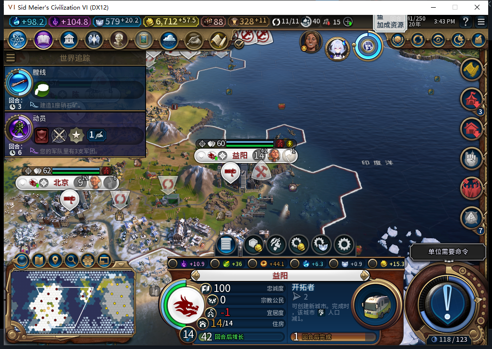
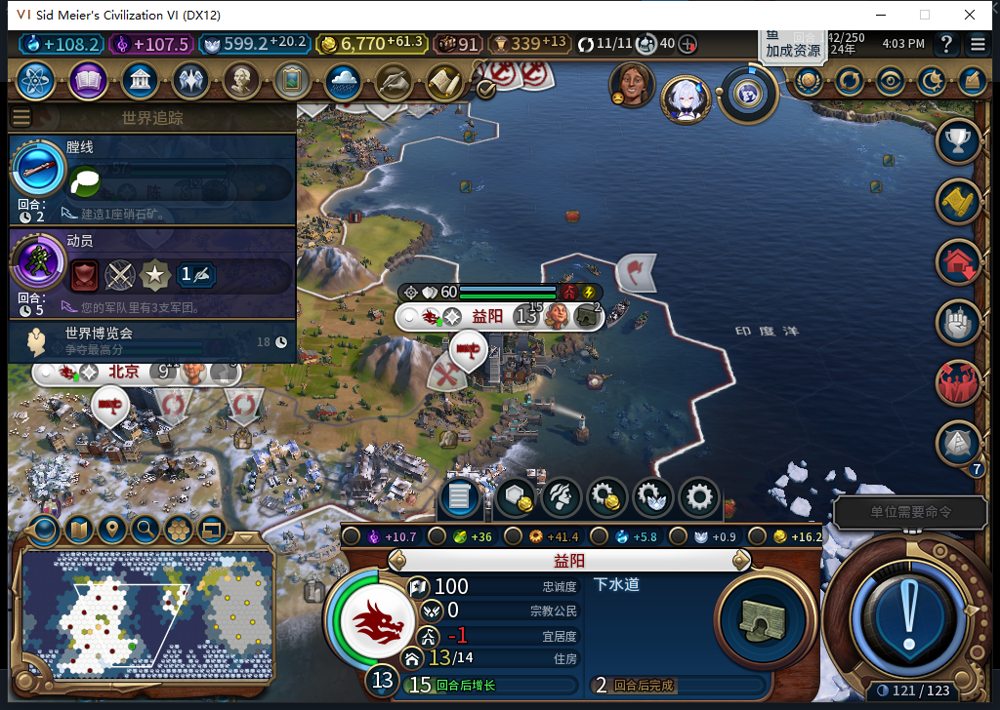
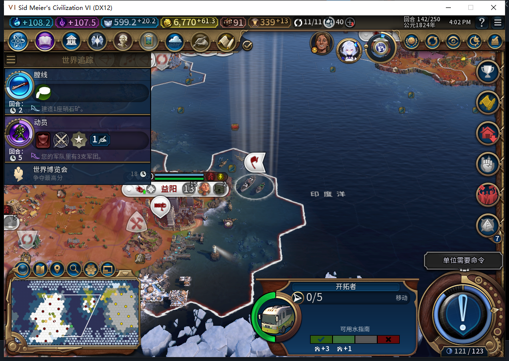

# 80自然训练：新移民出生，益阳实际消耗1人口

后续[同一7929900的80海路、长沙建城、初期生产及148正式重载](baiqi-natural-settler-founded-80.md)已完成窄样本；下文“该演员路线／建城继续”保留训练交付切点，不授完整TC-015／017或长期保城。

本次从80版自动排产开始追踪同一名新移民。138益阳自行选择移民，实际生产成本190；进度0→76→121→165，142新单位7929900在益阳出生，人口14→13，后台随后改排下水道。玩家没有改生产、补人口或移动文职。

这是80训练与出生子项，不是完整80新局。世界沿用前一组保存点，包含已经披露的历史测试单位；不能用这局的国库、产能或训练速度作正常开局平衡结论。工坊仍Alpha74。

138的后台请求0:138:29已在[前一组80实测](baiqi-known-border-native-80.md)记录。本次观察器在该请求之后安装，不把旧选择再计一次。138至141每次独立读回均为场上0移民、1座城在训练移民；没有手动挤掉其他生产。

141益阳粮食11.28515625、增长阈值82，14人口；已就任总督为GOVERNOR_THE_MERCHANT，免人口成本相关晋升Hash201364422实际为false。不是靠总督中文名字推断免成本。

142事件顺序为：新完整ID7929900在(19,6)出生；两条人口通知均读到13；随后一次移民生产完成，实际人口仍13。重复通知没有再扣人口。完成附近瞬时进度209、当次成本190；队列清空后下一名成本变205，不能把205倒算成本次训练成本，也不据209推定引擎扣产能／溢出次数。

UI／Core都读到同一健康移民7929900，已经由后台从益阳走到(20,7)，0行动力、单独编队、无排队目标。图上登船后显示0/5，不能改写为陆上0/2。当前1名移民、没有移民训练队列；完整路线、建城和消耗仍须继续实测。

事件窗口20条、错误／丢弃0；城市8次生产请求中有4次单位训练，含2次军事训练。军队训练属于允许的排产，不是后台军队指挥。本窗口未安装单位派发计数，初始移动只由实际前后位置与文本日志核实，不声称全局零军令或完整SDK次数。两项训练观察器及3个事件处理器已准确撤去。

141正式保存601766字节，SHA256 cb848524c3d1def5da30a70cd5c7871d31df5ecf06dfed8bf4e71b1af4c4f2e7；142保存600691字节，SHA256 c1fab613aa7b8d327983d1d50f48158b2a24f37981cc8c11faa827a43c112db9。二者本包均未加载，不能授存读档通过，私人存档不公开。

139的亚历山大宗教评价来访由测试玩家再见一次；141世界议会由测试玩家四项各投一张免费票，复核决议／竞赛花费均0、提交一次。实际通过的奢侈品是染料、间谍目标为破坏堤坝，和本方所投丝绸／窃取科技不同；外交胜利实际结果未另读回，不猜测。世界博览会通知正常确认后继续142。这些是玩家外交操作，不是自动外交或用强制结束绕过议会。

本包0产品修改、0新增模型HTTP、0 Steam上线／上传；沿用80已通过的完整1130项软件检查，不为实机文档重复测试。下一步继续这名7929900的安全路线、自动建城和新城生产，完整TC-015／017及40项仍部分。

[结构化训练、人口事件、保存点与观察范围](../research/baiqi-p6-training80-native-cost-evidence-2026-11-06.json)、[76历史训练样本](baiqi-natural-settler-training-76.md)。
