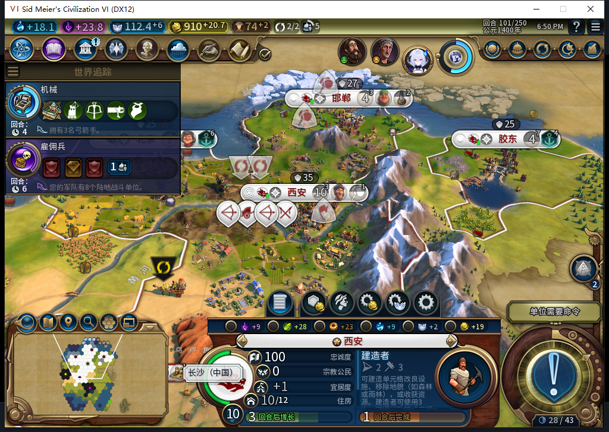
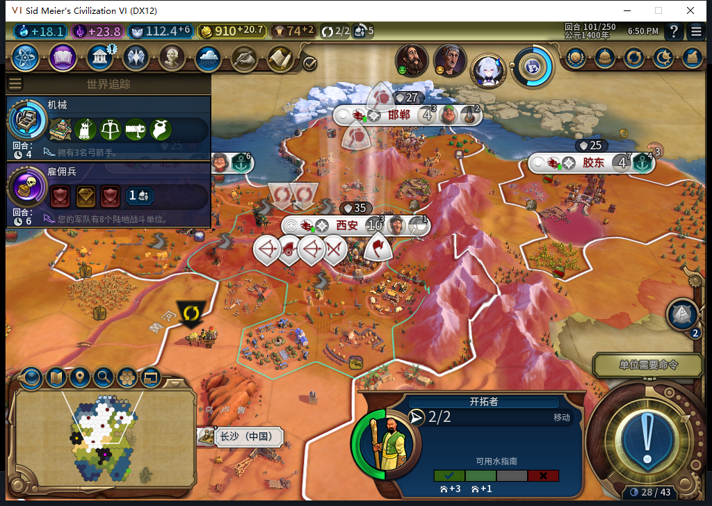
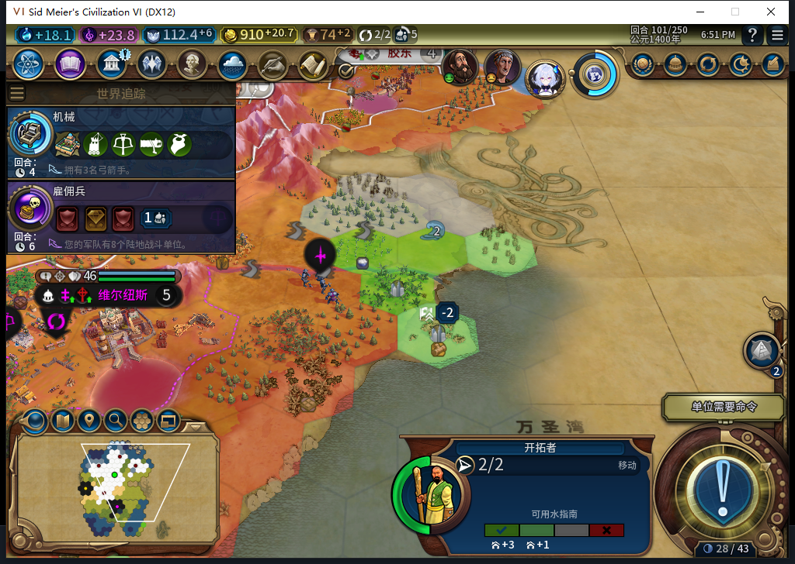
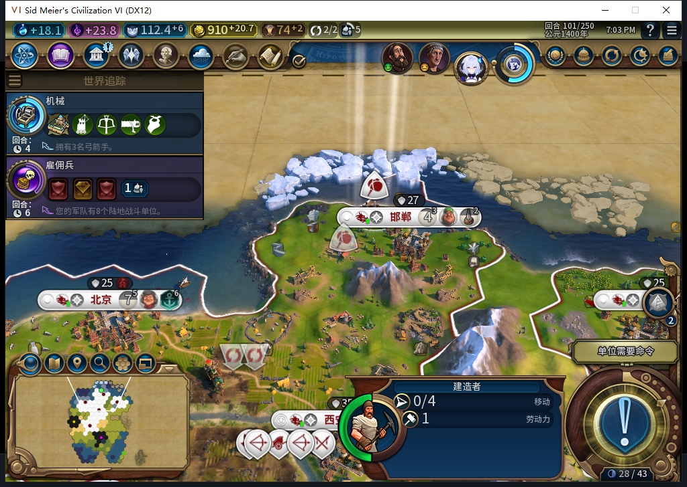

# 93冷实机：完成旧训练队列，移民等待，其他生产建设继续

离线冷装93，正式读取新移民出生前的99回合备份，实际走到101。100回合自然训练出移民1572869，首都人口11→10；它在首都55,34待命至101，仍2移动力、无原生排队目标，未选定保存城址。首都接续建造者到23/41；两处原本可见且没有改良的地块实际建成锯木厂。[逐项证据](../research/baiqi-p6-nearer-border93-cold-native101-evidence-2026-11-08.json)。

这次通过的是旧队列训练完成、保守等待与其他内政继续的窄窗口。**没有93安全城址／新城正案，长期保城FAIL未关闭。** 99已有移民队列67/100来自87存档，不能称作93重新选择训练或训练门的独立实机通过。104文件与已推送6e64d653一致，82Lua5.1编译；1330运行／1329通过／1SDK跳过是既有软件基线，本次未重复跑。

首都人口10，建造者界面预计1回合；23/41来自关联原生队列。北京港口24→35/69、邯郸灯塔16→36/60、胶东港口21→38/69、长沙粮仓20→30/32。[99、100、101共15行队列](nearer-border93-99-101-queues.csv)，不是玩家补选生产。

100和101均只读确认同一完整ID、55,34、2移动力、排队目的地nil；原有提案属性结构有效、目标数0。测试玩家只选中查看，原版选择自动打开定居透镜，没有移动、建城或指派文职任务。五城忠诚保持100，采样每回合变化均非负，[15行城市状态](nearer-border93-99-101-vitals.csv)。

实际100原生推荐共7项，2项当前可见：59,28最近己方城7格，58,29最近己方城6格，而外国城55,27均距4格、人口5。其余5项没有读取隐藏的归属／城市元数据。新规则会保守筛掉这种几何关系；移民等待与规则一致，但没有单独拦截每候选拒绝原因，不能把相关读数当作唯一归因。画面镜头移到前线，移民仍在首都，未走过去；透镜颜色和图标不是本模组的忠诚预测。

55,38／55,39在99均为可见己方NONE，101均为IMPROVEMENT_LUMBER_MILL；两名原有建造者各从2次降至1次。观察到2次MOVE_TO、2次BUILD_IMPROVEMENT，相关原生Hash已核实。不是把新揭示的旧改良算作新建，也没有测试玩家建造输入。四张为游戏原图，没有裁剪、合成或改数字。

观察器只覆盖BaiqiExecutor绑定，从99基线后到101：128次recruit检查、1城市RequestOperation、6单位RequestOperation、0单位RequestCommand，135条、0错误／丢弃。移民100／101各一SKIP，0MOVE_TO／FOUND_CITY；Native正常void返回不等于移动效果。加载初期订单次数未观测，保持unknown。观察器在保存前完整恢复、namespace撤下。

测试玩家2次军队SKIP、3次无REASON普通END，实际推进2回合。99出现罗马原版扩张抱怨，单次Bye后继续到100。100首次结束停在本回合，读回无待执行目的地、4支军队NativeSKIPfalse和UNITS提醒后，另一次新普通结束才到101；首次停留原因未隔离，未授排队移动实效通过。无UserForced／Shift+Enter、无重复军队SKIP或手补内政。负责人曾将progress误当读取且漏标签，IndexError在intent／查询前，实际0额外动作；读过入口后使用pending只读，后来的progress明确作为新普通END。

101已正式保存ACKtrue，1257909字节，SHA256为1fc152c46752c3466bf18f8b6af7d5e641c07564a612229a41d0b258941f6f68，连续读取稳定，尚未加载；私人存档不上库。99冷读WORLD、5城队列、9单位、12建筑、10区域、61可见己方格与87保存前对应采样逐字段相同，只证明报告范围，不是完整世界等价。

541只读警告器继续用原34场景资格：101两个当前候选都UNKNOWN/no_warning_entry；已知候选周围只读16个可见格，没有在合格的己方／无主非城市格读到数值负项。没有遍历警告全表或为了凑正案读取外国地块，原版渲染图标不填补候选缺值。仍未验证KNOWN_NEGATIVE实机正案，不接产品、不把缺值当0，也没有新HTTP。累计543逻辑／507完整外层JSON／33截断／3最终传输失败／573HTTP含30额外尝试，OpenCode原生生成0，未知缓存／人工成本null。

Steam其他设备仍占用。正式菜单导航与独立后台模式读取分开；查询无输入／激活／焦点变化／移动／截图，读到同实例“上线…”后才冷启。前一92正式退出后核实进程不存在，无终止操作。此段0上线／登录／下载／上传器初始化／上传／模式切换，公开Alpha2仍82／12图。下一步从保存101继续验证等待后的规划与真实扩张，不关闭旧ARMED／LEGACY、宗教采购、兼容、性能或完整40项。
