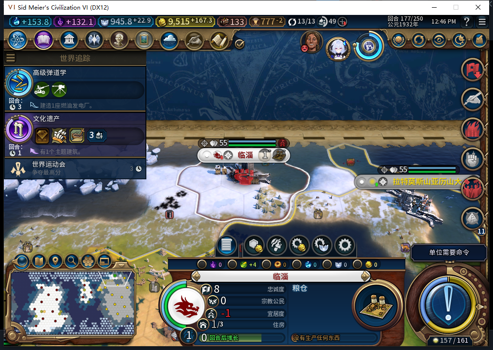
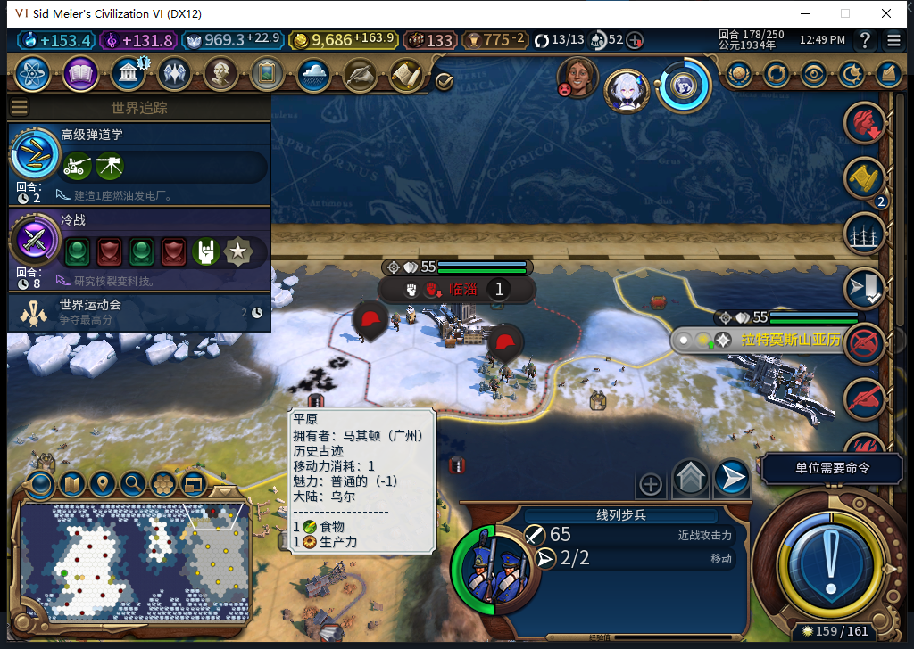

# 78实际失城：临淄建成五回合后转为自由城市

173自动建成的临淄，178已实际叛离。UI／Core分别确认：白绮自有城市16→15，原临淄完整ID1114127和该坐标均不在自有清单；当前可见的(37,24)城市完整ID131072、归属62，配置确为LEADER_FREE_CITIES／CIVILIZATION_FREE_CITIES。这是自动扩张的实际质量失败，不能再只写“可能丢城”。

[此前78绕行、建城、粮仓和175正式重载](baiqi-settler-detour-native-78.md)的窄结果仍然成立，但没有保证长久保城。工坊仍Alpha74，此缺口在78开发验收中实际观察到。

| 回合 | 忠诚 | 原生每回合变化 | 原生预计叛离 |
| --- | --- | --- | --- |
| 173 | 100（实机面板） | 未单独读回 | 未单独读回 |
| 175 | 54 | −23 | 3回合 |
| 176 | 31 | −23 | 2回合 |
| 177 | 8 | −23 | 1回合 |
| 178 | 已非白绮城市 | 不代读未知私有信息 | 实际转为自由城市 |

附近公民压力−20、幸福感−3。177原生仍为自有城，但面板产出已经归零，粮仓无完工估计；仅以已排队或早期1/32进度证明内政成功，会掩盖这个问题。

期间测试玩家只做原版军队跳过和普通结束回合，没有手动派总督、调军救忠诚、改属性、转城或代做文职。178先查自有清单，再在当前可见／已探明前提下查询原坐标的城市，没有为验证擅自读取隐藏外国城市。地图视图调整只查看已知地点。观察器已在175清除，后续军队调用计数未知，不能用“无救城输入”冒称SDK全局零调用。

当前选址沿用原生推荐排名，并检查地形、已知城距、探索与可见安全，没有明确忠诚门。不能猜原生AI推荐内部完全忽略忠诚，也不能用本次后置忠诚接口冒充已经验证了建城前预测。后续需要有依据的选址修复及同档复测。

178正式保存685221字节，SHA256 0fbb18e834cbcc1b642272635f8c627e0352b55ff7a8f1330f119ff7a412623f。15城、金币9686.23046875，原临淄不再归属白绮，QA钩子仍nil。保存不等于本178切点重载通过，私人存档不公开。

回执修复仍未采用：463候选3处精确匹配且Lua编译通过，但隔离反例显示“单位消失、新城晚到”会清掉未知请求，“单位仍健康、新城存在”又直接报成功；写前无城证据也停留在原生资格查询之前。候选整稿拒绝，0原稿Native／产品修改，负责人继续修复。461—463普通候选均不授游戏通过。

175回合辅助流程在实际到176后，末尾误读已清除的城市观察器而报错；保留原件，未重发结束回合或军队跳过。修正仅去掉失效的末尾诊断，176、177普通推进分别实际到177、178。此为验收工具失误，不冒充产品FAIL。

本包无产品修改，不重复完整1084软件套件。模型463一次完整stop／DONE／合法JSON，无重试；累计463逻辑、431完整、29截断拒绝、3最终传输失败，HTTP493／额外重试30。复用11月6日成功维护缓存，新OpenCode原生生成0，未知缓存／成本null。本轮Steam0上线／0上传；工坊仍74，完整40项未验完。

[结构化实际失城、候选反例和原件哈希](../research/baiqi-p6-loyalty78-actual-loss-evidence-2026-11-06.json)。
