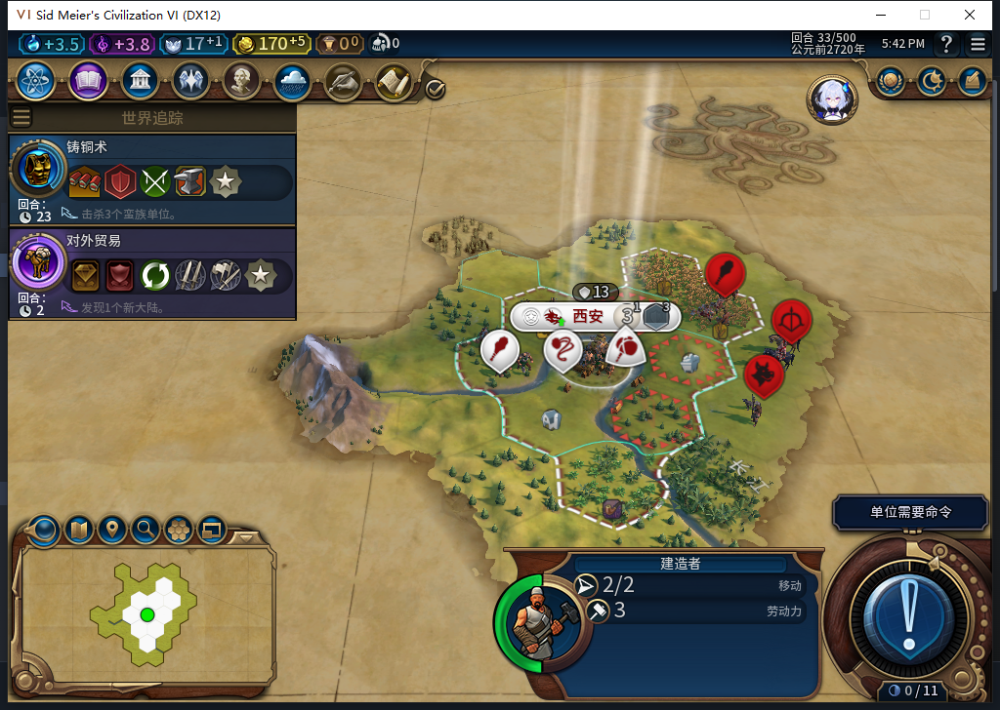

# 82新局第33回合：建造者有改良目标，首都附近仍有敌人

[首批单位验收](baiqi-newgame-standby-first-units-82.md)发现建造者出生后一直待命。这次只读诊断确认：原生AI给了3个改良目标；它当前所在的首都两格内，同时存在3支可见敌军。没有用QA私有规划器补动作，也没有移动文职。

## 目标存在，推荐接口没有返回空

实际调用`city:GetCityAI():GetImprovementRecommendationsForBuilder(unit:GetComponentID())`得到3条推荐。三个目标分别是59,29（地块2205）、61,30（2281）、59,31（2353），均属玩家、已探明且当前可见；非自有推荐0。诊断不把nil当空表，也不把推荐当作可通行或可施工证明。

## 当前出发点不满足安全条件

只查询首都周围两格内已经探明且当前可见的地块，在普通／宗教层读到三名外国单位，均为蛮族玩家63，与我方处于战争：61,31的勇士、61,29的侦察兵、62,30的蛮族骑射手。三者距建造者均为2。没有查询隐藏单位或其它玩家单位全集。

源码`Safe`会拒绝两格内可见敌军；原地施工先检查当前位置安全，路线验证还会检查包括起点在内的每个节点。当前原生状态符合这条拒绝条件。因此，这一刻的等待有安全依据，不能称为“没有目标”或单凭未施工就判停摆。这是状态与源码条件的对照，没有冒充私有规划器实际分支跟踪。

威胁清除后的重新规划、移动和改良落地仍未验证；本轮不授完整自动建设、安全矩阵或危险解除恢复通过。也没有让后台替玩家战斗。[ARMED存读档FAIL](baiqi-settlement-allowed-save-window-82.md)与[旧档扩张等待](baiqi-settlement-legacy-migration-82.md)继续开放。

## 只读工具资格

模型483原稿虽stop／完整JSON且Lua5.1可编译，却把`Game.GetLocalPlayer()`返回的数字当玩家对象，并编造`GetHuman/GetLeader`，还缺少合同要求的异常保护。27个场景中24个失败，许多被前置错误遮住，不能说成24种独立缺陷；整稿未入游戏。负责人独立提取器27项通过后才实际读取，包括完整ID别名、nil与空表、非自有推荐不查Map、原始集合上限和未知可见性。

本包无游戏指令、无观察器／持久状态写入；沿用已正式重载的33回合保存点，产品仍82、工坊仍Alpha74，未联网或上传。[结构化证据](../research/baiqi-p6-builder483-threat-wait-evidence-2026-11-07.json)附推荐、可见威胁、软件边界及原件摘要。图复用上一包原图，不计新截图。
