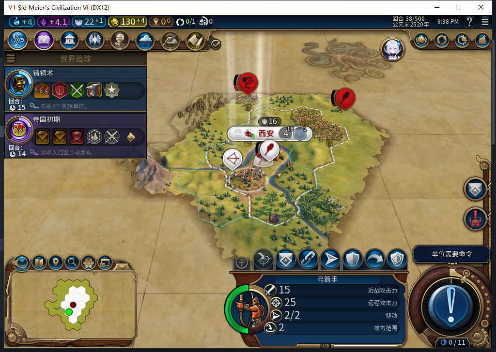
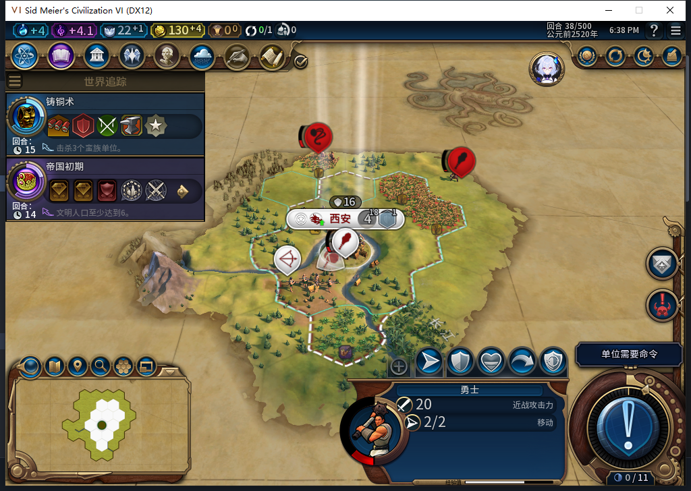
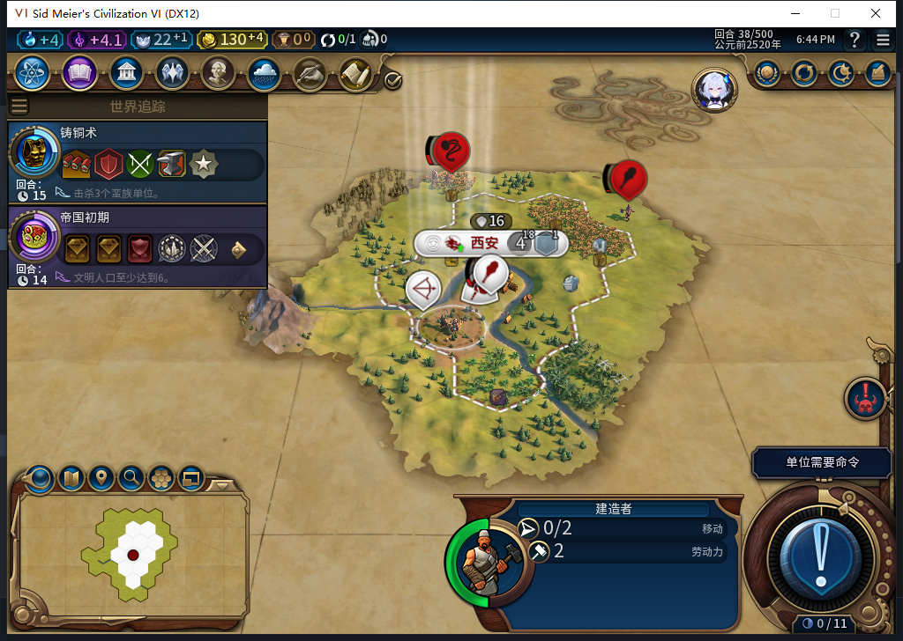

# 82新局：玩家负责交战，危险退去后AI修好首座农场

[第33回合](baiqi-newgame-builder-threat-wait-82.md)，建造者有3个原生改良推荐，却被首都附近的可见蛮族挡住。这一轮测试玩家指挥军队交战、调整站位；第38回合敌军退远后，建造者自己出城，在59,29修好农场。玩家没有移动、派活或交换建造者。

## 军队由玩家指挥，建设等待危险变化

第33回合，测试玩家通过原版单位界面入口花60金币把投石兵升级为弓箭手，国库170→110；旧单位262146由新完整ID327683替换，升级后行动力0。此后用正常回合与原版地图交互：弓箭手射击、勇士前进和近战；勇士受伤后撤回，37回合再调入首都，弓箭手移到59,29。

33→38共5次普通结束、3次军事待命，另有1次升级、4次军队移动、4次远程攻击和1次近战。没有强制结束、宣战输入、文职输入、资源或单位赠送。37回城前确认原生交换单位资格为false，避免军队动作间接移动建造者；移动后建造者仍在原位。

敌军并未全灭：38回合读到投石兵退到59,33、受伤勇士退到62,32。这里关闭的是当前可见危险离开后的恢复，不是“全图安全”或后台代打。

## 后台实际移动、建农场并消耗劳动力

34回合装入的原样透传观察器，只覆盖Executor未来调用。35—37记录的是建造者待命；38记录一次`MOVE_TO`到59,29，再一次`BUILD_IMPROVEMENT`，改良Hash168372657对应农场。随后原生地块2205确认为`IMPROVEMENT_FARM`／Index1、未被劫掠，建造者劳动力3→2、行动力0。没有拿请求返回值代替完成效果。

玩家选择建造者时，实际动作总数0；弓箭手／勇士分别保留9／6项动作。建造者移到弓箭手所在格后，两者编队数均1，弓箭手仍在59,29、行动力2，没有被后台带走。

观察器累计127次招募判断、1次城市请求、5次建造者操作，共133样本，0错误／丢样。5次单位操作是3次待命＋移动＋建农场；此Executor窗口军事请求0，不提升为所有UI上下文的全局零军令。36回合城市仍排待命项目；一条移民纯预算判断true不等于完整原生生产合法，后续另查，不先判故障。

## 完成状态正式保存、重载保持

精确恢复观察器后保存38回合，1024091字节，SHA256 `b40b7eb45a6312a7b7bd8f57de2e7cb5c9b398d02aa89ec6bc1fd49879a4a8e3`。正式加载、继续后再次确认：农场、2次劳动力、0文职动作、三单位位置／行动力／勇士75伤害、一城人口4、130金币、待命项目和首都OBSERVED记录保持，观察器不存在。私人存档不上库。

两次旧16读轮询在普通结束后提前到界，执行链当即停止，后续独立读回才确认35／36；没有重发结束。新未来窗口改为32次有界只读，36→37实际第20读就绪。一次射击的快速空闲读仍看到旧伤害0，稍后才读到66；保留两份结果，没有补射。

模型484计划混淆玩家0与回合33、勇士与弓箭手、升级对象及攻击API，整稿未采用；负责人按已资格原版入口执行，升级守卫15项Lua5.1场景通过。产品仍82，1153项产品软件结果不重跑。[结构化证据](../research/baiqi-p6-threat484-combat-and-farm-recovery-evidence-2026-11-07.json)记录动作、样本范围、原件摘要和负责人修正。

此局“危险等待→自主移动→普通农场→消耗劳动力→完成后存读档”窄通过；维修、更多地形／危险变化、完整军队与建设矩阵及40项仍未全验。[ARMED中途保存恢复FAIL](baiqi-settlement-allowed-save-window-82.md)与[旧档扩张等待](baiqi-settlement-legacy-migration-82.md)未修复。工坊仍Alpha74，本轮未联网／上传。
