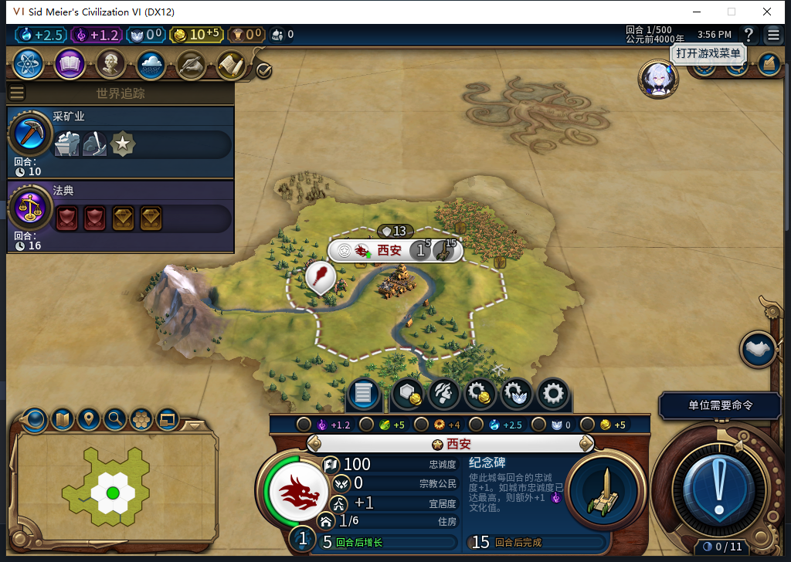
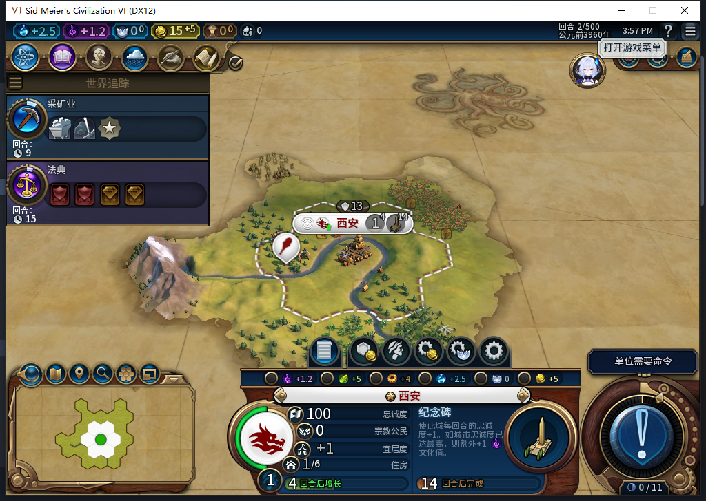

# 82新局首移民：自动建都、生产与完成后读档窄通过

这次从原版创建游戏进入白绮新局，没有先读旧档。风云变幻、王子、标准速度、大陆、小地图，六名参与者。源码／安装／运行仍82，93文件一致；启动前独立后台读到当前Steam实例的“上线...”菜单，确认离线，距进程启动约0.002秒。本轮没有Steam模式切换或上传，工坊仍Alpha74。

## 玩家进入新局，模组建都

测试玩家只选择领袖并开始游戏。第1回合首次读回时，UI的`GameConfiguration.IsSavedGame()`确为false，首都西安65536已在60,30建立，人口1、金币10。原移民65536对应一条`OBSERVED`，令牌`settle:0:1`、请求`0:1:1`，空地见证与新城匹配；没有误迁成`LEGACY_UNKNOWN`。单位ID与城市ID属于不同对象域，这里数值恰好相同。

UI名册只剩勇士131073，位置59,30、2行动力。Core当时另保留原移民的延迟销毁对象：坐标−9999,−9999、isDead=false、isDelayedDeath=true；这是已消耗对象，不能把Core多一条名册记录说成还有存活移民。新城与消耗证明均独立读回，日志给出`core_durable_empty_site_city_and_consumed_settler`。采矿业、法典与纪念碑由模组安排，测试没有补内政。

## 普通推进，生产实际增加

测试玩家仅跳过勇士一次、普通结束回合一次。实际第2回合，纪念碑从0/60增至4/60，金币10→15，勇士仍在59,30、恢复2行动力，等待玩家指挥。没有强制结束、文职移动、人工建城或生产输入。城市的改生产与管理市民控件均实际禁用。

正式保存893840字节，SHA256 `1f14dad0b73bc09d8fa0583b69fb289d66b07899b65e575bfa104dba9fb4d982`。正式重载、继续后，UI／Core仍第2回合、同一城与位置、金币15、同一OBSERVED／创建回合1／序号1；UI生产仍4/60。此时UI读档标志变为true，正是预期来源变化。Core缺少同名getter，不能借UI读数声称Core独立识别新局。

## 范围与仍未解决的问题

本次窄通过：一份全新世界的首移民自动建都、初始生产、一个普通回合和完成世界的存读档。首个原生世界读取已晚于后台建都，没有安装启动阶段SDK代理，不能给精确全局发令计数或全局零军令证明；纪念碑尚未完工，也没有覆盖所有开局、长期忠诚或完整40项。

[ARMED已保存而效果未落地的续建失败](baiqi-settlement-lifecycle-recovery-82.md)及[旧档移民未知记录导致停止扩张](baiqi-settlement-legacy-migration-82.md)均未修复。不能用本次完成后读档通过替代这些窗口。产品1153项软件检查沿用既有结果，本轮无产品修改，不重复跑数。

本地模型479给出三个条件式疑虑，均未作为新缺陷采用：缺依赖时拒绝发令是保守设计；既有日志在Initialize入口先克隆返回，不能忽略该分支后推成WriteNew的前次会话故障；初始化暂不可用也不足以证明永久等待。两段引文还将Lua的~=错写为!=。这次实机只证明实际新局成功，不证明所有异常环境均可用。模型完整stop／有效JSON与源审、游戏实效分别记录。[结构化证据](../research/baiqi-p6-newgame82-first-capital-evidence-2026-11-07.json)。
