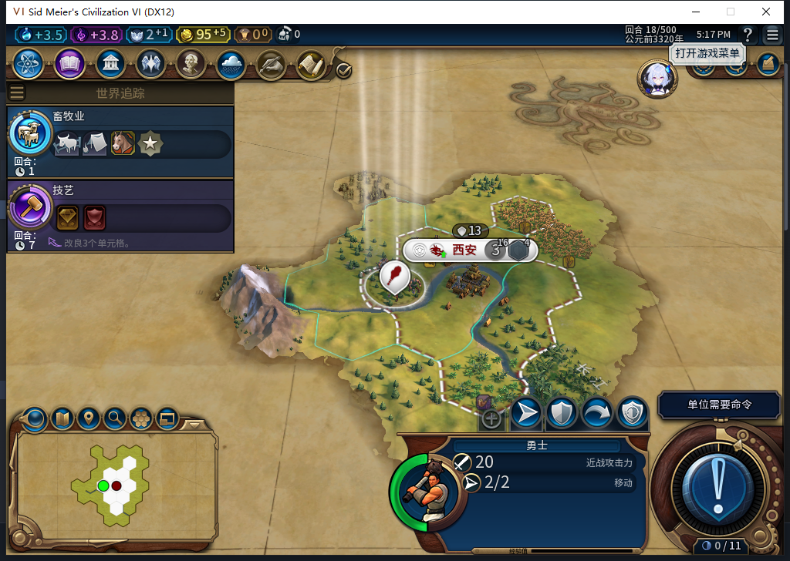

# 82新局前18回合：首项科技、市政与政策自动接续

沿用[首移民自动建都](baiqi-newgame-first-capital-82.md)的同一新局，从独立第2回合保存点继续。测试玩家只让勇士待命并普通结束回合，未选择科技、市政、政策或生产。源码／安装／运行仍82，工坊仍Alpha74。

## 研究与装卡确实落地

第2—10回合读到采矿业仍在研究、HasTech=false。第11回合首次读到采矿业已拥有，当前研究自动变为畜牧业。第13回合仍在法典、两个政策槽均空；第14回合首次读到法典已拥有，当前市政自动变为技艺，同时军事槽装入纪律、经济槽装入城市规划。

这是当前原生状态读回与实际界面，不是请求ACK或模拟结果。没有调用私有Admin／Planner来补内政；玩家没有为选卡支付或手动提交。没有装SDK观察器，因此不提供精确后台发令次数；“第11／14回合”指本轮首次读到完成的回合，不追认更精细事件时间。

## 城市继续成长，纪念碑已完成

第2回合纪念碑4/60，人口1、金币15；第10回合44/60，人口2、金币55。第18回合人口3、金币95，原生HasBuilding确认纪念碑已存在；此时生产队列是`PROJECT_BAIQI_STANDBY`（待命整备），不是空队列，也不是仍在造纪念碑。尚未独立记录建筑精确完工回合。

本工作包2→18共16次普通结束、16次测试玩家军事待命；勇士131073始终在59,30，没有后台侦察或由玩家移动文职来补效果。未装全局SDK，不能把位置保持提升为全局零军令证明。待命整备的具体原因未仅凭95金币归因，后续继续检查条件变化后的排产。

## 正式保存、读回保持

第18回合官方保存991483字节，SHA256 `104cd33b6df743864addad163ac0eec5c39edbbf815251733b68fd65e9522543`。正式重载、继续后，原生仍读到采矿业／法典已拥有、畜牧业／技艺在研、酋邦、纪律／城市规划两槽、纪念碑已存在；一城、人口3、金币95、同一勇士位置与待命项目均保持。私人存档不提交。

只关闭一份新局的上述窄范围：不代表整棵研究树、所有政体、付费换卡、政策替换或完整40项通过。[ARMED中途保存恢复FAIL](baiqi-settlement-allowed-save-window-82.md)与[旧档移民停止扩张](baiqi-settlement-legacy-migration-82.md)均未修复。

模型481原稿编译但20个合同场景中13个失败：缺成功KNOWN标志、未保护异常、未严格核数据库Index／字符串、未验证HasTech／HasCivic布尔值等，未进实机。负责人独立只读器20个Lua5.1场景通过后才读取原生状态。产品无修改，1153项产品软件结果不重复跑或重计；0 Steam联网／上传。[结构化时间线与证据](../research/baiqi-p6-domestic481-first-tech-civic-policy-evidence-2026-11-07.json)。
