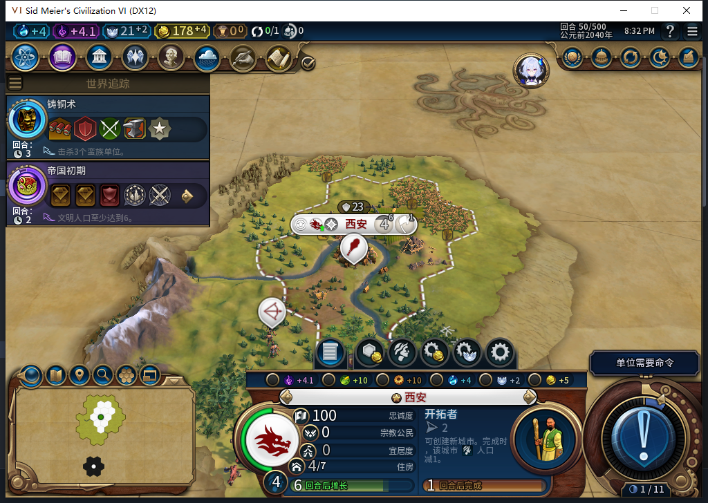
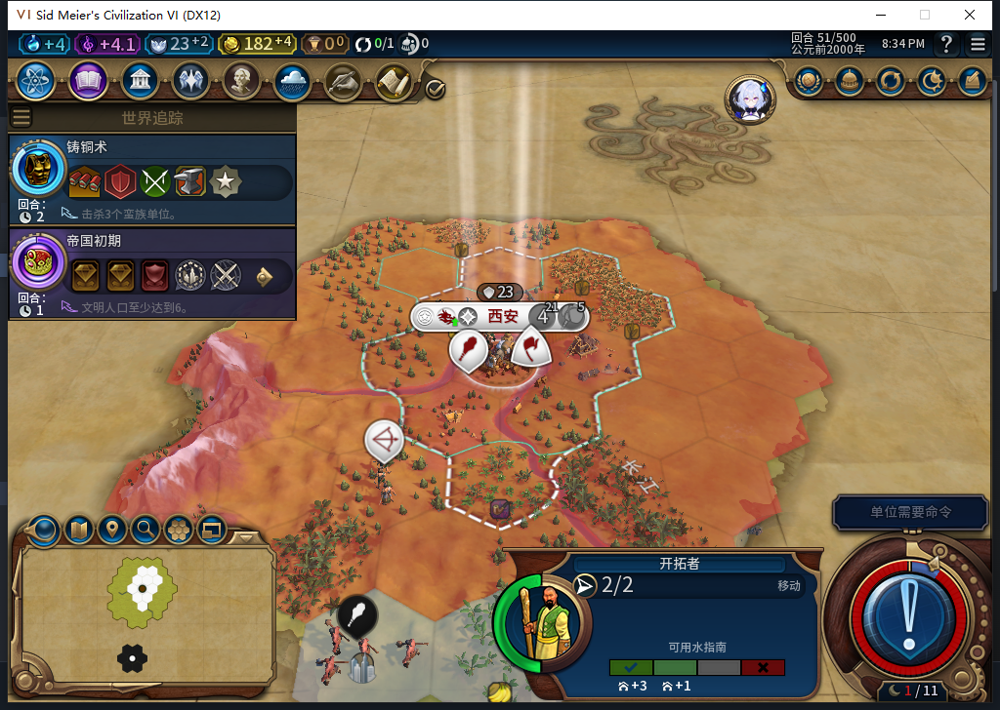
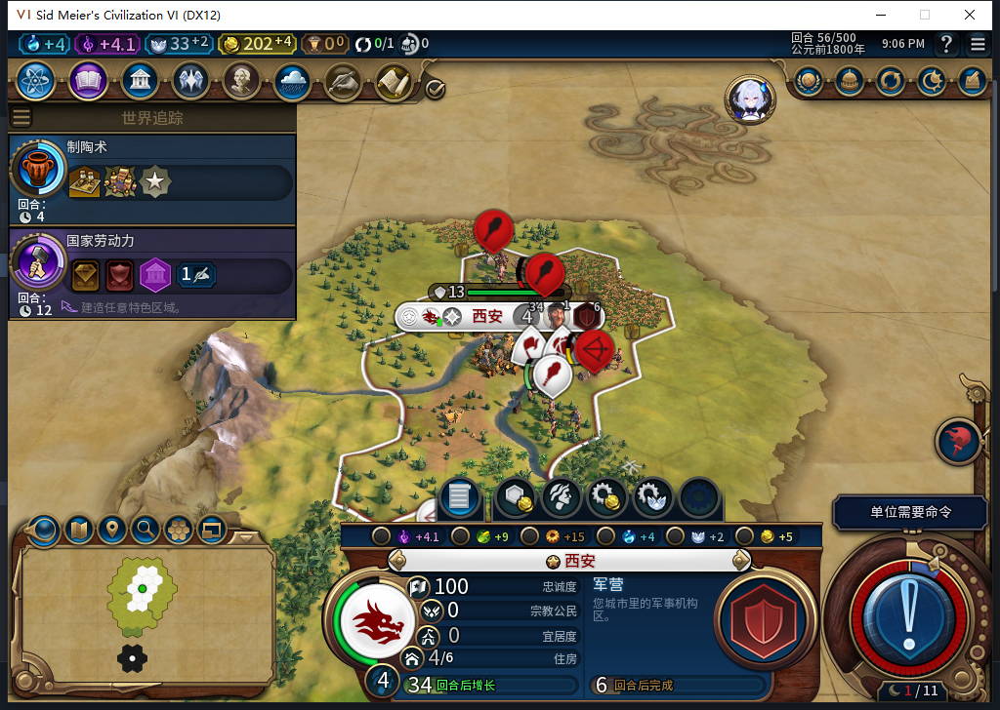

# 82新局：移民自然完工，仍等待安全出城

同一新局从正式重载的38回合农场继续到56。测试玩家只操作军队与普通结束；没有排产、文职命令、资源／单位赠送或揭图。后台在43回合排入移民，51回合实际训练完成；56回合又补出第二个建造者。移民尚未出城，完整扩张继续验。

## 先探明城址，再等待生产实际完成

38回合测试玩家把弓箭手从59,29移到59,28；当时推荐仍0条。39回合首次读到1条已探明且可见的城址59,26，原生地块无城市、陆地、可通行、无地貌、无人所有。39玩家射击邻近交战蛮族侦察兵，52再把弓箭手移到58,27。侦察归测试玩家，后台没有移动军队。

43回合城市自然排入移民0/80；46为37/80，48为57/80，49为67/80，50为77/80。

51回合出现移民393216，位于首都60,30、行动力2，文职操作总数0。队列自行转为建造者0/54；56实际出现新建造者458754，城市接续规划军营，Hash1725642169／位置60,32。军营只是当前队列与规划位置，并非已建成。

50与51回合首都人口都为4，52／53／56也为4；原生单位表PopulationCost=1／PrereqPopulation=2。没有记录到可解释的人口扣减，不授人口成本通过，也不先归因于总督。56实际资源总督仅有基础开拓能力；当前状态不能倒推51的瞬间。

## 第一位建造者用完三次劳动力

[38回合农场](baiqi-newgame-combat-farm-recovery-82.md)后，后台44在61,30修矿山，45在60,31修农场。46自有地块读回两座农场与一座矿山均未劫掠，旧建造者已不在自有集合；原始3次劳动力与3次实际BUILD相符，按正常耗尽分类。没有截获消耗瞬间的单位移除事件，不把消失单独当作施工证据。56的新建造者是自然再训练的另一个完整ID。

## 城址可用，路径仍有危险

51—56移民始终在首都等待。52／53在后台待命后读取原生寻路，返回真实空plots；这只能说明读取时状态，不能拿它解释派发前。后来装入透明观察器，54实际后台寻路返回5格；复制变体在55／56各记录一次，仍是5格：60,30→59,29→60,28→59,27→59,26。

55稍后的可见威胁读回，起点半径2内有4个交战蛮族：勇士60,31与61,32、投石兵60,29、弓箭手61,30；前四步受影响。城址本身安全，也不等于整条路径安全。源码逐步检查包括起点在内的安全半径2，因此这里的等待有相符的当前可见危险证据；没有声称威胁与派发同一原子时刻取样。

55测试玩家用勇士近战受伤投石兵一次，随后目标从仍可见格消失，勇士移到60,29、受到15伤害。弓箭手退向59,27时一步就用完行动；第二步预览及后续尝试均被守卫拒绝，原移动函数0执行。负责人编排未在预览失败后停下，这是工作流错误；已保留拒绝记录并改为核验退出码与语义成功后才继续。没有削弱守卫或重发攻击。

## 完成状态保存、重载保持

38—56共18次普通结束、31次军事待命，另2次侦察移动、1次射击、1次近战与1次防御移动；0强制结束／文职输入／内政选择／宣战。未来Executor财务观察器527样本：510招募、4城市、13单位操作、0单位命令，0错误／丢样；13次操作全部是建造者或移民。此范围军事请求0，不提升成所有UI上下文的全局零军令。

全量读出并精确恢复观察器后，56回合正式保存1090744字节，SHA256`049d6d01829fa298d39c38f3fe2ce09ffb8b35e1d6f2cc4ae7a55e55328425f1`。加载、原版继续后，UI与Core均确认：一城人口4、202金币、军营排产、四单位身份／位置／行动力及勇士15伤害、首都OBSERVED记录保持，全部观察器不存在。私人存档不上库。

模型486原稿Lua5.1不编译，负责人27项纯选择器检查通过；模型492可编译但18场景中7项失败，修订观察器18通过，复制路径变体19通过。没有整稿模型代码进游戏。[结构化证据](../research/baiqi-p6-frontier486-path492-natural-settler-evidence-2026-11-07.json)保留原件摘要、时间边界与负责人错误。

产品仍82，既有1153项产品软件结果未重跑。本包只授自然训练、第一建造者3次改良、再训练与完成状态存读档窄通过。移民行军／建城、人口成本、[ARMED中途保存恢复FAIL](baiqi-settlement-allowed-save-window-82.md)、[旧档移民等待](baiqi-settlement-legacy-migration-82.md)和完整40项仍开放。Steam未联网／上传，实际工坊最后核验为Alpha74。

## 后续85人口事件实测

[85同一38档的新分支](baiqi-settler-population-cost-native-85.md)重现43训练／51出生，真实事件先读人口3／粮食33／门槛33，后读人口4／粮食2／门槛44，扣1人口窄通过。其军事路线、版本与旧82样本不同，不补写82历史瞬间；上文人口成本未知保留当时范围。
