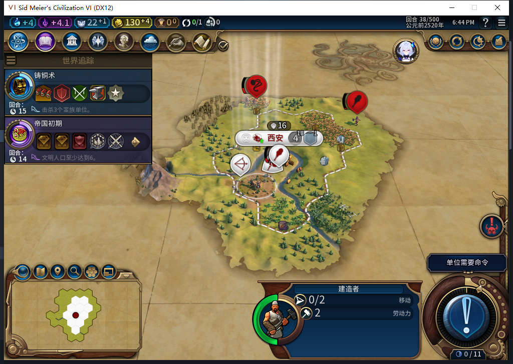

# 82新局第38回合：移民当前可生产，但城址推荐为空

上一轮36回合的观察器出现“移民纯预算判断true，城市最终仍排待命”。本次没有改队列来造条件，而是在[已正式重载的38回合农场现场](baiqi-newgame-combat-farm-recovery-82.md)继续只读排查。

当前原生结果明确：移民Index0／Hash−798712536，两种`CanProduce`与`CanStartOperation(BUILD, append)`均为true。城市队列仍有1项待命整备，并非空队列；允许追加不等于控制器此刻应插入新生产。

城址是另一道门。实际GrandStrategicAI接口存在，`GetSettlementRecommendations(12)`返回真正空table，条数0；没有把nil或接口错误冒充空候选。源码2027先临时令`hasSafeSite=true`做纯预算检查，2029才取真实城址，2030还要求城址非空。因此，预算true不能证明完整`RecruitAllowed`已通过。当前38的空推荐足以让这一层等待；不能据此倒推36当时也相同。

本包0游戏指令、0新观察器、0持久状态写入，没有直接调用私有SettlementSites／Planner、生成移民、改生产、揭图或移动军队来补效果。尚不能把没有入队判成生产故障，也没有授自动扩张通过。下一步用测试玩家的正常军队探索推进，再读原生推荐与真实训练；后台仍不得侦察或护送。

模型485完整JSON但Lua5.1编译失败（`player:GetCities and`语法），还把本地玩家数字当对象、缺异常保护，整稿未入游戏。负责人独立只读器25项合同场景通过后才查询原生；Hash按原值传入生产资格，未向进度接口传Hash。队列／回合前后边界相同仍不称原子快照。[结构化证据](../research/baiqi-p6-production485-settler-legality-hints-evidence-2026-11-07.json)。

产品82无修改，1153项产品软件结果未重跑，工坊Alpha74未更新。完整扩张、[ARMED保存恢复](baiqi-settlement-allowed-save-window-82.md)和[旧档扩张等待](baiqi-settlement-legacy-migration-82.md)继续开放。
