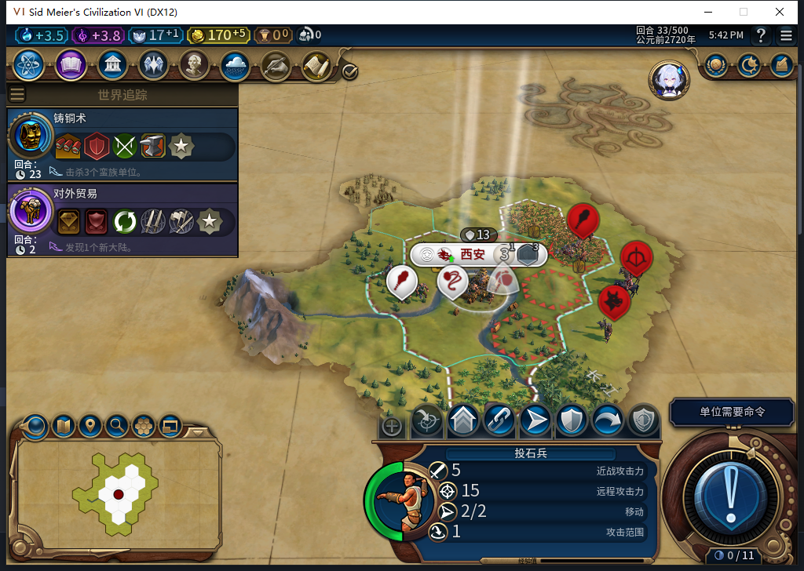
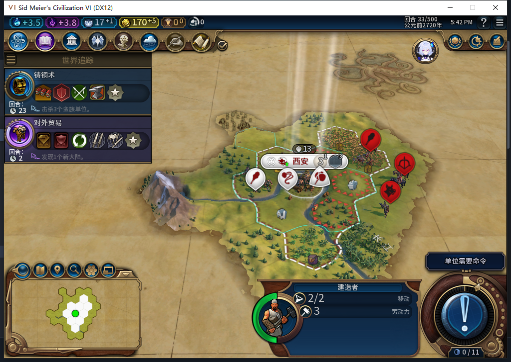

# 82新局：待命项目之后，建造者与投石兵正常完工

[前18回合](baiqi-newgame-first-tech-policies-82.md)的纪念碑建成后，西安执行“待命整备”。继续同一局普通回合，这次确认它能接续训练：第22回合排入建造者，第28回合建造者出生并改训投石兵，第32回合已能选中新投石兵。玩家没有排队、补金币、生成单位或指挥文职。

## 余额够了，仍会先完成当前项目

第18回合95金币，第19回合自然涨到100，但当前仍为待命整备。项目SQL定义基础产能30；没有资格化项目进度getter，因此未猜它当时还有几回合。第22回合观察到后台首次重新评估招募：115金币、净收入5，建造者允许，随后一次城市请求选择建造者。第26回合进度38/50，第27回合46/50，第28回合单位真实存在。

这关闭本局“待命后是否恢复排产”的疑点；没有因此推断所有预算变化都即时打断在做的项目，也没有把第19回合仍在待命误记为卡死。

## 新军队在首都等待玩家

建造者出生当回合，后台改训投石兵，原生进度0/35。第32回合测试玩家的军队选择记录已出现投石兵262146；到第33回合它仍在60,30首都，行动力2/2、无排队目的地。原勇士仍在59,30。测试玩家只给军队待命，没有移动或攻击。

观察窗口从19回合装入至33回合清理，覆盖Executor未来383次招募判断、3次城市请求、6次单位操作，共392样本，错误／丢样均0。3次城市请求分别是22建造者、28投石兵、32待命整备；6次单位操作全部属于建造者，日志标为待命。此范围未捕到军事请求；未覆盖其它UI上下文，不提升为全局零军令证明。原生请求返回0值，不拿它当成功布尔；完成以实际单位读回为准。

## 建造者尚未施工，继续验

建造者196608第28回合出生，到33回合仍在首都，行动力2、无排队目的地。28与33两次读回10块自有地（含城市中心）均未发现改良。邻近蛮族在图中可见，但本工作包还没单独追完安全筛选与推荐目标的因果链，不能只凭截图认定全部等待原因。本窗口不授自动建设完成。

18→33共15次普通结束、16次测试玩家军事待命，0强制结束／文职输入／人工内政。第33回合精确恢复观察器后正式保存1017948字节，SHA256 `be1c1596228d62a1b2f2d2b1fa79c40e163a29e5ff62eb0ad778f48acaf10ded`。正式加载、继续后，一城人口3／金币170／三单位身份位置及行动力／待命项目／纪念碑／首都OBSERVED记录保持，观察器不存在。私人存档不上库。

模型482提供源码审阅，未生成或执行游戏操作代码；“未发现缺陷”被限制为该次审阅，负分并非排除候选，项目Native完成语义也不能由源码保证。负责人纠正其事件名称及过宽的无死锁结论。已有透传观察器10项测试通过后绑定，产品未改，1153项产品软件结果未重跑。[结构化证据](../research/baiqi-p6-production482-standby-and-first-units-evidence-2026-11-07.json)。

[ARMED中途保存恢复FAIL](baiqi-settlement-allowed-save-window-82.md)、[旧档移民等待](baiqi-settlement-legacy-migration-82.md)仍开放；完整生产／军队／建设矩阵及40项未全验。运行82，工坊Alpha74未更新，本轮Steam无联网或上传。
