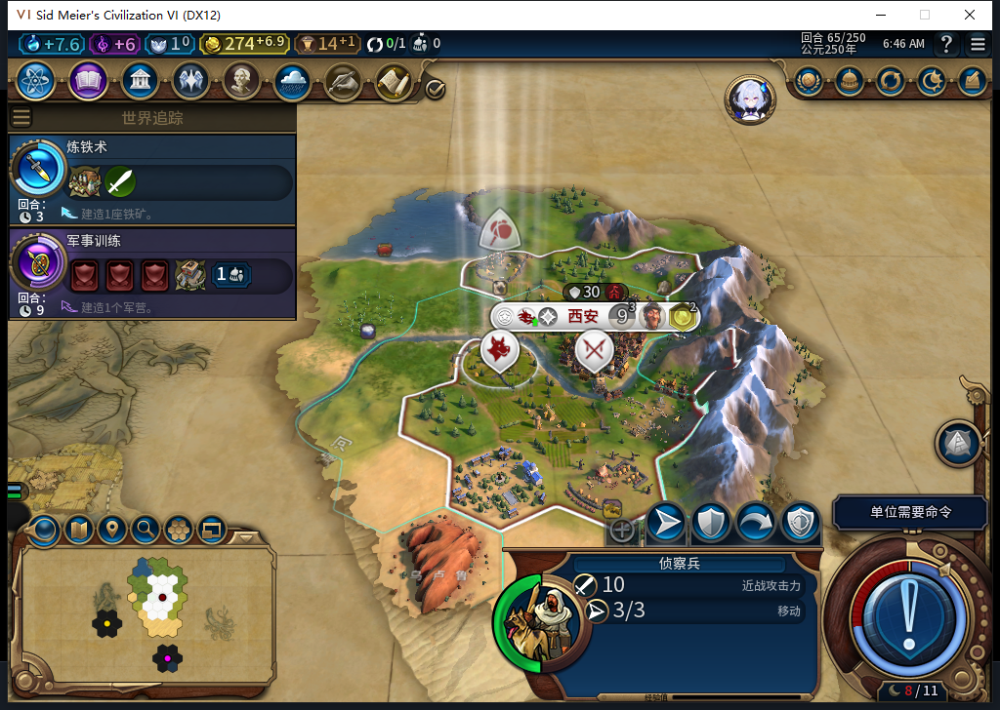
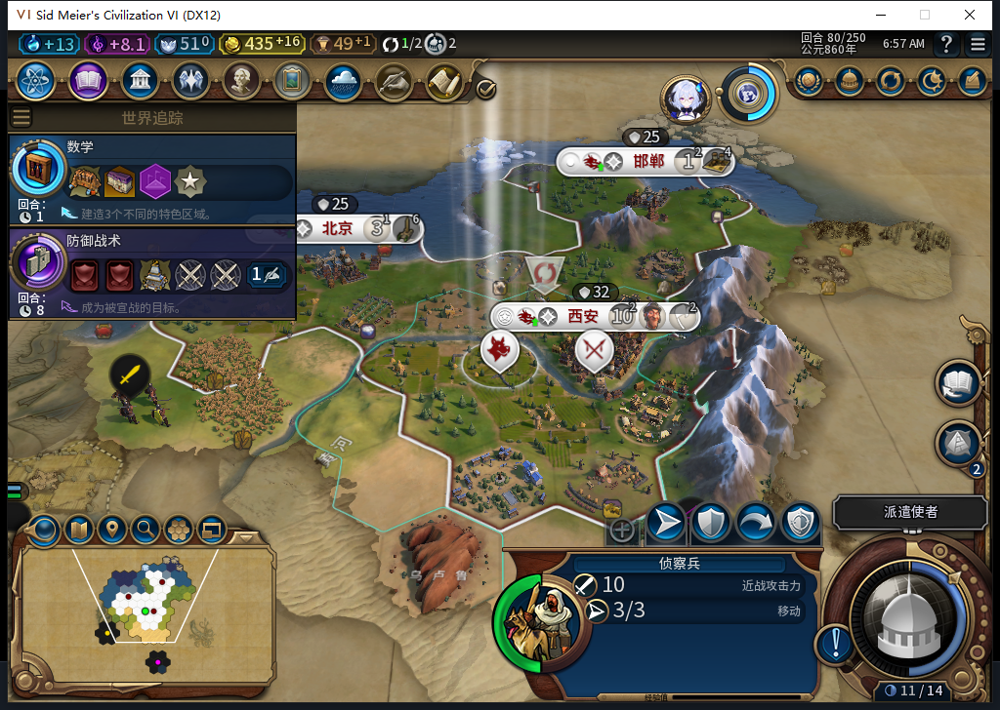
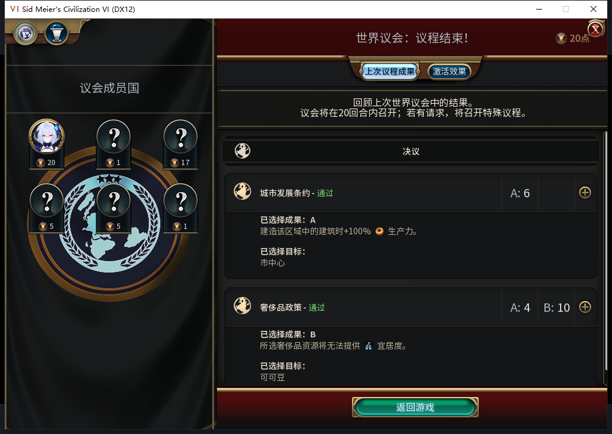
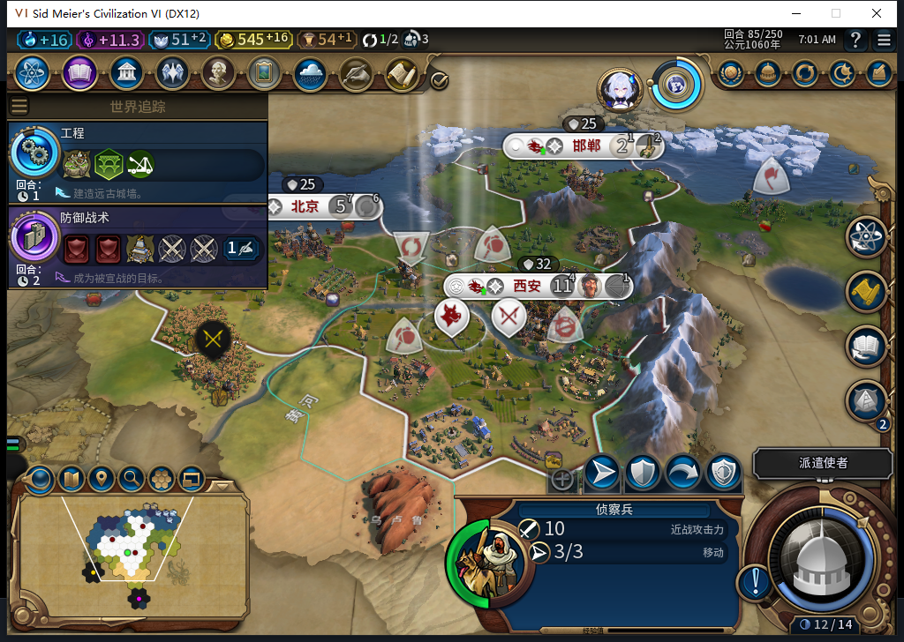
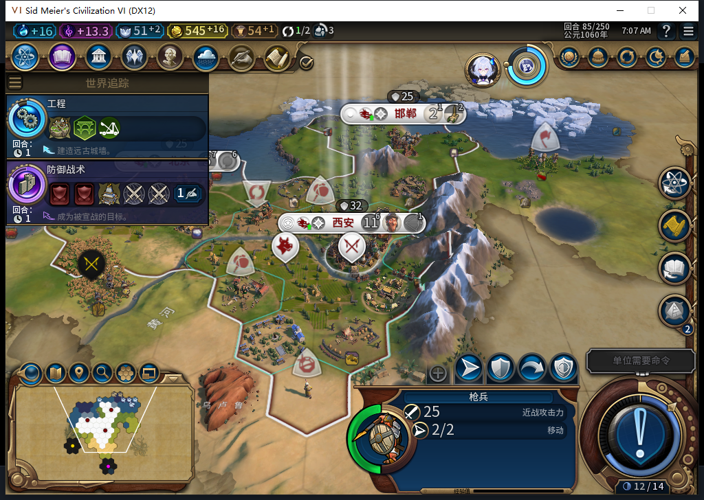

# 87无蛮族对照：自动扩至三城，保存加载保持

这局从第40回合的单城开始。测试玩家只让军队待命、结束正常回合和处理外交；模组自行生产、移动移民，71回合建成北京，78回合建成邯郸。85回合三城人口为11、5、2，首都在训练弓箭手，北京训练商人，邯郸建造纪念碑。45次正常END、90次军队待命，0UserForced、0玩家文职或生产输入。[逐项证据、请求范围和存档指纹](../research/baiqi-p6-nobarb85-model517-523-evidence-2026-11-08.json)。

场景为原版正式新局：白绮／中国、风云变幻、古典、联机速度、王子、小型大陆；“无野蛮人”开启、“蛮族氏族”关闭。联机只是速度名称，验收沿用离线启动的自有实例，期间没有Steam联网或上传。游戏／地图种子分别为-1719561275、-1719561274，启动前设置与实际局内参数均读回。这个对照有助于观察内政前提，不能关闭此前围城丢失文职或忠诚风险。41—65的扩展欢迎层未关，使用的是原版接口结束流程；65才关闭提示层，因此这段不算完整物理按钮验收。

外交由测试玩家处理。65将两名使者各追加一名给维尔纽斯和威尼斯，随后原生只读确认各2、剩余0。70普通结束进入世界议会，推进脚本按门槛停下；玩家投了圣地A1与可可豆A1，确认页提交一次。最终通过的却是市中心生产加成、可可豆不提供宜居度，未获得圣地加成。投票和使者分配均不计入模组后台操作。

56首次读到模组已选“城市守护女神”。55信仰13、56信仰1只说明时间相关，没有实际扣费记录，不能据此宣称万神殿成本。85信仰51、先知点和速率均0，仍无圣地完成、新先知或创教。圣地静态优先级35低于商业中心70、学院68及多种基础建筑；可生产不等于会被选中，不能为了取得先知测试对象而改评分或补发单位。

未来财务／请求观察共2760条：2678次招募评估、21次城市请求、59次文职／伟人操作、2次伟人激活请求，全部序号读回一次，0错误、0丢样。两个激活请求属于76的大科学家与85的大商人，返回0值本身不授实际效果通过；46份先知快照没有先知出生或激活事件，不代表所有伟人都没有动作。观察范围只限Executor钩子。

区域观察范围在复核时纠正：519及后续同实现只盯首都65536，65—85的0条记录不能证明其他城市没有区域请求。后续90邯郸已有港口队列，但缺少它请求前的原地块记录，不能补写为农场替换正案。523候选经26项Lua5.1边界检查并修正异常计数，已在90将未来观察扩至所有自有城市；87普通改良可被区域合法替代的实机前后证据仍待取得。

三套观察器按嵌套顺序撤除后，原版保存85一次；ACKtrue、稳定1180629字节，SHA256为37db3f8c43782fe96e7b1166147a1b15997a4c8ffa4d725b135910ef1d4ed7d1。正式加载精确文件、继续各一次，UI/Core读回三城七单位、545.9296875金、队列及三条OBSERVED建城日志均保持。加载期间一次连接拒绝、一次只读LSQ超时，没有重发加载。私人存档不上库。

这轮产品源码未变，先前1222通过／1SDK环境跳过不计为本轮重跑。模型517—523的完整请求、SSE与候选留本机，采用范围和负责人纠正见证据文件。普通三城加载保持属于窄通过；ARMED恢复FAIL、旧档等待、围城风险、宗教战斗单位权限、五城20回合、兼容和性能及完整40项仍开放。后续已到90的四城发展另分窗口继续记录。公开GitHub／Steam Alpha2仍是内部82／12张实机图，当前验收未再次发布。

后续[99→119五城窗口](baiqi-five-city-twenty-turns-87.md)已到七城，取得矿山替代工业区完成正案；缺逐回合战略库存，因此TC-037仍部分。上文“仍待取得”等均为85记录切点，农场子类型与宗教限制仍保持。
