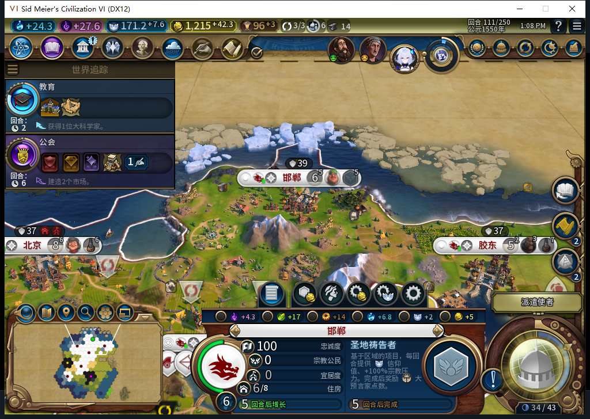

# 102实机111：圣地完工，正常祷告项目开工

真实早期分支中，邯郸106回合开始圣地，产能依次为0、27、42、55、68／75；111完成，地块54,37未被劫掠。后台随即排入原版“圣地祷告者”，项目12、0／68产能、原生显示5回合。此时自己44先知点／每回合4，先知122尚未领取，未持先知或创教。

这里只授“正常排产开工”通过。队列不是完工证据，项目说明也不是实际奖励到账。111节点已正式保存校验，尚未结束111回合；后续在普通回合里观察项目完成、点数和招募各自发生的时点，不手补点数、信仰或单位。

同一分支105被动观察到移民1572869的FOUND，111读到广州393221位于49,27；6城食粮非负、无饥饿倒计时，忠诚均100且正变化。这是正常新扩张窄正例，不能覆盖旧已发令ARMED恢复FAIL。103起的透明观察现1310条、0错0丢，26条单位调用仍为文职；本切点观察器仍在，未假称全部撤除。

107拒绝罗马交易、109拒绝巴西交易并各自原版再见，没有成交石膏／铁／金币／开放边界。110世界议会由测试玩家投两项免费A各1票，目标选商业中心与贸易城邦，复核总花费0外交支持，提交一次；111结果实际目标是剧院广场与文化城邦，返回游戏一次。明确区分测试玩家外交与模组后台行为，不能把测试玩家投票算自动外交，也不把它算手动城市排产。

570为后续完工准备只读观察器。原版CityProjectCompleted的回调是playerID、cityID、projectID三项。负责人模块只观察自身目标城的指定项目，适用身份和回合失效则忽略，快照未知与事件本身分列；32条默认上限、128条实用上限，保护回调和精确静态Add／Remove闭包，移除失败不报成功。事件只证明完成通知，不单独证明奖励已应用或其数量。工具不进产品包，本切点尚未实机订阅。

12项实际工具检查通过。模型原稿12方法产生9失败事件、11错误事件；只补默认上限的对照仍15失败事件、1错误事件，含同一方法子场景，不能当作20或16项独立用例。原稿漏默认、允许极大记录上限，回调未复核当前身份／城市／回合及快照一致性，也不保留事件标识，Restore无幂等及失败回执，Owned断言恒真、Add异常清理比较错对象。原稿及对照全部拒绝、0Native，负责人独立实现。工具12项不加写成新的产品完整1558通过，102完整1546切点保持。

570完整stop／DONE／JSON、1HTTP，4823+1196=6019 tokens、8.633995秒。累计570任务／532完整／35截断／3最终传输失败、600HTTP／30额外重试，新OpenCode原生生成0，未知缓存／人工节省null。

前次伟人数字的两原图、文档和待发布BBCode已从固定提交公开GET核验4项HTTP200、字节一致。Steam外机使用中，0模式切换／上线／登录／下载／上传初始化／上传，公开Alpha2仍内部82。祷告完工／奖励、先知招募、创教、国内传教与完整40继续开放。

[结构化证据](../research/baiqi-p6-prayer570-observer-software-and-native-prayer-start111-evidence-2026-11-09.json)、[12项观察器检查](../../tests/test_diagnostic_prayer_completion.py)、[只读工具](../../tools/lua/diagnostic_prayer_completion.lua)、[103数字实机](baiqi-great-people-native-numbers-102.md)。
