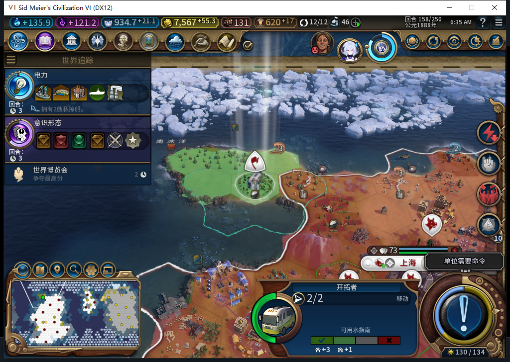

# 97重读旧建城中断档：记录保留，取消资格不足以解除等待

97正式加载了85保留的158回合失败档一次。原82建城中断问题仍未修复：8650807移民在10,19，目标846为空，ARMED／settle:0:1／request0:156:173完整保留。此次只读取和查看，没有结束旧档158回合、发取消或重发建城。

图中开拓者使用后期单位模型，原版单位面板仍明确标注“开拓者”。此图解释的是旧失败现场，不是97主线新建成的陇西。日志和原生队列读数由独立只读查询核对，图片本身不能证明这些后台状态。

## 这次读到了什么

旧档14城、58单位、金币7567.28515625；移民所有者0、2行动力、单独编队、伤害0。UI的HasPendingOperations=false、排队目的地nil；Core的HasPendingOperations=false、GetOperationType=−1。界面没有GetOperationType函数，Core没有GetQueuedDestination函数，缺失与返回空值分别记录。

原版CANCEL当前哈希533311341。按UnitPanel使用的两种CanStartCommand签名查询，均为boolean false，未调用RequestCommand。资格查询虽检查了本地白绮、单人、Core非忙及不在处理消息，却没有同步读取IsTurnActive和IsAllowStrategicCommands；不能把false提升为永久禁止该类单位取消，更不能把它当成旧FOUND已彻底失效的证明。

本次没有再推进旧档两个回合，因此不新增一份“97两回合恢复FAIL”。原82已有的两回合恢复FAIL继续保留，没有取消回执、清日志、手动文职救场或未知命令重放。

## 主验收线已独立保存并返回

切旧档前正式保存97主线176回合，1689266字节，SHA256 `5ace55e4087b7a7702578aac74b9b193e65a11360792147f0e9d26d384d71258`。完成旧档读取后，正式加载这份主线一次并点击一次原版继续；回读176回合、9城、30单位。

九城忠诚度均100且每回合为正，食物结余均非负、饥荒倒计时均−1。长沙7人口、食物结余9，原粮食优先仍true；广州5人口、食物结余0，余量偏薄；陇西1人口、粮仓3/32、食物结余2、忠诚度每回合+17。此次没有结束主线176回合，不声称整个世界逐字相同或加载期间零后台动作。

旧档地图宽44、随机种子20261101且并非无蛮族；主线地图宽74、种子不同且无蛮族。两份样本分别记账，私人存档均不上库。

Steam其他设备占用约束持续生效，本轮0模式切换、0联网／登录／下载／上传初始化／上传。产品仍97，公开Alpha2内部82不变。

[结构化证据及9城食物／忠诚度原生读数](../research/baiqi-p6-oldarmed97-native158-evidence-2026-11-09.json)、[557原版CANCEL源码诊断](baiqi-armed-cancel-source-557.md)、[82中断存读失败](baiqi-settlement-lifecycle-recovery-82.md)、[97陇西已完成状态存读](baiqi-longxi-completed-reload-97.md)。
