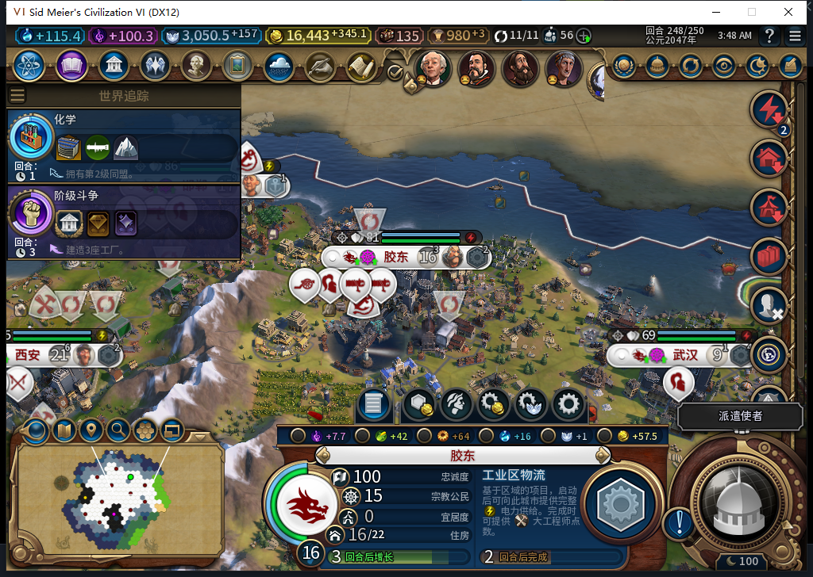
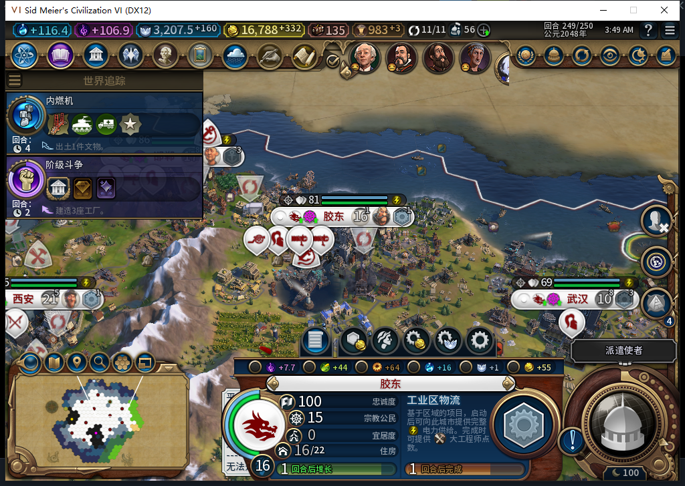
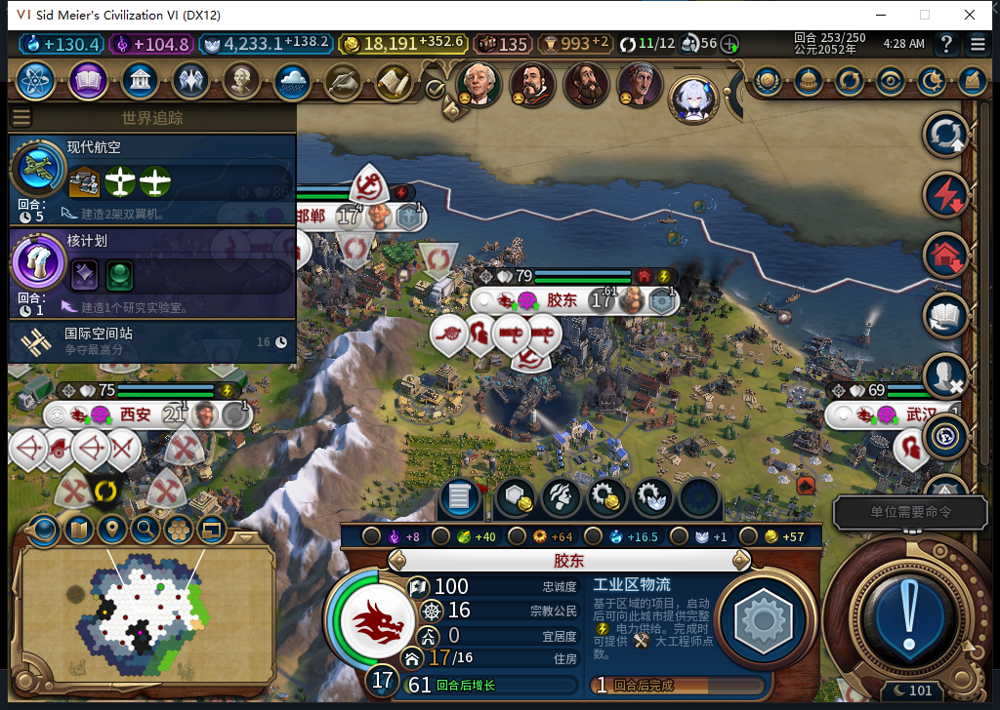

# 120 实机：项目供电、正常完成与 253 重载

2026-11-12，BF-202609141645。120 的 115 文件与已推送源码逐字节一致。首次 Steam 后台查询不可用时没有启动游戏；正式菜单头部导航后，独立后台只读取得当前实例离线证明，以 0.008437 秒新鲜度启动。导航与确认分账，没有切上线、登录、下载或上传，工坊仍 82。

原 119／246 完成态冷加载后，世界行、11 城、151 建筑、64 区域、200 可见自有格、51 单位及粮食／状态全部保持。新分数函数也在正式运行上下文中存在。之后正常推进到 253，共七个实际回合。

秀容原生产完成后于 247 自动选择工业区后勤项目，原版读回完全供电与项目供电均为 true。胶东、广州于 248 自动开工；胶东新入队时仍未完全供电，不能把队列回执当作供电效果。

249 胶东项目正常推进到 92/129，原版两个供电标记均为 true，完好食品市场实际产粮从 4 变成 6。这个建筑贡献与城市总粮变化分别记录；没有凭城市净粮推断收益。

250 原生 `CityProductionCompleted(0,262147,3,10,false,-1)` 确认胶东工业区项目正常完成；后台同回合再次安排该项目，252 又完成重开。253 新一轮为 88/131，胶东、广州、秀容三城均由原版标为项目供电。成本随游戏进度变化，未固定为初始 129，也没有免费完成或改电量／燃料。三种燃料各次读回仍为 0。

新项目排入队列后，供电标记可能暂为 false，后续实际施工时才为 true；秀容、胶东的重新开工帧都保留这个间隙。只授本次自动选择、正常进度、实际供电、完成接续和重载的窄链，不承诺持续无间隙供电或长期燃料供应。长沙原商业中心继续施工，没有被新策略抢占。

251 出现另一个问题：胶东 60,37 的社区由完好变为损坏，食品市场也被标为损坏、实际产粮为 0，即使当时项目供电为 true。252 原版 CanProduce 与 CanStartOperation 均返回“洪灾区域，无法修复。”，253 仍拒绝。当前胶东 17 人、库存 3.81640625、净粮 6；没有越权修复、取消原生产或伪造市场收益。已分别保存 251 和 253；海岸低地、海平面与防洪设施资格另行诊断，不用地块事件 nil 否认气候影响。

同期上海银行 250 完成并接证券交易所，253 为 138/165，旧工厂仍未建、保留 73/165；沈阳港口 250、灯塔 253 完成，长沙已自然六人。十一城每回合人口不下降、粮食净值非负。被动观察器从 249 安装，最终 10 行、0 错误／丢弃，3 订阅已精确撤除；重复两行沈阳港口事件只计一个实际区域。

测试玩家共 7 次显式普通 END、49 次军队待命，0 人工内政、0 UserForced。西班牙交易和世界议会共 17 次物理点击、4 次滚轮查看、2 次原版滚动条查看；另外两次继续游戏分别用于冷载和重载。议会四项首票在原版界面选择并提交，费用页为 0；其内置普通 END 来自已读的原版消费者，没有独立全局 API 次数计量，因此与 7 次显式请求分开。两次过期图凭证在输入前被挡住，未产生点击。

议会最终通过的是数字化民主额外槽和禁止建造燃煤电厂，与本测试玩家投票目标不同；没有把其他文明的结果写成模组外交。原版对话／议会等待均未重发未知 END。没有后台军令或外交替代操作。

253 正式保存 2109285 字节，SHA-256 `d9d917a3d730cc6b8d05a5b6d803b340bc00664d3f27af35969cfeda8ca2f46f`，一次原版重载后，世界行、11 城、158 建筑、64 区域、204 可见自有格、52 单位及 11 城粮食／状态全部相同，供电和受损读数也一致。四个旧／新诊断命名空间实际均读到 nil。

本段保存的完整 Lua 日志无 BAIQI 错误。启动 Database 日志有 70 条 Localization 重复键错误，关联 21 次 CurrentClickouts 与 14 次 HallOfFame 文件加载；该日志无 Baiqi 引用和 Gameplay 错误，不称数据库全零错误。负责人一次额外只读工具误用了 Districts 迭代器的数值键，已改用既有正确双返回消费者；没有在失败后执行依赖游戏动作。

此次实机验证没有新增 HTTP；633 软件候选已单独记账。独立的 634 海岸诊断候选在重载期间完成，不在本页追认采用。旧 213、武汉逐城伤亡原因、未知动作恢复、完整矩阵及长期能源策略仍开放。

[结构化证据、逐回合供电、输入与重载比较](../research/baiqi-p6-source120-native-power253-evidence-2026-11-12.json) · [120 软件与候选反例](baiqi-empty-fuel-power-project-120.md)。
