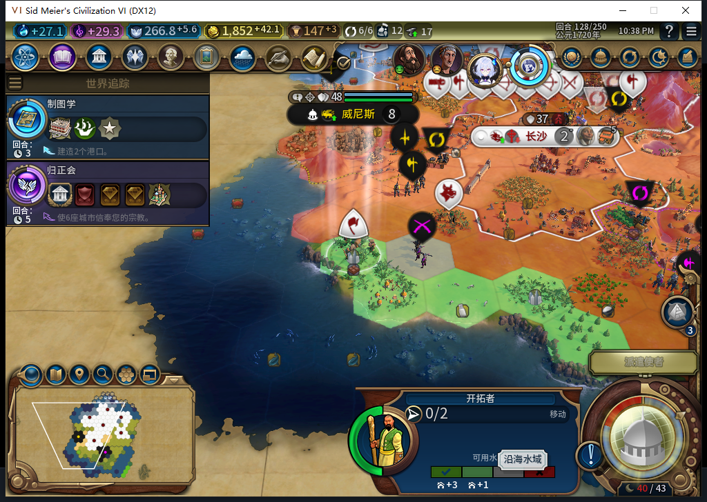
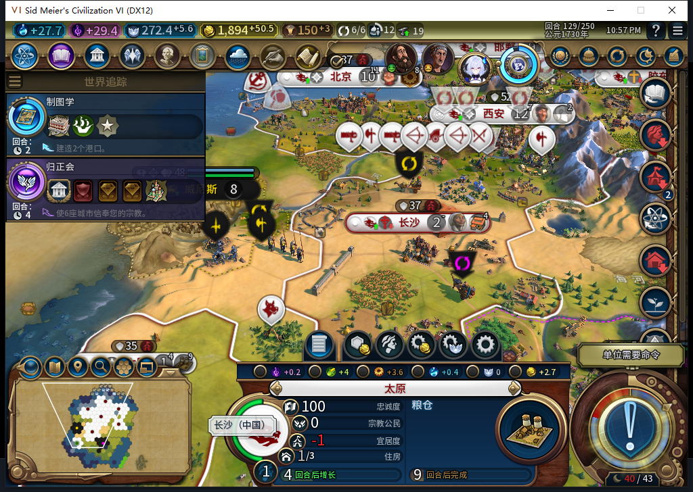
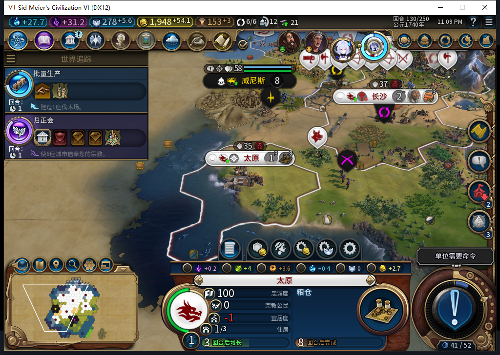
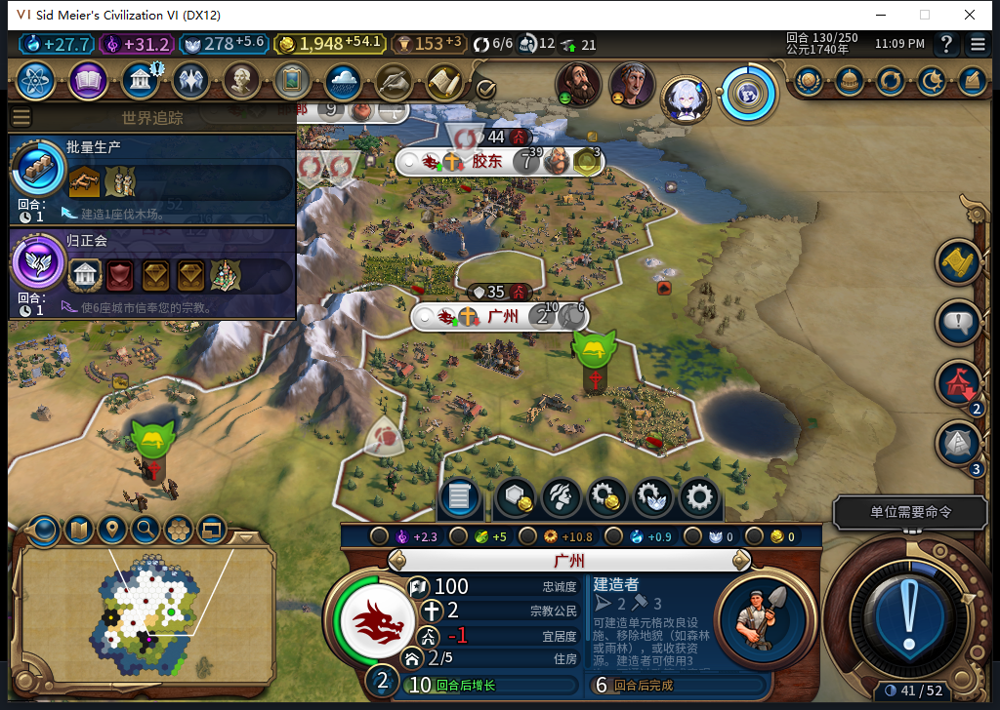

# 94实机：雨林建太原，跨入黑暗时代

后续已完成[130正式加载及己方数据比对](baiqi-rainforest-completed-reload-94.md)。本页“尚未加载”保持原交付切点，不覆盖后继事实，长期与旧恢复仍开放。

129回合，AI在原先被地貌筛选排除的49,27雨林建立太原。130进入黑暗时代后，太原仍忠诚100／每回合+17，粮仓自然推进至3/32；广州为100／+18，粮仓、纪念碑已完工，人口增至2。这里通过的是实际雨林建城及一次时代切换的窄样本，长期保城和完整40项仍未完成。

[68行队列](rainforest94-120-130-queues.csv)、[68行城市状态](rainforest94-120-130-vitals.csv)、[机器与逐项证据](../research/baiqi-p6-rainforest94-dark130-evidence-2026-11-08.json)。此前[广州建城与120完成态重载](baiqi-settlement-features-native-94.md)保留为独立窗口。

这是94重新选择的新训练：120排移民0/115，121为43、122为87，123自然完成2686992，首都人口12→11。它自己写入49,27目标并行军，128到址；当时该格可见、无主、非城、雨林，原版Settlement=true。玩家只选择查看，没有移动、建造或手指城址。126的一次采样仍有2行动力，不能说每次采样都已走完。

太原完整ID458758。125安装的第二观察窗口记录该移民4次MOVE_TO、129一次FOUND_CITY；随后移民消失、保存目标清理。该窗口覆盖1064样本：1019招募检查、8城市操作、37单位操作、0单位命令、0错误／丢弃，130已撤下。它只覆盖Executor绑定；120撤钩至125安装之间没有计数，不能与前窗口相加冒充完整连续审计。

129仍英雄时代、分数40、倒计时0；130已为黑暗时代、分数41、时代4。太原维持100／+17，实际产出约3.60，队列3/32。这个相邻回合对照不保证后续人口、战争或隐藏压力安全，也没有修复旧92成都130的失败存档。

广州127粮仓完工并增长，130纪念碑完工、接续建造者0/61，忠诚100／+18。四张均为已查看的原图，没有裁剪、合成或修改数字。

120→130共30次玩家军队待命、13次普通结束输入、10次实际换回合，0UserForced、0手补内政。127、129首次结束仍停留，读取新鲜阻塞与待命资格后才另发新普通结束；原因未隔离，不授排队执行通过。128使者提醒经原版查看／关闭，12枚全部保留、已考虑=true，再发新普通结束。122罗马、128和129巴西来访各告别一次。126特殊议程经原版入口直接进入等待，无玩家投票页；127结果为援助14票通过后返回游戏，未补投票或重放END。

两次点击被截图过期守卫拒绝，0点击；首次静态比较又因外层装饰差异停止，0点击。离线比对确认实际文字和完整按钮一致后，现场重新截图、精确比对，再由原60秒／进程／窗口守卫只点击一次。失败原件保留，没有绕过守卫。一次失败后多做了只读等待，未追加变更动作。

130正式保存ACKtrue、1432691字节，SHA256为170ef7f2537409abe8fea8cd2c6169d0cf53cafb8cf04dd8e7e5a4fddb81263f，连续读取稳定，尚未加载；私人存档不上库。当前source／install／runtime94，软件基线仍1339运行／1338通过／1SDK跳过，本轮没有新HTTP或软件case。累计545任务／508完整JSON／34截断／3最终传输失败／575HTTP；未知成本保留null。

Steam其他设备占用禁令持续，0模式切换／上线／登录／下载／上传器初始化／上传，公开Alpha2仍82／12图。后续继续长期城市状态、旧ARMED／LEGACY恢复、宗教、Base／RF兼容及性能；不因本窗口关闭这些风险。
