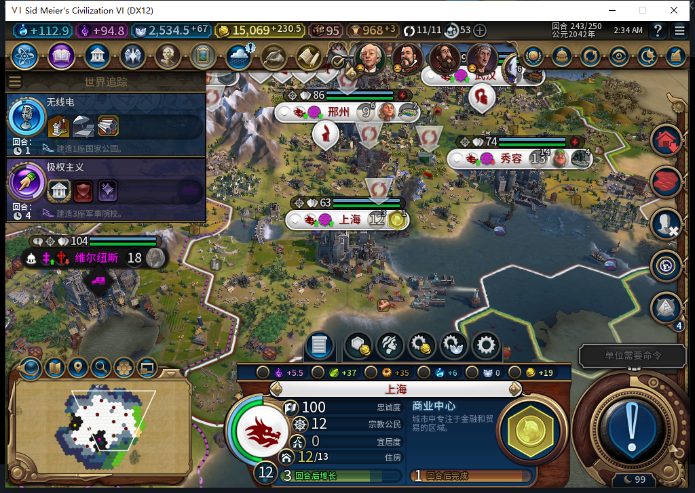
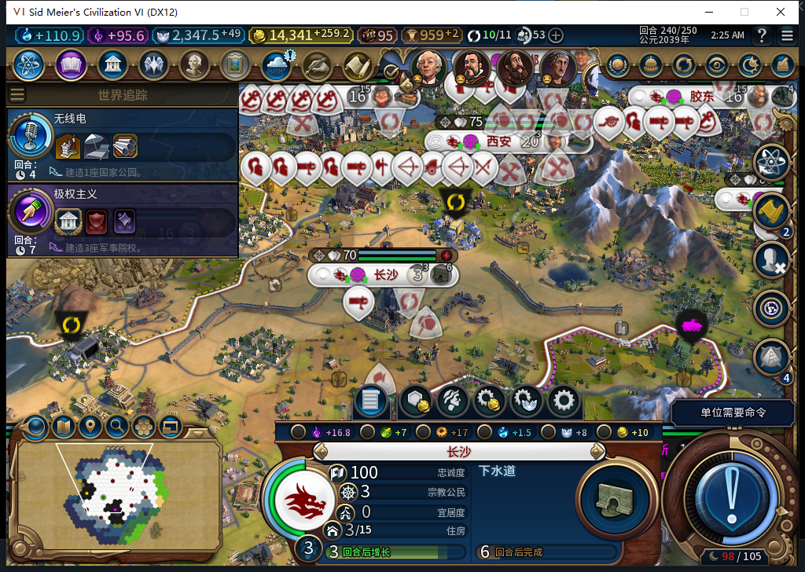
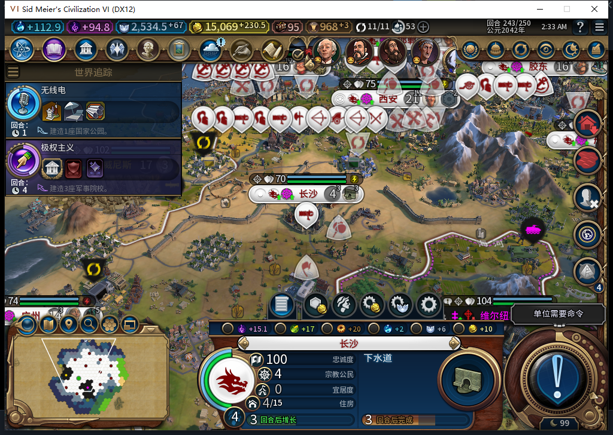

# 119 实机：洪灾受阻生产接续、食品市场建成与重载

119 从原 236 自动存档的字节相同副本冷加载，独立验证 236→243 七个实际回合。这是 216 巴西文化胜利后的功能复现，原 116 主线 237、118 复现失败均保留，不把重放回合计成原主线新进度。启动前取得新鲜后台 Steam 离线确认，全程没有切上线或上传。

上海在 237 再次遇到工业区洪灾：原版拒绝修复，工厂 73/165 停滞。后台 PREPEND 下水道后，引擎仍移除旧工厂条目、保留其生产；119 实际确认了这次回执。下水道 0→72/100，239 正常完成并自动开工商业中心，243 已到 132/143。工厂仍未建、73 点生产保持，未补偿或退款。只关闭这条受阻队列接续失败；洪灾区域修复、未来续造工厂和商业中心完工仍未授通过。

长沙食品市场最初由 116 在 228 按低粮 94 分自动开工；原 236 存档已有 136/190，119 沿同一建筑续建至 240 正常完成，之后自动安排下水道。原版实际建筑产粮接口和 tooltip 均为 4。城市净粮当时仍为 1，因为开发地块粮食从 6 变成 2；本次没有逐格记录 239 的工人分配，不能把整个总粮变化归给市场。

243 长沙自然增长为 4 人，食品市场实际产粮变为 6；原规则另有通电 +2，西安水力发电站同回合完成。当前总粮 17（建筑 7、地块 10）、净粮 9，库存 0.125 是增长后的余额。240→243 的人口、地块与电力共同变化，建筑本身的实际收益与城市净变化分别记录。

住房 18→15 与托管君主制升级民主制一致：长沙三级城墙都完好，原版君主制各提供 1 住房；现有住房分项为水 2、建筑 2、改良 3、区域 8、政策 0。两个社区也都完好。240 派发时记录到住房 18、人口 3，新社区候选为零，选择 40 分下水道；没有另做旧版同局重放，不虚构当时逐地块原版合法性。

该独立分支共 9 次普通 END 请求、44 次测试玩家军队待命，实际换过 7 回合；多出的两次普通 END 用于原生队列执行后的新鲜推进。特殊议会开始／返回及罗马、西班牙、加拿大对话共 8 次物理输入。无 UserForced、无测试玩家内政补操作；模组后台没有借测试玩家权限指挥军队或外交。

被动事件记录 36 行、生产选择／写入配对 16 行，均 0 错误、0 丢弃；3 项事件订阅和 2 个函数绑定已精确撤掉。243 正式保存后只请求一次原版重载、点击一次继续。实际读回 11 城队列、145 建筑、63 区域、198 可见自有地块、51 单位、世界经济行，以及 11 城粮食／忠诚等读数全部与保存前一致。长沙四人、市场产粮 6、净粮 9、下水道 53/100，以及上海商业中心 132/143、工厂 73/165 都保持。

这完成低粮建筑从真实选择到建成、收益、后续增长及重载的窄链，并关闭 118 的原版删条目回执失败。213 人口损失／115 自然低粮新商路、武汉 222 逐城灾害归因、旧未决动作恢复和完整矩阵继续开放。工坊仍 82。

[可分享读数、存档指纹、输入计数和重载比较](../research/baiqi-p6-source119-native-recovery-food243-evidence-2026-11-12.json) · [119 软件与 118 实机反例](baiqi-pruned-building-receipt-119.md)。
