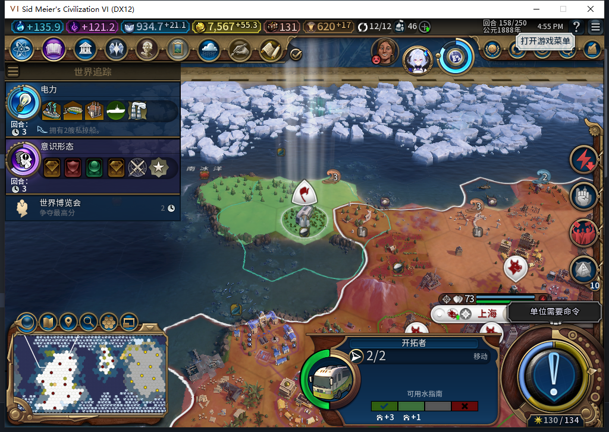

# 82保存窗口复测：原版资格允许，读档后仍未续建

上轮已发现[建城意图ARMED、原生效果尚未入档](baiqi-settlement-lifecycle-recovery-82.md)会使移民停住。本轮补查一个具体问题：当时原版保存资格是否允许保存？**实际采样为允许，但这份定时测试保存读回后仍未续建，恢复FAIL未解除。**

## 新补到的资格证据

复用82版148回合空日志现场，让同一自然移民重新训练、行军；不重复计算训练通过数。原版菜单、快速保存等入口调用`CanLocalPlayerSaveGame`。负责人从其真实UI上下文取得原函数，用有类型检查的只读适配器采样，不更改原函数或资格结果。

156回合，后台实际建城请求`0:156:173`返回时，原生返回值数量为0。Core持久记录仍是`ARMED`／`settle:0:1`，目标10,19／846；原版函数返回`KNOWN / true`。随后测试玩家执行一次官方保存，ACK为true。透明包装共85次调用、匹配1次建城，重入与观察错误均0；不把其余84次未经分类的调用写成全局零军令证明。

文件630058字节，三次稳定读取SHA256：`d5a12456e94d80cb4f06756c71876ac89a95c3c17674661748fe03543c1f5f62`。原世界后来正常建成太原，15城、OBSERVED、粮仓0/32；这个完成现场另存636331字节，SHA256 `beb9f9854e8bc0aa3a8a188a136f2875e3673ddc36378b7a2ffcc8516bba65e6`。两份保存用途不同，不是重试定时保存。

## 真正读回了未完成的世界

精确恢复SDK原函数并移除只读QA接口后，正式重载定时文件。继续之前的新日志已恢复同一ARMED。进入游戏，UI和Core均实际156回合、14城，移民8650807仍在10,19、1行动力、单独编队，没有太原。UI名册60、Core61分别记录；文件并未因原世界后来成功建城就自动变成完成状态。

普通156→157→158两个回合后，仍14城、同一ARMED／令牌／请求，移民同地块、2行动力。Core当前单位操作读数是HasPendingOperations=false、GetOperationType=−1；它不证明全部输入／网络队列已经清空，不授取消记录或重发许可。其他内政继续，金币到7567.28515625。

失败现场再独立保存630319字节，SHA256 `6ba7c8eaacc5fffa96fc8752520732d812b1e8e4a578a00eb44e6f12a597c50b`。前一轮失败、完成157、旧档迁移137、停机137及新局首都2回合的独立保存均未覆盖。私人保存不上传。

## 结论边界

原版资格没有排除这个时刻，不能以“保存一定会被原版禁止”消除该风险。但本次保存是定时测试输入，位于原生命令返回后、控制器继续执行前；**资格为true不证明玩家物理点击能恰好插入同一调用栈，也未验证自动保存的时序。**因此这里只收紧已知窗口的证据，不估计普通游玩发生率。

非空记录持久化与防重复保持，前进恢复在本次两个普通回合内仍FAIL；不推定永久死锁或引擎已丢命令。没有人工文职操作、清队列、清ARMED、强制结束或私有恢复函数救场。同回合普通结束先处理排队时，先新鲜核对待办，再提交新的普通结束，分别记账。重载后未装SDK代理，不宣称全局命令计数。

模型480的极窄只读适配器经14个Lua5.1合同检查后，整段采用在忽略目录的QA工具中；它不是产品修复。负责人扩展的透明观察器当前44场景通过（35个相关基础场景因代码改动复查，新增9个），并核Lua5.1语法。原始候选的“无游戏逻辑／全局访问”表述过宽：实际上会执行所给原版getter并读取引擎状态。产品82未改，1153项产品软件检查不重跑或重计；工坊仍Alpha74，本轮0 Steam联网／上传。[结构化证据](../research/baiqi-p6-settlement480-allowed-save-window-evidence-2026-11-07.json)。

## 后续85升级核对

[旧158失败档正式交给85读取](baiqi-armed-upgrade-and-native-api-85.md)，同一ARMED／移民／空城址保留。UI与Core操作接口分布已独立核对，未获得全派发层空证明；没有重发未知FOUND，恢复FAIL保持。
